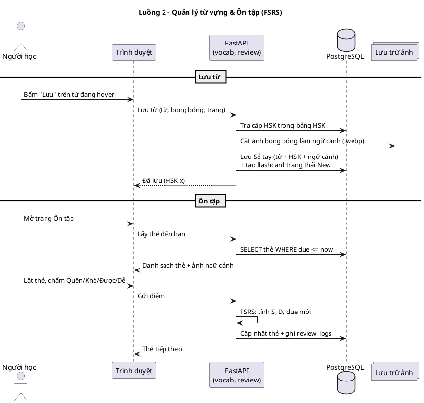
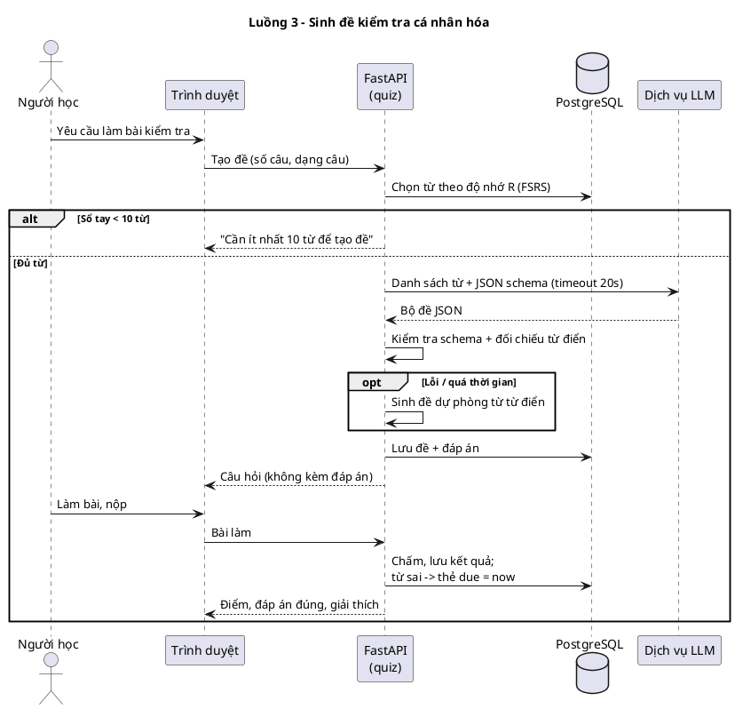

# Đánh giá Luồng 2 & Luồng 3 — chuyển sang kiến trúc FastAPI

> Tài liệu nhận xét hai sơ đồ luồng đề xuất (Luồng 2 – Quản lý từ vựng & Ôn tập; Luồng 3 – Sinh đề kiểm tra
> cá nhân hóa). Hệ thống chưa có code; mọi khuyến nghị dưới đây là cho thiết kế.

## 1. Kết luận nhanh

| Luồng | Khả thi? | Nhận xét chính |
|---|---|---|
| Luồng 2 – Sổ tay & Ôn tập (FSRS) | **Khả thi** | Ý tưởng đúng. Nên gộp "Core API" và "AI API" thành **một ứng dụng FastAPI**; phân loại HSK nên **tra bảng** thay vì dùng mô hình AI; FSRS dùng **4 mức đánh giá**. |
| Luồng 3 – Sinh đề bằng LLM | **Khả thi, có rủi ro** | Cần ép LLM trả JSON đúng schema, đối chiếu đáp án với từ điển, có **đề dự phòng** khi LLM lỗi, **chấm điểm ở máy chủ**, lưu kết quả. Đây là phần **ngoài thuyết minh**, nên trao đổi với GVHD. |

## 2. Kiến trúc: bỏ tách C# Core API / Python AI API

Sơ đồ đang chia 2 dịch vụ (C# ASP.NET Core + Python FastAPI) chỉ vì AI viết bằng Python. Khi đã dùng FastAPI thì lý do đó mất:

- **Một ứng dụng FastAPI** (monolith chia module): `auth`, `library`, `vocab` (Sổ tay), `review` (Ôn tập), `quiz` (Kiểm tra), `dictionary`, `tts`.
- **Không cần API Gateway** riêng: bản thân FastAPI là cổng vào (router + middleware xác thực JWT). Gateway chỉ đáng khi có nhiều dịch vụ độc lập.
- **Chỉ tách riêng phần nặng**: pipeline xử lý ảnh (YOLO + PaddleOCR + inpaint) chạy ở **worker nền** (process/hàng đợi riêng) vì nạp model tốn RAM và chạy lâu. FSRS và phân loại HSK chỉ tốn vài mili-giây → chạy ngay trong request.
- Lợi ích: bớt 1 ngôn ngữ, bớt 1 lượt gọi mạng (bước 4→7 và 16→19 biến mất), dễ triển khai và dễ chấm đồ án.

```
Trình duyệt ──HTTP──> FastAPI (auth · library · vocab · review · quiz · dictionary · tts)
                         │            │                 │
                         │            ├── PostgreSQL     ├── Dịch vụ LLM (ngoài)
                         │            └── Lưu trữ ảnh    └── Edge TTS (ngoài)
                         └── Hàng đợi ──> Worker xử lý ảnh (YOLO → OCR → dịch → inpaint → render)
```

## 3. Luồng 2 — Quản lý từ vựng & Ôn tập

### 3.1 Điểm tốt
- Lưu từ **kèm ảnh ngữ cảnh gốc** đúng mục tiêu số 3 của thuyết minh.
- Dùng **FSRS** thay cho SM-2 là lựa chọn tốt: FSRS chính xác hơn và có thư viện Python sẵn (`fsrs`).
- Tách rõ 2 pha: *lưu từ* (bước 1–8) và *ôn tập hằng ngày* (bước 9–20).

### 3.2 Vấn đề & đề xuất sửa

| # | Vấn đề trong sơ đồ | Đề xuất |
|---|---|---|
| 1 | **"Mô hình phân loại cấp độ HSK"** bằng AI | HSK là **danh sách từ chính thức** (HSK 3.0, cấp 1–9). Tra bảng thì chính xác 100% và tức thì; mô hình ML sẽ đoán sai. Từ không có trong danh sách thì lấy **cấp cao nhất của các chữ cấu thành**, nếu không có nữa thì để "Ngoài HSK". Vẫn có thể gọi đây là bước "cá nhân hóa" mà không cần AI. |
| 2 | Lưu từ (bước 8) **chờ** kết quả HSK (bước 4–7) | Với cách tra bảng thì không còn chờ. Nếu vẫn dùng AI, nên lưu từ trước, cập nhật HSK sau (bất đồng bộ) để nút "Lưu" phản hồi ngay. |
| 3 | **Thiếu bước tạo flashcard** khi lưu từ | Trong cùng giao dịch lưu sổ tay, tạo thẻ ở trạng thái `New` (due = ngay bây giờ). |
| 4 | Đánh giá **3 mức** Quên / Khó / Dễ | FSRS được thiết kế cho **4 mức**: Again / Hard / Good / Easy (Quên / Khó / Được / Dễ). Nếu bỏ "Được" thì người học phải chọn Khó hoặc Dễ cho trường hợp phổ biến nhất, khiến lịch ôn bị lệch. |
| 5 | Bước 16 "**đẩy lịch sử đánh giá** sang AI" mỗi lần chấm | Để tính một lượt ôn, FSRS chỉ cần **trạng thái hiện tại của thẻ** (S, D, lần ôn cuối) và **điểm vừa chấm**. Toàn bộ lịch sử chỉ dùng cho **tối ưu tham số FSRS** riêng từng người, chạy định kỳ khi đã có vài trăm lượt ôn. |
| 6 | Bước 9 "(Hàng ngày) yêu cầu tải thẻ" | Không cần job hằng ngày. Khi mở trang Ôn tập thì truy vấn `due <= now`. Job hằng ngày chỉ cần cho tính năng **nhắc ôn** (tùy chọn). |
| 7 | Cắt ảnh ngữ cảnh (bước 3) | Cần **tọa độ bong bóng** từ Luồng 1 (OCR). Cắt một lần, lưu `.webp` nhỏ, gắn với từ và trang gốc. |
| 8 | Thiếu **ghi log lượt ôn** | Lưu mỗi lượt vào bảng `review_logs` (thẻ, điểm, thời điểm, S/D trước–sau). Đây là dữ liệu cho thống kê và cho việc tối ưu FSRS. |
| 9 | Sơ đồ có **quá nhiều đường cắt nhau**, khó đọc | Trong báo cáo nên vẽ thành **biểu đồ tuần tự** (bên dưới). |

### 3.3 Luồng 2 đã chỉnh (PlantUML)



## 4. Luồng 3 — Sinh đề kiểm tra cá nhân hóa (LLM)

### 4.1 Điểm tốt
- Biến sổ tay thành bài kiểm tra cá nhân hóa. Sinh câu điền từ có ngữ cảnh là việc LLM làm tốt.
- Yêu cầu LLM trả về **JSON** là đúng hướng.

### 4.2 Vấn đề & đề xuất sửa

| # | Vấn đề | Đề xuất |
|---|---|---|
| 1 | Chỉ lấy từ **"Mature"** (đã nhớ sâu) | Đó là những từ người học đã chắc chắn nhớ, kiểm tra ít giá trị. Nên chọn theo **khả năng nhớ R của FSRS**: khoảng 60% từ có R thấp (sắp quên hoặc đang học), 30% từ trung bình, 10% từ đã nhớ lâu. Người dùng mới chưa có từ "mature" nên đề sẽ rỗng; cần đặt **tối thiểu 10 từ** mới cho tạo đề. |
| 2 | LLM có thể **sai nghĩa, sai đáp án, trả JSON hỏng** | Dùng *structured output* hoặc JSON schema, **kiểm tra schema** và **đối chiếu đáp án với từ điển**; nếu sai thì sinh lại 1 lần, vẫn sai thì dùng **đề dự phòng** do hệ thống tự sinh (trắc nghiệm nghĩa với phương án nhiễu lấy từ cùng cấp HSK). |
| 3 | Bước 8 gửi **cả đề lẫn đáp án** xuống trình duyệt, bước 10 chấm ở client | **Chấm ở máy chủ**: lưu đề và đáp án trong DB, chỉ gửi câu hỏi xuống trình duyệt, khi nộp bài thì máy chủ chấm. |
| 4 | **Không lưu** đề và kết quả | Lưu `quizzes`, `quiz_questions` và `quiz_attempts` để xem lại lịch sử và thống kê. |
| 5 | Kết quả bài kiểm tra **không quay lại** Luồng 2 | Từ nào làm sai thì đưa thẻ đó về ôn sớm (đặt `due = now`). Không nên ghi thẳng vào FSRS như một lượt ôn vì sẽ làm lệch mô hình. |
| 6 | **Độ trễ và chi phí** LLM (5–20 giây mỗi đề) | Hiển thị trạng thái "Đang tạo đề…", đặt timeout khoảng 20 giây, giới hạn số đề mỗi người mỗi ngày, cache đề theo bộ từ. |
| 7 | **Quyền riêng tư** | Chỉ gửi từ, pinyin và nghĩa; không gửi email hay thông tin cá nhân. Khóa API để trong `.env` phía máy chủ. |
| 8 | **Phạm vi đề tài** | Thuyết minh chưa có tính năng "Sinh đề kiểm tra" hay LLM. Nên ghi là **chức năng mở rộng** và xin ý kiến GVHD; đặt độ ưu tiên *Should*, làm sau các chức năng chính. |
| 9 | Sơ đồ có mũi tên trùng đè và đánh số chưa khớp với bố cục | Vẽ lại thành biểu đồ tuần tự (bên dưới). |

### 4.3 Luồng 3 đã chỉnh (PlantUML)



## 5. Cập nhật danh sách actor

Luồng 3 thêm một **actor phụ: Dịch vụ LLM bên ngoài**. "Mô hình phân loại HSK" và "Mô hình FSRS" là **thành phần bên trong** hệ thống, không phải actor.
