# Phân rã Module → Chức năng hệ thống YingHua (映画)

> Tài liệu thiết kế chức năng, học phần Phát triển ứng dụng, Trường Đại học Lạc Hồng.
> Sinh viên thực hiện: Hoàng Hạc Hiếu, Đinh Thị Quỳnh Anh. GVHD: TS. Đoàn Thiện Minh.
> Căn cứ: `docs/user-stories.md` (98 user story kèm tiêu chí chấp nhận) và `docs/danh-gia-luong-2-3.md` (kiến trúc đã chốt).

## 1. Giới thiệu

### 1.1 Mục đích

Tài liệu này phân rã hệ thống YingHua thành các **module nghiệp vụ** và các **chức năng (function)** bên trong mỗi module. Mỗi chức năng được truy vết về user story gốc, mô tả đầu vào, các bước xử lý chính, đầu ra, quy tắc nghiệp vụ và ngoại lệ. Tài liệu làm cơ sở cho bước thiết kế chi tiết (biểu đồ lớp, ERD, biểu đồ tuần tự), lập kế hoạch lập trình và viết ca kiểm thử.

Hệ thống chưa được hiện thực; tài liệu chỉ mô tả thiết kế ở mức chức năng, không đi vào lược đồ dữ liệu hay giao diện lập trình cụ thể. Kiến trúc mục tiêu gồm: **một ứng dụng FastAPI chia module** (đóng vai trò cổng vào duy nhất, xác thực bằng middleware), **PostgreSQL**, **kho lưu trữ ảnh**, **worker nền** chạy pipeline xử lý ảnh (YOLO → OCR → tách từ → dịch → xóa chữ → đắp chữ) qua hàng đợi; các dịch vụ ngoài là **Edge TTS** và **dịch vụ LLM**. Cấp HSK được xác định bằng **tra bảng danh sách HSK chính thức** (không dùng mô hình AI); lịch ôn tập dùng thuật toán **FSRS** với bốn mức đánh giá Quên / Khó / Được / Dễ.

### 1.2 Quy ước

| Ký hiệu | Ý nghĩa |
|---|---|
| `M01` … `M15` | Mã module |
| `F08.02` | Chức năng số 02 của module M08 |
| `US-NH-39` | Mã user story trong `docs/user-stories.md` |
| TC*n* | Tiêu chí chấp nhận thứ *n* của user story |
| [TM] | Có trong thuyết minh đề tài |
| [Luồng 2], [Luồng 3] | Bổ sung từ luồng Sổ tay–Ôn tập và luồng Kiểm tra cá nhân hóa (đã ghi ở tài liệu user story) |
| [Đề xuất] | Mở rộng hoặc giá trị mặc định do nhóm đề xuất, chưa có trong thuyết minh |
| (chức năng nội bộ) | Chức năng không có user story riêng, được tách ra để phục vụ nhiều story khác; vẫn ghi rõ story được hỗ trợ |

**Actor.** Tác nhân chính: Khách, Người học, Quản trị viên. Quản trị viên **kế thừa** toàn bộ chức năng của Người học, nên ở mọi chức năng dành cho Người học, cột Actor ghi thêm "Quản trị viên (kế thừa)". Tác nhân phụ (hệ thống/dịch vụ ngoài): Pipeline xử lý ảnh, Dịch vụ TTS (Edge TTS), Dịch vụ LLM, Bộ hẹn giờ hệ thống.

**Các con số mặc định** lấy theo tài liệu user story: ảnh tối đa 10 MB, định dạng jpg/png/webp; Hover hiển thị dưới 1 giây; Khách tra tối đa 5 lượt mỗi phiên; liên kết đặt lại mật khẩu hiệu lực 30 phút; mật khẩu tối thiểu 8 ký tự; tốc độ TTS 0,5x–1,5x; bài kiểm tra 10 câu; sổ tay tối thiểu 10 từ để tạo bài; chờ LLM tối đa 20 giây; ảnh tải nhanh giữ 7 ngày; chu kỳ dọn dẹp 60 phút; ghi chú tối đa 1000 ký tự.

### 1.3 Điều chỉnh so với phương án phân module ban đầu

Phân module bám theo phương án gợi ý gồm 15 module; có các điều chỉnh sau:

| # | Điều chỉnh | Lý do |
|---|---|---|
| 1 | **US-KH-05** (Khách tra từ giới hạn khi đọc thử) chuyển từ M06 sang **M05 Đọc truyện & Hover-Dịch** (F05.04). | Story mô tả thao tác Hover trong trình đọc thử, giới hạn lượt tra theo phiên và nút "Lưu" trên khung Hover; đây là hành vi của trình đọc. M06 chỉ cung cấp dữ liệu tra cứu (đã ghi ở mục phụ thuộc). |
| 2 | **US-HG-02** đặt ở M08 (F08.01) nhưng **không tạo tác vụ định kỳ** trong M15. | Theo kiến trúc đã chốt, thẻ "đến hạn" được xác định bằng điều kiện *thời điểm ôn ≤ hiện tại* ngay khi truy vấn; không cần job hằng ngày. M15 chỉ điều phối các job thực sự định kỳ (HG-01, HG-03, HG-04). |
| 3 | Bổ sung 6 **chức năng nội bộ**: F01.09, F06.08, F08.09, F13.06, F14.05, F15.03. Ngoài ra US-NH-15 được tách thành chức năng riêng F03.10 (bảo vệ quyền sở hữu) thay vì gộp vào F03.09. | Tách các xử lý dùng chung (kiểm tra vai trò, xác định HSK, tạo thẻ, ghi nhật ký quản trị, gửi thông báo, lập lịch) để tránh lặp mô tả ở nhiều chức năng. Mỗi chức năng nội bộ đều chỉ ra story được hỗ trợ. F03.10 là quy tắc quyền được mọi chức năng của M03, M04, M05 gọi tới. |
| 4 | Thiết lập **tốc độ đọc** (US-NH-55) giữ ở M11 và **giờ nhắc ôn** (US-NH-59) giữ ở M14 thay vì M02. | Hai story gắn chặt với hành vi phát âm và hành vi gửi nhắc; dữ liệu tùy chọn vẫn được lưu chung trong "Cài đặt cá nhân" do M02 quản lý (ghi ở mục phụ thuộc). |
| 5 | Ở F06.08, khi từ **không có** trong danh sách HSK thì lấy **cấp cao nhất của các chữ cấu thành**; không chữ nào có cấp thì gán "Ngoài HSK". | Nhóm đã chốt cách này, thống nhất với US-NH-31 TC2 và tài liệu đánh giá Luồng 2. Nhờ vậy từ ghép, thành ngữ, tên riêng không có trong danh sách vẫn có cấp ước lượng để lọc sổ tay và xếp gợi ý. |

## 2. Bảng tổng quan module

| Mã | Tên module | Mục đích | Actor sử dụng | Số chức năng |
|---|---|---|---|---|
| M01 | Xác thực & Tài khoản | Quản lý vòng đời tài khoản, phiên đăng nhập và kiểm tra quyền cho mọi yêu cầu. | Khách, Người học, Quản trị viên | 9 |
| M02 | Cài đặt cá nhân | Lưu các tùy chọn học tập của từng Người học (trình độ HSK, chế độ đọc, giọng đọc). | Người học, Quản trị viên; Dịch vụ TTS (phụ) | 3 |
| M03 | Thư viện truyện | Quản lý truyện, chương, trang, ảnh tải nhanh, quyền sở hữu và tiến độ đọc. | Khách, Người học, Quản trị viên; Pipeline (phụ) | 12 |
| M04 | Xử lý ảnh & Nhận diện văn bản | Đưa trang qua pipeline nhận diện, dịch, xóa chữ, đắp chữ và theo dõi trạng thái xử lý. | Người học, Quản trị viên; Pipeline xử lý ảnh (phụ) | 15 |
| M05 | Đọc truyện & Hover-Dịch | Hiển thị trang ở ba dạng, tra nhanh bằng Hover/chạm và quản lý bản sửa dịch cá nhân. | Khách, Người học, Quản trị viên; Pipeline (phụ) | 6 |
| M06 | Từ điển & Tra cứu | Cung cấp tra cứu đa chiều, tách từ, phân rã chữ Hán, dữ liệu từ điển và danh sách HSK. | Khách (hạn chế), Người học, Quản trị viên; Pipeline (phụ) | 8 |
| M07 | Sổ tay cá nhân | Lưu từ kèm ngữ cảnh gốc, cấp HSK, ghi chú, trạng thái học và xuất dữ liệu. | Người học, Quản trị viên; Pipeline (phụ) | 8 |
| M08 | Flashcard & Ôn tập (FSRS) | Lập lịch ôn bằng FSRS, tổ chức phiên ôn với ba loại thẻ và quản lý lịch sử ôn. | Người học, Quản trị viên; Dịch vụ TTS, Bộ hẹn giờ (phụ) | 9 |
| M09 | Kiểm tra cá nhân hóa | Sinh bài kiểm tra từ sổ tay (LLM hoặc đề dự phòng), chấm ở máy chủ và đưa từ sai về ôn sớm. | Người học, Quản trị viên; Dịch vụ LLM (phụ) | 8 |
| M10 | Gợi ý từ cá nhân hóa | Đề xuất từ nên học trong chương theo tần suất, trình độ và lịch sử tra. | Người học, Quản trị viên | 3 |
| M11 | Phát âm (TTS) | Phát âm từ, câu, cả trang qua Edge TTS với bộ đệm và xử lý lỗi. | Người học, Quản trị viên; Dịch vụ TTS (phụ) | 6 |
| M12 | Thống kê & Tiến trình | Tổng hợp số liệu học tập cá nhân và số liệu toàn hệ thống. | Người học, Quản trị viên | 3 |
| M13 | Quản trị hệ thống | Quản lý người dùng, kiểm duyệt ảnh, cấu hình dịch vụ ngoài và nhật ký quản trị. | Quản trị viên | 6 |
| M14 | Phản hồi & Thông báo | Tiếp nhận, xử lý báo lỗi và gửi thông báo, nhắc ôn tập. | Người học, Quản trị viên; Bộ hẹn giờ (phụ) | 5 |
| M15 | Tác vụ nền & Lập lịch | Dọn dữ liệu hết hạn và điều phối các tác vụ định kỳ. | Bộ hẹn giờ hệ thống (phụ) | 3 |
| | **Tổng** | | | **104** |

## 3. Sơ đồ phân rã chức năng

```plantuml
@startwbs
<style>
wbsDiagram { node { FontSize 11 } }
</style>
* Hệ thống YingHua
** M01 Xác thực & Tài khoản
*** F01.01 Đăng ký
*** F01.02 Đăng nhập
*** F01.03 Duy trì phiên
*** F01.04 Đăng xuất
*** F01.05 Đăng xuất mọi thiết bị
*** F01.06 Quên & đặt lại mật khẩu
*** F01.07 Xem & sửa hồ sơ
*** F01.08 Đổi mật khẩu
*** F01.09 Xác thực & kiểm tra vai trò (nội bộ)
** M02 Cài đặt cá nhân
*** F02.01 Khai báo trình độ HSK
*** F02.02 Chế độ mặc định Đọc/Học
*** F02.03 Chọn giọng đọc TTS
** M03 Thư viện truyện
*** F03.01 Trang giới thiệu
*** F03.02 Duyệt & tìm truyện
*** F03.03 Đọc thử chương công khai
*** F03.04 Tạo truyện riêng tư
*** F03.05 Đăng truyện công khai
*** F03.06 Thêm chương
*** F03.07 Tải ảnh trang lên chương
*** F03.08 Tải nhanh ảnh lẻ
*** F03.09 Sửa & xóa nội dung của mình
*** F03.10 Bảo vệ quyền sở hữu
*** F03.11 Sửa & xóa bất kỳ truyện
*** F03.12 Tiến độ đọc
** M04 Xử lý ảnh & Nhận diện
*** F04.01 Tự động nhận diện văn bản
*** F04.02 Xem trạng thái xử lý
*** F04.03 Yêu cầu dịch lại
*** F04.04 Tải ảnh về máy
*** F04.05 Giám sát xử lý ảnh
*** F04.06 Chạy lại trang lỗi
*** F04.07 Nhận việc từ hàng đợi
*** F04.08 Phát hiện bong bóng
*** F04.09 Nhận dạng ký tự (OCR)
*** F04.10 Tách từ & gắn từ điển
*** F04.11 Dịch Trung→Việt ngoại tuyến
*** F04.12 Xóa chữ & đắp chữ Việt
*** F04.13 Cập nhật trạng thái
*** F04.14 Chống xử lý ảnh trùng
*** F04.15 Tọa độ bong bóng
** M05 Đọc truyện & Hover-Dịch
*** F05.01 Xem ba dạng hiển thị
*** F05.02 Hover & Dịch bằng chuột
*** F05.03 Hover & Dịch cảm ứng
*** F05.04 Tra giới hạn cho Khách
*** F05.05 Sửa bản dịch bong bóng
*** F05.06 Hoàn tác bản sửa dịch
** M06 Từ điển & Tra cứu
*** F06.01 Tra cứu chi tiết từ
*** F06.02 Tìm kiếm từ
*** F06.03 Từ điển tu tiên
*** F06.04 Tách câu thành từ
*** F06.05 Phân rã chữ Hán
*** F06.06 Nạp dữ liệu từ điển
*** F06.07 Nạp danh sách HSK
*** F06.08 Xác định cấp HSK (nội bộ)
** M07 Sổ tay cá nhân
*** F07.01 Lưu từ khi đang đọc
*** F07.02 Chống trùng & thêm ngữ cảnh
*** F07.03 Đổi trạng thái học
*** F07.04 Ghi chú cho từ
*** F07.05 Xem & xóa ngữ cảnh
*** F07.06 Xóa từ
*** F07.07 Xem & lọc sổ tay
*** F07.08 Xuất CSV/Anki
** M08 Flashcard & Ôn tập
*** F08.01 Thẻ đến hạn
*** F08.02 Chấm mức nhớ & lập lịch FSRS
*** F08.03 Ba loại thẻ
*** F08.04 Ảnh ngữ cảnh trên thẻ
*** F08.05 Tạm ngưng/đặt lại thẻ
*** F08.06 Lịch sử ôn
*** F08.07 Hoàn thành phiên ôn
*** F08.08 Tối ưu tham số FSRS
*** F08.09 Tạo bộ thẻ (nội bộ)
** M09 Kiểm tra cá nhân hóa
*** F09.01 Yêu cầu tạo bài
*** F09.02 Làm & nộp bài
*** F09.03 Chấm điểm & kết quả
*** F09.04 Từ sai về ôn sớm
*** F09.05 Lịch sử bài kiểm tra
*** F09.06 Sinh đề bằng LLM
*** F09.07 Kiểm tra lược đồ & đáp án
*** F09.08 Thời gian chờ & đề dự phòng
** M10 Gợi ý từ
*** F10.01 Từ nên học trong chương
*** F10.02 Nhận gợi ý
*** F10.03 Bỏ qua & khôi phục gợi ý
** M11 Phát âm (TTS)
*** F11.01 Nghe từ và câu
*** F11.02 Nghe cả trang
*** F11.03 Chỉnh tốc độ đọc
*** F11.04 Tổng hợp qua Edge TTS
*** F11.05 Cache âm thanh
*** F11.06 Xử lý lỗi TTS
** M12 Thống kê & Tiến trình
*** F12.01 Thống kê cá nhân
*** F12.02 Chuỗi ngày & tiến độ đọc
*** F12.03 Thống kê toàn hệ thống
** M13 Quản trị hệ thống
*** F13.01 Xem & tìm người dùng
*** F13.02 Đổi vai trò
*** F13.03 Khóa/mở khóa
*** F13.04 Kiểm duyệt ảnh
*** F13.05 Cấu hình LLM, TTS
*** F13.06 Nhật ký quản trị (nội bộ)
** M14 Phản hồi & Thông báo
*** F14.01 Gửi & theo dõi báo lỗi
*** F14.02 Xử lý báo lỗi
*** F14.03 Cấu hình nhắc ôn
*** F14.04 Gửi nhắc ôn hằng ngày
*** F14.05 Gửi thông báo (nội bộ)
** M15 Tác vụ nền & Lập lịch
*** F15.01 Dọn ảnh tải nhanh
*** F15.02 Dọn phiên hết hạn
*** F15.03 Lập lịch tác vụ (nội bộ)
@endwbs
```

## 4. Chi tiết từng module

### 4.1 M01 — Xác thực & Tài khoản

- **Mục đích & phạm vi:** Quản lý toàn bộ vòng đời tài khoản: đăng ký, đăng nhập, duy trì và thu hồi phiên, đặt lại và đổi mật khẩu, hồ sơ cá nhân. Module cũng cung cấp cơ chế xác thực yêu cầu và kiểm tra vai trò dùng chung cho mọi module khác. Việc quản trị tài khoản người khác (đổi vai trò, khóa) thuộc M13.
- **Actor sử dụng:** Khách, Người học (chính); Quản trị viên (kế thừa).
- **Module phụ thuộc:** không phụ thuộc module nghiệp vụ nào; dùng dịch vụ gửi email (hạ tầng) cho đặt lại mật khẩu. M13 thay đổi trạng thái khóa và vai trò mà M01 kiểm tra.
- **Dữ liệu chính:** Tài khoản (email, mật khẩu đã băm, tên hiển thị, vai trò, trạng thái hoạt động/khóa, ngày tham gia), Phiên đăng nhập (theo thiết bị, hạn dùng, trạng thái thu hồi), Yêu cầu đặt lại mật khẩu (mã dùng một lần, hạn 30 phút).
- **Gợi ý router FastAPI:** `auth` (đăng ký, đăng nhập, phiên, mật khẩu) và `account` (hồ sơ của chính mình); kiểm tra vai trò đặt ở dependency dùng chung.

| Mã | Tên chức năng | Actor | User story |
|---|---|---|---|
| F01.01 | Đăng ký tài khoản | Khách | US-KH-02 |
| F01.02 | Đăng nhập | Khách | US-KH-03 |
| F01.03 | Duy trì (làm mới) phiên đăng nhập | Người học, Quản trị viên (kế thừa) | US-NH-01 |
| F01.04 | Đăng xuất thiết bị hiện tại | Người học, Quản trị viên (kế thừa) | US-NH-02 |
| F01.05 | Đăng xuất mọi thiết bị | Người học, Quản trị viên (kế thừa) | US-NH-03 |
| F01.06 | Quên và đặt lại mật khẩu qua email | Khách | US-KH-06 |
| F01.07 | Xem và sửa hồ sơ | Người học, Quản trị viên (kế thừa) | US-NH-04 |
| F01.08 | Đổi mật khẩu | Người học, Quản trị viên (kế thừa) | US-NH-05 |
| F01.09 | Xác thực yêu cầu và kiểm tra vai trò (chức năng nội bộ) | Hệ thống (phục vụ mọi actor chính) | hỗ trợ US-NH-02, US-NH-04, US-QT-01, US-QT-02, US-QT-06, US-QT-08, US-QT-09, US-QT-11 |

##### F01.01 — Đăng ký tài khoản
- **Actor:** Khách (chính)
- **User story:** US-KH-02 [TM]
- **Mô tả:** Cho phép Khách tạo tài khoản bằng email và mật khẩu để lưu từ và theo dõi việc học. Tài khoản mới luôn mang vai trò Người học; quyền quản trị chỉ được cấp qua F13.02.
- **Đầu vào:** email, mật khẩu.
- **Xử lý chính:**
  1. Kiểm tra email không trống và đúng định dạng; báo lỗi ngay tại trường nếu sai.
  2. Kiểm tra mật khẩu có từ 8 ký tự trở lên.
  3. Kiểm tra email chưa được dùng (so sánh không phân biệt hoa thường [Đề xuất]).
  4. Băm mật khẩu bằng thuật toán băm một chiều có muối.
  5. Tạo tài khoản với vai trò Người học, trạng thái hoạt động, ngày tham gia là thời điểm hiện tại; tên hiển thị ban đầu do hệ thống gán mặc định để người dùng sửa ở F01.07 [Đề xuất].
  6. Chuyển người dùng tới bước tiếp theo (trang đăng nhập hoặc vào thẳng ứng dụng).
- **Đầu ra:** tài khoản mới; thông báo đăng ký thành công.
- **Quy tắc nghiệp vụ:**
  - Mật khẩu tối thiểu 8 ký tự.
  - Mỗi email chỉ gắn với một tài khoản.
  - Vai trò mặc định là Người học.
  - Mật khẩu chỉ được lưu dưới dạng băm; không ai, kể cả Quản trị viên, xem được mật khẩu gốc.
- **Ngoại lệ:**
  - Email đã tồn tại: thông báo "Email đã được sử dụng", không tạo tài khoản.
  - Mật khẩu ngắn hơn 8 ký tự: thông báo "Mật khẩu tối thiểu 8 ký tự".
  - Email trống hoặc sai định dạng: báo lỗi tại trường email, không gửi yêu cầu.

##### F01.02 — Đăng nhập
- **Actor:** Khách (chính)
- **User story:** US-KH-03 [TM]
- **Mô tả:** Xác minh email và mật khẩu, kiểm tra trạng thái tài khoản và thiết lập phiên đăng nhập cho thiết bị hiện tại. Thông báo lỗi được thiết kế để không tiết lộ email có tồn tại hay không.
- **Đầu vào:** email, mật khẩu; thông tin thiết bị (để phân biệt phiên).
- **Xử lý chính:**
  1. Kiểm tra hai trường không trống ở giao diện; thiếu thì báo lỗi và không gửi yêu cầu.
  2. Tìm tài khoản theo email và so khớp mật khẩu với bản băm.
  3. Nếu thông tin đúng, kiểm tra trạng thái tài khoản (hoạt động hay bị khóa).
  4. Tạo phiên mới cho thiết bị: mã truy cập ngắn hạn và mã làm mới dài hạn gắn với phiên.
  5. Chuyển người dùng tới trang làm việc.
- **Đầu ra:** phiên đăng nhập hợp lệ; trang làm việc của Người học (hoặc Quản trị viên).
- **Quy tắc nghiệp vụ:**
  - Sai email hoặc sai mật khẩu đều dùng chung thông báo "Email hoặc mật khẩu không đúng".
  - Thông báo khóa tài khoản chỉ hiện khi thông tin đăng nhập đúng.
  - Mỗi lần đăng nhập tạo một phiên riêng theo thiết bị (phục vụ F01.04, F01.05).
- **Ngoại lệ:**
  - Tài khoản bị khóa: "Tài khoản đã bị khóa, vui lòng liên hệ quản trị viên", không tạo phiên.
  - Mất kết nối mạng: "Không thể kết nối, vui lòng thử lại"; dữ liệu đã nhập được giữ nguyên trên biểu mẫu.

##### F01.03 — Duy trì (làm mới) phiên đăng nhập
- **Actor:** Người học (chính), Quản trị viên (kế thừa)
- **User story:** US-NH-01 [TM]
- **Mô tả:** Tự động làm mới phiên khi người dùng còn thao tác để không bị đăng xuất giữa lúc đọc. Lần làm mới cũng là thời điểm hệ thống áp dụng các thay đổi về vai trò hoặc trạng thái khóa.
- **Đầu vào:** mã làm mới của phiên hiện tại.
- **Xử lý chính:**
  1. Giao diện phát hiện mã truy cập sắp hết hạn trong khi người dùng vẫn thao tác và gửi yêu cầu làm mới.
  2. Kiểm tra mã làm mới còn hạn và chưa bị thu hồi.
  3. Kiểm tra tài khoản chưa bị khóa; đọc lại vai trò hiện hành.
  4. Cấp mã truy cập mới (và xoay vòng mã làm mới [Đề xuất]).
  5. Giao diện tiếp tục hoạt động, không tải lại trang, không mất nội dung đang xem.
- **Đầu ra:** cặp mã phiên mới; vai trò cập nhật.
- **Quy tắc nghiệp vụ:**
  - Thay đổi vai trò (F13.02) có hiệu lực từ lần đăng nhập hoặc làm mới phiên kế tiếp.
  - Tài khoản bị khóa không được làm mới phiên.
- **Ngoại lệ:**
  - Mã làm mới hết hạn hoặc bị thu hồi: đưa về trang đăng nhập kèm "Phiên đã hết hạn".
  - Tài khoản bị khóa trong lúc dùng: từ chối làm mới và đăng xuất.
  - Mất mạng đúng lúc làm mới: giao diện chờ có mạng trở lại rồi thử làm mới lại, không đăng xuất ngay.

##### F01.04 — Đăng xuất thiết bị hiện tại
- **Actor:** Người học (chính), Quản trị viên (kế thừa)
- **User story:** US-NH-02 [TM]
- **Mô tả:** Kết thúc phiên trên thiết bị đang dùng để bảo vệ tài khoản trên máy dùng chung, không ảnh hưởng phiên ở thiết bị khác.
- **Đầu vào:** phiên hiện tại.
- **Xử lý chính:**
  1. Thu hồi phiên hiện tại ở máy chủ.
  2. Giao diện xóa mã phiên và dữ liệu cá nhân đang lưu tạm.
  3. Chuyển về trang giới thiệu (F03.01).
- **Đầu ra:** phiên hiện tại bị vô hiệu; trang giới thiệu.
- **Quy tắc nghiệp vụ:**
  - Chỉ thu hồi phiên của thiết bị hiện tại; phiên ở thiết bị khác giữ nguyên.
  - Các trang cá nhân không được trình duyệt lưu đệm, nên nút Quay lại không hiển thị được dữ liệu cá nhân.
- **Ngoại lệ:**
  - Sau khi đăng xuất, mọi yêu cầu tới trang cá nhân bị từ chối và chuyển về trang đăng nhập (qua F01.09).

##### F01.05 — Đăng xuất mọi thiết bị
- **Actor:** Người học (chính), Quản trị viên (kế thừa)
- **User story:** US-NH-03 [TM]
- **Mô tả:** Thu hồi đồng thời mọi phiên của tài khoản, kể cả phiên hiện tại, khi người dùng nghi ngờ tài khoản bị lộ.
- **Đầu vào:** yêu cầu từ phiên hiện tại.
- **Xử lý chính:**
  1. Đếm và thu hồi tất cả phiên còn hiệu lực của tài khoản trong một giao dịch.
  2. Trả về số thiết bị đã bị đăng xuất.
  3. Đưa thiết bị hiện tại về trang đăng nhập.
- **Đầu ra:** thông báo xác nhận kèm số thiết bị đã đăng xuất.
- **Quy tắc nghiệp vụ:**
  - Thao tác là nguyên tử: hoặc mọi phiên bị thu hồi, hoặc không phiên nào bị thu hồi.
  - Thiết bị khác nhận thông báo phiên không hợp lệ ở yêu cầu kế tiếp và được chuyển về trang đăng nhập.
- **Ngoại lệ:**
  - Mất mạng, yêu cầu không gửi được: hiện lỗi; các phiên vẫn còn hiệu lực.

##### F01.06 — Quên và đặt lại mật khẩu qua email
- **Actor:** Khách (chính)
- **User story:** US-KH-06 [Đề xuất]
- **Mô tả:** Cho phép người quên mật khẩu nhận liên kết đặt lại qua email và đặt mật khẩu mới. Sau khi đặt lại, mọi phiên cũ bị thu hồi để chặn người đang chiếm phiên.
- **Đầu vào:** (bước 1) email; (bước 2) mã đặt lại trong liên kết, mật khẩu mới.
- **Xử lý chính:**
  1. Nhận email; nếu email thuộc một tài khoản thì tạo mã đặt lại dùng một lần, hiệu lực 30 phút, và gửi email chứa liên kết.
  2. Luôn trả về thông báo chung "Nếu email tồn tại, chúng tôi đã gửi hướng dẫn".
  3. Khi người dùng mở liên kết, kiểm tra mã còn hạn và chưa dùng.
  4. Kiểm tra mật khẩu mới có từ 8 ký tự; băm và cập nhật.
  5. Đánh dấu mã đã dùng; thu hồi mọi phiên của tài khoản.
- **Đầu ra:** mật khẩu mới có hiệu lực; mọi phiên cũ bị đăng xuất.
- **Quy tắc nghiệp vụ:**
  - Liên kết hết hạn sau 30 phút và chỉ dùng được một lần.
  - Không tiết lộ email có tồn tại hay không; email chưa đăng ký thì không gửi thư.
  - Mật khẩu mới tối thiểu 8 ký tự.
- **Ngoại lệ:**
  - Liên kết quá hạn hoặc đã dùng: thông báo liên kết không còn hiệu lực và cho phép yêu cầu lại.
  - Mật khẩu mới dưới 8 ký tự: từ chối với thông báo tối thiểu 8 ký tự.
  - Dịch vụ email lỗi: ghi nhật ký; người dùng vẫn thấy thông báo chung và có thể yêu cầu lại.

##### F01.07 — Xem và sửa hồ sơ
- **Actor:** Người học (chính), Quản trị viên (kế thừa)
- **User story:** US-NH-04 [TM]
- **Mô tả:** Hiển thị và cho phép chỉnh sửa thông tin hồ sơ của chính người dùng để thông tin tài khoản luôn đúng.
- **Đầu vào:** tên hiển thị mới.
- **Xử lý chính:**
  1. Xác định người dùng từ phiên (không nhận mã người dùng từ tham số).
  2. Hiển thị email, tên hiển thị và ngày tham gia.
  3. Khi lưu, kiểm tra tên hiển thị không trống; cập nhật và trả về hồ sơ mới.
- **Đầu ra:** hồ sơ đã cập nhật, tên mới hiển thị ngay trên giao diện.
- **Quy tắc nghiệp vụ:**
  - Người dùng chỉ xem và sửa được hồ sơ của chính mình.
  - Tên hiển thị là trường bắt buộc.
- **Ngoại lệ:**
  - Tên hiển thị trống: từ chối với thông báo trường bắt buộc.
  - Cố sửa hồ sơ người khác: từ chối với thông báo không có quyền.

##### F01.08 — Đổi mật khẩu
- **Actor:** Người học (chính), Quản trị viên (kế thừa)
- **User story:** US-NH-05 [TM]
- **Mô tả:** Cho phép người dùng đổi mật khẩu khi biết mật khẩu hiện tại; các phiên ở thiết bị khác bị đăng xuất để đảm bảo an toàn.
- **Đầu vào:** mật khẩu hiện tại, mật khẩu mới.
- **Xử lý chính:**
  1. So khớp mật khẩu hiện tại với bản băm.
  2. Kiểm tra mật khẩu mới có từ 8 ký tự và khác mật khẩu cũ.
  3. Băm và cập nhật mật khẩu mới.
  4. Thu hồi mọi phiên khác, giữ phiên hiện tại.
- **Đầu ra:** thông báo đổi mật khẩu thành công.
- **Quy tắc nghiệp vụ:**
  - Mật khẩu mới tối thiểu 8 ký tự và không trùng mật khẩu cũ.
  - Phiên hiện tại vẫn hoạt động; các thiết bị khác bị đăng xuất ở yêu cầu kế tiếp.
- **Ngoại lệ:**
  - Sai mật khẩu hiện tại: "Mật khẩu hiện tại không đúng", mật khẩu không đổi.
  - Mật khẩu mới dưới 8 ký tự: thông báo tối thiểu 8 ký tự.
  - Mật khẩu mới trùng mật khẩu cũ: yêu cầu chọn mật khẩu khác.

##### F01.09 — Xác thực yêu cầu và kiểm tra vai trò (chức năng nội bộ)
- **Actor:** Hệ thống, phục vụ mọi actor chính (Khách, Người học, Quản trị viên)
- **User story:** (chức năng nội bộ) hỗ trợ US-NH-02 TC2, US-NH-04 TC4, US-QT-01 TC3, US-QT-02 TC1/TC4, US-QT-06 TC4, US-QT-08 TC4, US-QT-09 TC5, US-QT-11 TC4
- **Mô tả:** Lớp kiểm tra dùng chung đặt trước mọi chức năng nghiệp vụ: xác định người gọi là ai, còn phiên hợp lệ không, có vai trò phù hợp không. Kiểm tra quyền sở hữu dữ liệu cụ thể (truyện, từ, thẻ, bài kiểm tra) do từng module tự thực hiện dựa trên danh tính mà chức năng này cung cấp.
- **Đầu vào:** mã truy cập kèm theo yêu cầu (có thể không có, với Khách).
- **Xử lý chính:**
  1. Đọc mã truy cập; nếu không có thì coi là Khách.
  2. Kiểm tra chữ ký, hạn dùng và trạng thái thu hồi của phiên.
  3. Nạp tài khoản; từ chối nếu tài khoản bị khóa.
  4. Đối chiếu vai trò với yêu cầu của chức năng: công khai, cần đăng nhập, hoặc chỉ Quản trị viên.
  5. Chuyển danh tính (mã người dùng, vai trò) cho module nghiệp vụ.
- **Đầu ra:** danh tính người gọi, hoặc phản hồi từ chối.
- **Quy tắc nghiệp vụ:**
  - Quản trị viên kế thừa mọi quyền của Người học.
  - Chức năng dành riêng Quản trị viên từ chối Người học với thông báo không có quyền.
- **Ngoại lệ:**
  - Chưa đăng nhập khi truy cập trang cá nhân: chuyển về trang đăng nhập.
  - Phiên hết hạn hoặc bị thu hồi: thông báo phiên không hợp lệ, giao diện thử F01.03 rồi mới chuyển về đăng nhập.
  - Sai vai trò: thông báo "Bạn không có quyền thực hiện thao tác này".

### 4.2 M02 — Cài đặt cá nhân

- **Mục đích & phạm vi:** Lưu và áp dụng các tùy chọn học tập của từng Người học: trình độ HSK tự khai báo, chế độ hiển thị mặc định của trình đọc và giọng đọc TTS. Module này là nơi lưu chung "Cài đặt cá nhân"; một số tùy chọn khác (tốc độ đọc ở F11.03, bật/tắt từ điển chuyên ngành ở F06.03, giờ nhắc ôn ở F14.03) cũng ghi vào đây nhưng được mô tả ở module dùng chúng.
- **Actor sử dụng:** Người học (chính), Quản trị viên (kế thừa); Dịch vụ TTS (phụ, phục vụ nghe thử giọng).
- **Module phụ thuộc:** M01 (danh tính), M11 (danh sách giọng và nghe thử).
- **Dữ liệu chính:** Cài đặt cá nhân (trình độ HSK 1–9 hoặc "Chưa chọn", chế độ mặc định Đọc/Học, giọng đọc, tốc độ đọc, tùy chọn hiển thị từ điển chuyên ngành, tùy chọn nhắc ôn).
- **Gợi ý router FastAPI:** `settings`.

| Mã | Tên chức năng | Actor | User story |
|---|---|---|---|
| F02.01 | Khai báo trình độ HSK | Người học, Quản trị viên (kế thừa) | US-NH-06 |
| F02.02 | Chọn chế độ mặc định Đọc/Học | Người học, Quản trị viên (kế thừa) | US-NH-07 |
| F02.03 | Chọn giọng đọc Text-to-Speech | Người học, Quản trị viên (kế thừa); Dịch vụ TTS (phụ) | US-NH-08 |

##### F02.01 — Khai báo trình độ HSK
- **Actor:** Người học (chính), Quản trị viên (kế thừa)
- **User story:** US-NH-06 [TM]
- **Mô tả:** Người học tự khai báo trình độ HSK từ 1 đến 9. Giá trị này được M10 dùng để xếp hạng từ gợi ý và M09 dùng để chọn mức độ phương án nhiễu khi ra đề.
- **Đầu vào:** cấp HSK (số nguyên 1–9).
- **Xử lý chính:**
  1. Hiển thị giá trị hiện tại, hoặc "Chưa chọn" nếu chưa khai báo.
  2. Kiểm tra giá trị nằm trong khoảng 1–9.
  3. Lưu vào Cài đặt cá nhân.
- **Đầu ra:** trình độ đã lưu, hiển thị đúng ở lần mở sau.
- **Quy tắc nghiệp vụ:**
  - Chỉ chấp nhận số nguyên 1–9.
  - Khi chưa khai báo, các gợi ý dùng mức mặc định chung.
  - Đổi trình độ làm danh sách gợi ý (F10.01) thay đổi theo ở lần xem kế tiếp.
- **Ngoại lệ:**
  - Giá trị ngoài 1–9: từ chối với thông báo giá trị không hợp lệ.

##### F02.02 — Chọn chế độ mặc định Đọc/Học
- **Actor:** Người học (chính), Quản trị viên (kế thừa)
- **User story:** US-NH-07 [TM]
- **Mô tả:** Lưu chế độ mà trình đọc dùng khi mở chương: chế độ Đọc ưu tiên ảnh đã đắp bản dịch; chế độ Học ưu tiên ảnh gốc kèm Hover & Dịch. F05.01 đọc giá trị này khi mở trang.
- **Đầu vào:** chế độ (Đọc hoặc Học).
- **Xử lý chính:**
  1. Kiểm tra giá trị thuộc hai chế độ cho phép.
  2. Lưu vào Cài đặt cá nhân.
  3. Khi mở chương, F05.01 lấy chế độ đã lưu để chọn dạng hiển thị ban đầu.
- **Đầu ra:** chế độ mặc định đã lưu.
- **Quy tắc nghiệp vụ:**
  - Chuyển chế độ tạm thời bằng nút trên trình đọc không làm thay đổi thiết lập đã lưu.
  - Chưa thiết lập thì dùng chế độ Đọc (giả định của US-NH-07).
- **Ngoại lệ:**
  - Giá trị khác Đọc/Học: từ chối với thông báo giá trị không hợp lệ.

##### F02.03 — Chọn giọng đọc Text-to-Speech
- **Actor:** Người học (chính), Quản trị viên (kế thừa); Dịch vụ TTS (phụ)
- **User story:** US-NH-08 [TM]
- **Mô tả:** Cho phép chọn một giọng tiếng Trung trong danh sách giọng khả dụng của Edge TTS, có nút nghe thử. Mọi lần phát âm sau đó (F11.01, F11.02, thẻ nghe F08.03) dùng giọng đã chọn.
- **Đầu vào:** mã giọng đọc.
- **Xử lý chính:**
  1. Lấy danh sách giọng tiếng Trung khả dụng (danh sách được M11 lưu đệm).
  2. Khi người dùng bấm nghe thử, gọi F11.01 với một câu mẫu và giọng đang chọn.
  3. Kiểm tra giọng có trong danh sách; lưu vào Cài đặt cá nhân.
- **Đầu ra:** giọng đọc đã lưu.
- **Quy tắc nghiệp vụ:**
  - Chưa chọn giọng thì dùng giọng mặc định của hệ thống.
  - Giọng đã lưu không còn khả dụng thì khi phát âm dùng giọng mặc định và thông báo đã chuyển giọng.
- **Ngoại lệ:**
  - Mã giọng không có trong danh sách: từ chối lưu.
  - Dịch vụ TTS lỗi khi nghe thử: thông báo theo F11.06, thiết lập vẫn lưu được.

### 4.3 M03 — Thư viện truyện

- **Mục đích & phạm vi:** Quản lý nội dung truyện gồm truyện, chương, trang và ảnh tải nhanh; phân biệt truyện công khai (do Quản trị viên đăng) và truyện riêng tư (của từng Người học); bảo vệ quyền sở hữu; ghi nhớ tiến độ đọc. Module cũng phục vụ Khách qua trang giới thiệu và các chương đọc thử. Việc xử lý ảnh sau khi tải lên được giao cho M04.
- **Actor sử dụng:** Khách, Người học (chính); Quản trị viên (kế thừa và có chức năng riêng F03.05, F03.11); Pipeline xử lý ảnh (phụ, nhận trang mới tải lên).
- **Module phụ thuộc:** M01 (danh tính, vai trò), M04 (đưa trang vào hàng đợi, trạng thái xử lý), M13 (ghi nhật ký thao tác quản trị qua F13.06). M15 dọn ảnh tải nhanh hết hạn.
- **Dữ liệu chính:** Truyện (tên, ảnh bìa, chủ sở hữu, chế độ công khai/riêng tư), Chương (số thứ tự, tên, cờ cho đọc thử), Trang (ảnh gốc, dấu vân tay nội dung, thứ tự, trạng thái xử lý), Ảnh tải nhanh (chủ sở hữu, thời điểm tải, hạn lưu 7 ngày), Tiến độ đọc (vị trí dừng và các trang đã đọc theo từng truyện).
- **Gợi ý router FastAPI:** `library` (truyện, chương, trang, tiến độ) và `uploads` (tải nhanh); trang giới thiệu là trang tĩnh của giao diện.

| Mã | Tên chức năng | Actor | User story |
|---|---|---|---|
| F03.01 | Xem trang giới thiệu | Khách | US-KH-01 |
| F03.02 | Duyệt và tìm truyện | Người học, Quản trị viên (kế thừa) | US-NH-09 |
| F03.03 | Đọc thử chương công khai | Khách | US-KH-04 |
| F03.04 | Tạo truyện riêng tư | Người học, Quản trị viên (kế thừa) | US-NH-10 |
| F03.05 | Đăng truyện công khai và quản lý chế độ hiển thị | Quản trị viên | US-QT-04 |
| F03.06 | Thêm chương | Người học, Quản trị viên (kế thừa) | US-NH-11 |
| F03.07 | Tải ảnh trang lên chương | Người học, Quản trị viên (kế thừa); Pipeline (phụ) | US-NH-12 |
| F03.08 | Tải nhanh một ảnh lẻ | Người học, Quản trị viên (kế thừa); Pipeline (phụ) | US-NH-13 |
| F03.09 | Sửa và xóa truyện, chương, trang của mình | Người học, Quản trị viên (kế thừa) | US-NH-14 |
| F03.10 | Bảo vệ quyền sở hữu nội dung truyện | Người học, Quản trị viên (kế thừa) | US-NH-15 |
| F03.11 | Sửa và xóa bất kỳ truyện | Quản trị viên | US-QT-05 |
| F03.12 | Lưu và tiếp tục tiến độ đọc | Người học, Quản trị viên (kế thừa) | US-NH-16 |

##### F03.01 — Xem trang giới thiệu
- **Actor:** Khách (chính)
- **User story:** US-KH-01 [TM]
- **Mô tả:** Trang công khai giới thiệu cách YingHua giúp học tiếng Trung qua truyện tranh, giúp Khách hiểu giá trị ứng dụng trước khi đăng ký.
- **Đầu vào:** yêu cầu mở trang chủ (có hoặc không có phiên đăng nhập).
- **Xử lý chính:**
  1. Kiểm tra phiên (F01.09); nếu đã đăng nhập thì chuyển thẳng tới trang làm việc của Người học.
  2. Nếu chưa đăng nhập, hiển thị phần giới thiệu các chức năng chính: nhận diện chữ, Hover & Dịch, Sổ tay cá nhân, Flashcard, Text-to-Speech.
  3. Cung cấp nút "Đăng ký" và "Đăng nhập" dẫn tới biểu mẫu tương ứng (F01.01, F01.02).
- **Đầu ra:** trang giới thiệu hoặc chuyển hướng tới trang làm việc.
- **Quy tắc nghiệp vụ:**
  - Không yêu cầu đăng nhập để xem.
  - Bố cục đáp ứng (responsive): hiển thị đầy đủ trên điện thoại, không tràn ngang.
- **Ngoại lệ:**
  - Phiên đã hết hạn: coi như Khách và hiển thị trang giới thiệu.

##### F03.02 — Duyệt và tìm truyện
- **Actor:** Người học (chính), Quản trị viên (kế thừa)
- **User story:** US-NH-09 [TM]
- **Mô tả:** Hiển thị thư viện chung (truyện công khai) có chia trang và tìm kiếm theo tên, kèm mục "Truyện của tôi" chứa truyện riêng tư của chính người dùng.
- **Đầu vào:** từ khóa (tùy chọn), số trang.
- **Xử lý chính:**
  1. Lấy truyện công khai có ít nhất một chương; với Quản trị viên lấy thêm truyện công khai chưa có chương kèm nhãn "Chưa có chương".
  2. Nếu có từ khóa, lọc theo tên chứa từ khóa, không phân biệt hoa thường.
  3. Lấy riêng danh sách truyện riêng tư của người dùng cho mục "Truyện của tôi".
  4. Trả về danh sách chia trang gồm tên, ảnh bìa, số chương.
- **Đầu ra:** danh sách truyện công khai và danh sách "Truyện của tôi".
- **Quy tắc nghiệp vụ:**
  - Truyện riêng tư của người khác không bao giờ xuất hiện trong kết quả duyệt hay tìm kiếm.
  - Truyện công khai chưa có chương bị ẩn với Người học (US-QT-04 TC2).
- **Ngoại lệ:**
  - Không khớp truyện nào: "Không tìm thấy truyện phù hợp".

##### F03.03 — Đọc thử chương công khai
- **Actor:** Khách (chính)
- **User story:** US-KH-04 [Đề xuất]
- **Mô tả:** Cho phép Khách mở các chương được Quản trị viên đánh dấu "cho đọc thử", xem các trang ở dạng ảnh gốc và ảnh đã dịch. Đây là cửa vào cho F05.04 (tra từ giới hạn).
- **Đầu vào:** chương được chọn.
- **Xử lý chính:**
  1. Lấy danh sách chương thuộc truyện công khai có cờ đọc thử.
  2. Khi Khách mở một chương, kiểm tra chương có cờ đọc thử.
  3. Trả về các trang ở trạng thái "Xong" với ảnh gốc và ảnh đã dịch (qua F05.01).
- **Đầu ra:** trang đọc thử.
- **Quy tắc nghiệp vụ:**
  - Khách chỉ đọc được chương có cờ đọc thử của truyện công khai.
  - Cờ đọc thử do Quản trị viên bật (F03.05).
- **Ngoại lệ:**
  - Mở chương không thuộc diện đọc thử: hiện lời nhắc đăng ký/đăng nhập.
  - Mở truyện riêng tư: từ chối, thông báo không có quyền truy cập.
  - Chưa có chương đọc thử: "Chưa có chương đọc thử".

##### F03.04 — Tạo truyện riêng tư
- **Actor:** Người học (chính), Quản trị viên (kế thừa)
- **User story:** US-NH-10 [TM]
- **Mô tả:** Người học tạo truyện của riêng mình để học từ chính các trang truyện muốn đọc. Truyện do Người học tạo luôn ở chế độ riêng tư.
- **Đầu vào:** tên truyện, ảnh bìa (tùy chọn [Đề xuất]), xác nhận khi trùng tên.
- **Xử lý chính:**
  1. Kiểm tra tên không trống.
  2. Kiểm tra trùng tên với truyện hiện có của chính người dùng; nếu trùng, yêu cầu xác nhận hoặc đổi tên.
  3. Tạo truyện, chủ sở hữu là người dùng, chế độ riêng tư.
- **Đầu ra:** truyện mới trong mục "Truyện của tôi".
- **Quy tắc nghiệp vụ:**
  - Truyện mới luôn riêng tư; chỉ chủ sở hữu (và Quản trị viên) nhìn thấy.
  - Chỉ Quản trị viên được chuyển truyện sang công khai (F03.05).
- **Ngoại lệ:**
  - Tên trống: từ chối với thông báo trường bắt buộc.
  - Trùng tên: cảnh báo, chỉ tạo khi người dùng xác nhận.
  - Người học cố đặt chế độ công khai: từ chối vì chỉ Quản trị viên được đăng truyện công khai.

##### F03.05 — Đăng truyện công khai và quản lý chế độ hiển thị
- **Actor:** Quản trị viên (chính)
- **User story:** US-QT-04 [TM] (kèm cờ đọc thử phục vụ US-KH-04)
- **Mô tả:** Quản trị viên tạo truyện công khai hoặc chuyển truyện giữa công khai và riêng tư, đồng thời bật/tắt cờ "cho đọc thử" của từng chương để Khách đọc được.
- **Đầu vào:** truyện, chế độ hiển thị mới; cờ đọc thử của chương.
- **Xử lý chính:**
  1. Kiểm tra vai trò Quản trị viên (F01.09).
  2. Cập nhật chế độ hiển thị của truyện.
  3. Cập nhật cờ đọc thử của các chương được chọn [Đề xuất, suy ra từ US-KH-04 và US-QT-04].
  4. Ghi nhật ký thao tác (F13.06).
- **Đầu ra:** truyện xuất hiện hoặc biến mất khỏi thư viện chung.
- **Quy tắc nghiệp vụ:**
  - Truyện công khai chỉ hiện với Người học khi có ít nhất một chương; Quản trị viên vẫn thấy kèm nhãn "Chưa có chương".
  - Chuyển công khai về riêng tư: truyện biến mất khỏi thư viện chung của người khác; từ đã lưu của họ vẫn giữ ngữ cảnh ảnh đã cắt (ảnh cắt là bản sao độc lập, xem F07.01).
- **Ngoại lệ:**
  - Người học cố đăng truyện công khai: từ chối vì không có quyền.

##### F03.06 — Thêm chương
- **Actor:** Người học (chính), Quản trị viên (kế thừa)
- **User story:** US-NH-11 [TM]
- **Mô tả:** Chủ truyện thêm chương với số thứ tự và tên để sắp xếp các trang theo từng phần.
- **Đầu vào:** truyện, số thứ tự chương, tên chương.
- **Xử lý chính:**
  1. Kiểm tra quyền sửa truyện (F03.10).
  2. Kiểm tra số thứ tự chưa tồn tại trong truyện.
  3. Tạo chương; sắp xếp danh sách chương theo số thứ tự.
- **Đầu ra:** chương mới ở đúng vị trí, trạng thái "Chưa có trang".
- **Quy tắc nghiệp vụ:**
  - Số thứ tự chương là duy nhất trong một truyện.
- **Ngoại lệ:**
  - Trùng số chương: từ chối với thông báo trùng số chương.
  - Truyện của người khác: từ chối với thông báo không có quyền.

##### F03.07 — Tải ảnh trang lên chương
- **Actor:** Người học (chính), Quản trị viên (kế thừa); Pipeline xử lý ảnh (phụ)
- **User story:** US-NH-12 [TM]
- **Mô tả:** Tải một hoặc nhiều ảnh trang vào chương; mỗi ảnh hợp lệ tạo một trang ở trạng thái "Đang chờ" và được đưa vào hàng đợi xử lý của M04.
- **Đầu vào:** chương đích, một hoặc nhiều tệp ảnh.
- **Xử lý chính:**
  1. Kiểm tra quyền sửa chương (F03.10).
  2. Với từng tệp: kiểm tra định dạng (jpg, png, webp) và dung lượng (không quá 10 MB).
  3. Tính dấu vân tay nội dung (băm nội dung ảnh); nếu trùng một trang đã có trong cùng chương thì bỏ qua tệp đó.
  4. Chỉ khi tệp đã tải trọn vẹn mới lưu ảnh và tạo trang ở trạng thái "Đang chờ" (lưu tạm rồi xác nhận).
  5. Đưa trang vào hàng đợi xử lý (F04.01).
  6. Trả kết quả riêng cho từng tệp: thành công hoặc lý do lỗi.
- **Đầu ra:** các trang mới trong danh sách trang; danh sách tệp lỗi kèm lý do.
- **Quy tắc nghiệp vụ:**
  - Định dạng cho phép jpg/png/webp; tối đa 10 MB mỗi tệp.
  - Một tệp lỗi không làm hỏng các tệp hợp lệ khác trong cùng lượt tải.
  - Ảnh trùng nội dung ở chương khác vẫn được tạo trang, nhưng pipeline có thể dùng lại kết quả (F04.14).
- **Ngoại lệ:**
  - Sai định dạng hoặc quá dung lượng: từ chối, nêu rõ lý do (định dạng hoặc dung lượng).
  - Trùng ảnh trong cùng chương: "Ảnh đã tồn tại", không tạo trang.
  - Mất kết nối giữa chừng: không tạo trang dở dang; người dùng tải lại được.

##### F03.08 — Tải nhanh một ảnh lẻ
- **Actor:** Người học (chính), Quản trị viên (kế thừa); Pipeline xử lý ảnh (phụ)
- **User story:** US-NH-13 [TM]
- **Mô tả:** Tải một ảnh lẻ không cần tạo truyện để đọc và tra từ ngay. Ảnh tải nhanh là tạm thời và tự động bị xóa sau 7 ngày (F15.01).
- **Đầu vào:** một tệp ảnh.
- **Xử lý chính:**
  1. Kiểm tra định dạng và dung lượng như F03.07.
  2. Lưu ảnh dưới dạng Ảnh tải nhanh của người dùng, ghi thời điểm tải và hạn lưu 7 ngày.
  3. Đưa vào hàng đợi xử lý (F04.01); giao diện theo dõi trạng thái (F04.02).
  4. Khi xử lý xong, mở trang đọc với Hover & Dịch (M05).
- **Đầu ra:** trang đọc của ảnh tải nhanh, kèm ghi chú "ảnh sẽ được tự động xóa sau 7 ngày".
- **Quy tắc nghiệp vụ:**
  - Chỉ chủ sở hữu (và Quản trị viên) truy cập được ảnh tải nhanh.
  - Ảnh hết hạn bị xóa nội dung nhưng giữ bản ghi đánh dấu "đã hết hạn" để thông báo đúng.
- **Ngoại lệ:**
  - Sai định dạng/dung lượng: từ chối với thông báo cụ thể.
  - Truy cập ảnh tải nhanh của người khác: từ chối vì không có quyền.
  - Ảnh đã bị xóa sau 7 ngày: "Ảnh đã hết hạn lưu".

##### F03.09 — Sửa và xóa truyện, chương, trang của mình
- **Actor:** Người học (chính), Quản trị viên (kế thừa)
- **User story:** US-NH-14 [TM]
- **Mô tả:** Chủ truyện đổi tên truyện, tên chương, thứ tự chương và xóa truyện, chương hoặc trang để quản lý thư viện cá nhân.
- **Đầu vào:** đối tượng (truyện/chương/trang), thông tin sửa hoặc lệnh xóa đã xác nhận.
- **Xử lý chính:**
  1. Kiểm tra quyền (F03.10) và đối tượng còn tồn tại.
  2. Sửa: kiểm tra dữ liệu hợp lệ (tên không trống, số thứ tự không trùng) rồi lưu.
  3. Xóa: hiển thị hộp thoại cảnh báo; khi xác nhận, xóa đối tượng cùng mọi đối tượng con và ảnh liên quan (ảnh gốc, ảnh dẫn xuất, kết quả nhận diện).
  4. Tiến độ đọc bị ảnh hưởng được xử lý ở F03.12 (chuyển tới trang gần nhất còn tồn tại).
- **Đầu ra:** thay đổi hiển thị ngay.
- **Quy tắc nghiệp vụ:**
  - Xóa truyện xóa luôn chương, trang và ảnh liên quan.
  - Xóa trang không ảnh hưởng từ đã lưu trong Sổ tay; ngữ cảnh ảnh đã cắt trước đó được giữ.
  - Hủy ở hộp thoại thì không xóa gì.
- **Ngoại lệ:**
  - Đối tượng đã bị xóa từ thiết bị khác: "Không còn tồn tại".
  - Không có quyền: xử lý theo F03.10.

##### F03.10 — Bảo vệ quyền sở hữu nội dung truyện
- **Actor:** Người học (chính, là người được bảo vệ), Quản trị viên (kế thừa, có ngoại lệ ở F03.11)
- **User story:** US-NH-15 [TM]
- **Mô tả:** Quy tắc kiểm tra quyền áp dụng cho mọi thao tác đọc và sửa trên truyện, chương, trang, ảnh tải nhanh. Đảm bảo không ai sửa/xóa nội dung của người khác và không tiết lộ sự tồn tại của truyện riêng tư.
- **Đầu vào:** danh tính người gọi (từ F01.09), đối tượng, loại thao tác (đọc/sửa/xóa).
- **Xử lý chính:**
  1. Xác định chủ sở hữu và chế độ hiển thị của truyện chứa đối tượng.
  2. Thao tác đọc: cho phép nếu truyện công khai, hoặc người gọi là chủ sở hữu, hoặc là Quản trị viên.
  3. Thao tác sửa/xóa: cho phép nếu người gọi là chủ sở hữu hoặc Quản trị viên.
  4. Trả kèm cờ "được phép sửa" để giao diện quyết định hiển thị nút sửa/xóa.
- **Đầu ra:** cho phép hoặc từ chối thao tác; cờ quyền sửa cho giao diện.
- **Quy tắc nghiệp vụ:**
  - Truyện công khai do Quản trị viên đăng: Người học chỉ đọc, không sửa/xóa.
  - Truyện riêng tư của người khác được trả lời như "không tồn tại" để không tiết lộ sự có mặt.
  - Nút sửa/xóa không hiển thị với nội dung không thuộc quyền.
- **Ngoại lệ:**
  - Sửa/xóa nội dung người khác: "Bạn không có quyền thực hiện thao tác này", dữ liệu không đổi.

##### F03.11 — Sửa và xóa bất kỳ truyện
- **Actor:** Quản trị viên (chính)
- **User story:** US-QT-05 [TM]
- **Mô tả:** Quản trị viên sửa hoặc xóa truyện của bất kỳ ai (công khai hay riêng tư) để xử lý nội dung sai hoặc vi phạm. Dữ liệu học tập của Người học liên quan được bảo toàn.
- **Đầu vào:** truyện/chương/trang bất kỳ, thông tin sửa hoặc lệnh xóa đã xác nhận.
- **Xử lý chính:**
  1. Kiểm tra vai trò Quản trị viên (F01.09).
  2. Thực hiện sửa hoặc xóa như F03.09 (cùng quy tắc xóa theo tầng).
  3. Ghi nhật ký thao tác kèm người thực hiện, thời điểm (F13.06).
- **Đầu ra:** thay đổi được lưu, hiển thị với chủ truyện.
- **Quy tắc nghiệp vụ:**
  - Xóa truyện không xóa từ, ngữ cảnh ảnh đã cắt và flashcard của Người học đã lưu từ truyện đó.
  - Hủy ở hộp thoại xác nhận thì không xóa gì.
- **Ngoại lệ:**
  - Người học gọi chức năng này với truyện không thuộc quyền: từ chối (chỉ áp dụng quyền chủ sở hữu ở F03.09).
  - Đối tượng không còn tồn tại: "Không còn tồn tại".

##### F03.12 — Lưu và tiếp tục tiến độ đọc
- **Actor:** Người học (chính), Quản trị viên (kế thừa)
- **User story:** US-NH-16 [TM]
- **Mô tả:** Ghi nhận vị trí đang đọc (truyện, chương, trang) ở máy chủ để người dùng tiếp tục đúng chỗ, kể cả trên thiết bị khác. Dữ liệu các trang đã đọc cũng phục vụ thống kê tiến độ ở F12.02.
- **Đầu vào:** truyện, chương, trang đang xem.
- **Xử lý chính:**
  1. Khi người dùng mở một trang, ghi vị trí dừng mới nhất cho truyện đó và đánh dấu trang là đã đọc.
  2. Khi mở thư viện hoặc truyện, trả nút "Tiếp tục đọc" nếu có vị trí dừng.
  3. Khi bấm "Tiếp tục đọc", nếu trang dừng còn tồn tại thì mở trang đó; nếu không, mở trang gần nhất còn tồn tại.
- **Đầu ra:** vị trí tiếp tục đọc.
- **Quy tắc nghiệp vụ:**
  - Tiến độ lưu theo tài khoản nên đồng bộ giữa các thiết bị.
  - Chưa đọc truyện nào thì không hiện nút "Tiếp tục đọc".
- **Ngoại lệ:**
  - Trang dừng đã bị xóa: chuyển tới trang gần nhất còn tồn tại thay vì báo lỗi.
  - Cả truyện đã bị xóa: bỏ vị trí dừng của truyện đó.

### 4.4 M04 — Xử lý ảnh & Nhận diện văn bản

- **Mục đích & phạm vi:** Biến ảnh trang thô thành dữ liệu học được: phát hiện bong bóng, nhận dạng chữ, tách từ và gắn từ điển, dịch ngoại tuyến, tạo ảnh đã xóa chữ và ảnh đã đắp bản dịch. Module gồm phần giao tiếp với người dùng (xem trạng thái, dịch lại, tải ảnh, giám sát, chạy lại) chạy trong ứng dụng FastAPI và phần xử lý nặng chạy ở **worker nền** nhận việc qua hàng đợi.
- **Actor sử dụng:** Người học (chính), Quản trị viên (kế thừa và chức năng riêng F04.05, F04.06); Pipeline xử lý ảnh (phụ, thực hiện F04.07–F04.15).
- **Module phụ thuộc:** M03 (trang, ảnh gốc, quyền sở hữu), M06 (từ điển và từ điển chuyên ngành cho tách từ), M01 (danh tính). Cung cấp dữ liệu cho M05, M07, M10, M11.
- **Dữ liệu chính:** Công việc xử lý (hàng đợi, thứ tự vào hàng), Trạng thái trang và Lý do lỗi (tên bước, thông điệp), Bong bóng (tọa độ, loại, thứ tự đọc, văn bản OCR, bản dịch tự động), Từ đã tách trong bong bóng (vị trí, pinyin, liên kết mục từ điển), Ảnh dẫn xuất (ảnh đã xóa chữ, ảnh đã dịch), Dấu vân tay nội dung ảnh.
- **Gợi ý router FastAPI:** `processing` (trạng thái, dịch lại, tải ảnh, giám sát); phần pipeline là tiến trình worker nền, không có router.

| Mã | Tên chức năng | Actor | User story |
|---|---|---|---|
| F04.01 | Tự động nhận diện văn bản trên trang tải lên | Người học, Quản trị viên (kế thừa); Pipeline (phụ) | US-NH-17 |
| F04.02 | Xem trạng thái xử lý của trang | Người học, Quản trị viên (kế thừa) | US-NH-18 |
| F04.03 | Yêu cầu dịch lại trang lỗi | Người học, Quản trị viên (kế thừa) | US-NH-21 |
| F04.04 | Tải ảnh về máy | Người học, Quản trị viên (kế thừa) | US-NH-20 |
| F04.05 | Giám sát xử lý ảnh | Quản trị viên | US-QT-06 |
| F04.06 | Chạy lại trang lỗi (đơn lẻ, hàng loạt) | Quản trị viên | US-QT-07 |
| F04.07 | Nhận việc từ hàng đợi và xử lý tuần tự | Pipeline xử lý ảnh | US-XL-01 |
| F04.08 | Phát hiện và phân loại bong bóng chữ | Pipeline xử lý ảnh | US-XL-02 |
| F04.09 | Nhận dạng ký tự (OCR) | Pipeline xử lý ảnh | US-XL-03 |
| F04.10 | Tách từ và gắn mục từ điển | Pipeline xử lý ảnh | US-XL-04 |
| F04.11 | Dịch Trung→Việt ngoại tuyến | Pipeline xử lý ảnh | US-XL-05 |
| F04.12 | Xóa chữ gốc và đắp chữ Việt | Pipeline xử lý ảnh | US-XL-06 |
| F04.13 | Cập nhật trạng thái và ghi lý do lỗi | Pipeline xử lý ảnh | US-XL-07 |
| F04.14 | Chống xử lý lại ảnh trùng | Pipeline xử lý ảnh | US-XL-08 |
| F04.15 | Lưu và cung cấp tọa độ bong bóng | Pipeline xử lý ảnh | US-XL-09 |

##### F04.01 — Tự động nhận diện văn bản trên trang tải lên
- **Actor:** Người học (chính), Quản trị viên (kế thừa); Pipeline xử lý ảnh (phụ)
- **User story:** US-NH-17 [TM]
- **Mô tả:** Chức năng hướng người dùng bao trùm toàn bộ pipeline: mỗi trang vừa tải lên tự động được nhận diện vùng chữ tiếng Trung, không cần nhập tay. Kết quả được lưu bền vững để các lần mở sau hiển thị ngay.
- **Đầu vào:** trang ở trạng thái "Đang chờ" (do F03.07, F03.08, F04.03, F04.06 tạo).
- **Xử lý chính:**
  1. Ghi một Công việc xử lý vào hàng đợi.
  2. Worker lấy việc (F04.07) và chạy lần lượt F04.08 → F04.09 → F04.10 → F04.11 → F04.12, cập nhật trạng thái qua F04.13.
  3. Lưu bong bóng, tọa độ, văn bản, từ đã tách, bản dịch và ảnh dẫn xuất.
  4. Đặt trang sang "Xong" hoặc "Lỗi".
- **Đầu ra:** trang "Xong" với các vùng chữ có thể Hover để tra; hoặc trang "Lỗi" kèm lý do.
- **Quy tắc nghiệp vụ:**
  - Kết quả nhận diện chỉ chạy một lần; tải lại trang không chạy lại pipeline.
  - Ảnh không có chữ tiếng Trung: trang "Xong" kèm thông báo "Không tìm thấy văn bản tiếng Trung".
  - Phát hiện được vùng chữ nhưng không vùng nào đọc được do ảnh quá mờ (độ tin cậy OCR dưới ngưỡng [Đề xuất]): trang "Lỗi" kèm lý do, không hiển thị vùng chữ sai lệch. Nếu chỉ một số bong bóng không đọc được thì bỏ qua các bong bóng đó (F04.09).
- **Ngoại lệ:**
  - Lỗi ở bất kỳ bước nào: xử lý theo F04.13, trang "Lỗi" và người dùng có thể dịch lại (F04.03).

##### F04.02 — Xem trạng thái xử lý của trang
- **Actor:** Người học (chính), Quản trị viên (kế thừa)
- **User story:** US-NH-18 [TM]
- **Mô tả:** Hiển thị trạng thái của từng trang (Đang chờ, Đang xử lý, Xong, Lỗi) và tự cập nhật để người dùng biết khi nào đọc được.
- **Đầu vào:** chương hoặc ảnh tải nhanh đang xem.
- **Xử lý chính:**
  1. Trả danh sách trang kèm đúng một trong bốn trạng thái.
  2. Giao diện tự hỏi lại định kỳ các trang chưa kết thúc (hoặc nhận sự kiện đẩy [Đề xuất]) để cập nhật mà không cần tải lại.
  3. Với trang "Lỗi", trả lý do lỗi đã chuyển sang tiếng Việt dễ hiểu và nút "Dịch lại" (F04.03).
- **Đầu ra:** danh sách trang và trạng thái hiện hành.
- **Quy tắc nghiệp vụ:**
  - Trang chưa "Xong" khi mở thì hiện thông báo đang xử lý, không bật Hover & Dịch.
  - Chỉ xem được trạng thái trang mà người dùng có quyền đọc (F03.10).
- **Ngoại lệ:**
  - Mất mạng khi tự cập nhật: giữ trạng thái cũ và thử lại ở chu kỳ sau.

##### F04.03 — Yêu cầu dịch lại trang lỗi
- **Actor:** Người học (chính), Quản trị viên (kế thừa)
- **User story:** US-NH-21 [TM]
- **Mô tả:** Cho phép chủ trang đưa trang bị lỗi trở lại hàng đợi mà không phải tải ảnh lần nữa.
- **Đầu vào:** trang ở trạng thái "Lỗi".
- **Xử lý chính:**
  1. Kiểm tra quyền sửa trang (F03.10).
  2. Kiểm tra trang đang ở "Lỗi"; nếu không thì từ chối.
  3. Chuyển trạng thái sang "Đang chờ" và đưa vào hàng đợi đúng một lần (kiểm tra và đổi trạng thái là một thao tác nguyên tử).
- **Đầu ra:** trang ở trạng thái "Đang chờ".
- **Quy tắc nghiệp vụ:**
  - Không tạo công việc trùng cho trang đang chờ hoặc đang xử lý.
  - Bản sửa dịch cá nhân của Người học được giữ sau khi dịch lại (F05.06).
  - Xử lý lại vẫn lỗi: trạng thái về "Lỗi" kèm lý do mới nhất.
- **Ngoại lệ:**
  - Trang đang "Đang chờ"/"Đang xử lý": từ chối, thông báo trang đang được xử lý.
  - Trang không thuộc quyền: từ chối vì không có quyền.

##### F04.04 — Tải ảnh về máy
- **Actor:** Người học (chính), Quản trị viên (kế thừa)
- **User story:** US-NH-20 [TM]
- **Mô tả:** Tải tệp ảnh của một dạng xem (gốc, đã xóa chữ, đã dịch) về máy để xem ngoại tuyến.
- **Đầu vào:** trang, dạng ảnh cần tải.
- **Xử lý chính:**
  1. Kiểm tra quyền đọc trang (F03.10) và ảnh chưa bị gỡ do kiểm duyệt (F13.04).
  2. Kiểm tra trang ở "Xong" và dạng ảnh yêu cầu đã tồn tại.
  3. Trả tệp ảnh đúng dạng với tên tệp gợi ý theo truyện–chương–trang.
- **Đầu ra:** tệp ảnh được tải xuống.
- **Quy tắc nghiệp vụ:**
  - Ảnh đã xóa chữ và ảnh đã dịch chỉ tải được khi trang "Xong".
- **Ngoại lệ:**
  - Chưa có ảnh dịch: "Chưa có ảnh dịch".
  - Trang thuộc truyện riêng tư của người khác: từ chối vì không có quyền.
  - Mất mạng khi đang tải: thông báo lỗi và cho phép thử lại.

##### F04.05 — Giám sát xử lý ảnh
- **Actor:** Quản trị viên (chính)
- **User story:** US-QT-06 [TM]
- **Mô tả:** Cho Quản trị viên xem toàn bộ trang theo trạng thái xử lý để theo dõi hàng đợi và phát hiện sự cố.
- **Đầu vào:** bộ lọc trạng thái, số trang danh sách.
- **Xử lý chính:**
  1. Kiểm tra vai trò Quản trị viên (F01.09).
  2. Đếm số trang theo từng trạng thái.
  3. Trả danh sách trang thuộc trạng thái đã chọn (chia trang).
  4. Với trang "Lỗi", trả lý do lỗi do pipeline ghi (tên bước và thông điệp).
- **Đầu ra:** bảng số lượng theo trạng thái và danh sách trang.
- **Quy tắc nghiệp vụ:**
  - Chỉ Quản trị viên truy cập được.
- **Ngoại lệ:**
  - Không có trang ở trạng thái đã lọc: "Không có trang nào".
  - Người học truy cập: từ chối.

##### F04.06 — Chạy lại trang lỗi (đơn lẻ, hàng loạt)
- **Actor:** Quản trị viên (chính)
- **User story:** US-QT-07 [TM] (được gọi từ F14.02 theo US-QT-11 TC3)
- **Mô tả:** Quản trị viên đưa một hoặc nhiều trang lỗi trở lại hàng đợi sau khi khắc phục sự cố.
- **Đầu vào:** một hoặc nhiều trang.
- **Xử lý chính:**
  1. Kiểm tra vai trò Quản trị viên.
  2. Loại bỏ các trang bị chọn trùng; với từng trang: kiểm tra đang ở "Lỗi", chuyển sang "Đang chờ" và xếp hàng đúng một lần.
  3. Trả kết quả riêng cho từng trang.
- **Đầu ra:** danh sách kết quả theo trang.
- **Quy tắc nghiệp vụ:**
  - Mỗi trang chỉ được xếp hàng một lần.
  - Chạy lại vẫn lỗi thì lý do lỗi mới ghi đè lý do cũ.
- **Ngoại lệ:**
  - Trang không ở "Lỗi": từ chối với thông báo trang đang không lỗi.
  - Người học gọi: từ chối vì không có quyền.

##### F04.07 — Nhận việc từ hàng đợi và xử lý tuần tự
- **Actor:** Pipeline xử lý ảnh (phụ, hệ thống)
- **User story:** US-XL-01 [TM]
- **Mô tả:** Worker nền lấy công việc theo thứ tự vào hàng và xử lý từng trang một, tránh quá tải tài nguyên (nạp mô hình YOLO, PaddleOCR tốn bộ nhớ).
- **Đầu vào:** hàng đợi công việc.
- **Xử lý chính:**
  1. Chờ việc ở trạng thái nghỉ (không tiêu tốn tài nguyên xử lý) cho tới khi có việc mới.
  2. Lấy công việc cũ nhất, đánh dấu trang "Đang xử lý" (F04.13).
  3. Gọi F04.14 (kiểm tra trùng), sau đó chuỗi F04.08 … F04.12 nếu cần xử lý mới.
  4. Kết thúc trang ("Xong"/"Lỗi") rồi lấy việc kế tiếp.
  5. Khi khởi động, quét các trang kẹt ở "Đang xử lý" từ lần chạy trước và đưa lại vào hàng đợi, hoặc đánh dấu "Lỗi" kèm lý do nếu đã thử lại [Đề xuất: tối đa 1 lần].
- **Đầu ra:** các trang được xử lý theo thứ tự.
- **Quy tắc nghiệp vụ:**
  - Tại mỗi thời điểm chỉ một trang ở "Đang xử lý".
  - Thứ tự xử lý theo thứ tự vào hàng đợi.
- **Ngoại lệ:**
  - Một trang lỗi: ghi lỗi cho trang đó, các trang sau vẫn xử lý bình thường.
  - Worker dừng đột ngột: trang đang xử lý không bị kẹt, được xử lý ở bước 5 khi khởi động lại.

##### F04.08 — Phát hiện và phân loại bong bóng chữ
- **Actor:** Pipeline xử lý ảnh (phụ, hệ thống)
- **User story:** US-XL-02 [TM]
- **Mô tả:** Dùng mô hình phát hiện đối tượng (YOLO) tìm các vùng chữ và phân loại thành bốn loại: hội thoại, hiệu ứng âm thanh, thư pháp, chữ nổi, để các bước sau xử lý phù hợp.
- **Đầu vào:** ảnh gốc của trang.
- **Xử lý chính:**
  1. Đọc và giải mã ảnh.
  2. Chạy mô hình phát hiện, nhận danh sách vùng bao và loại.
  3. Giữ riêng các vùng chồng lấn, không gộp nhầm thành một.
  4. Chuyển danh sách bong bóng cho F04.09 và F04.15.
- **Đầu ra:** danh sách bong bóng, mỗi bong bóng có đúng một loại và một vùng bao.
- **Quy tắc nghiệp vụ:**
  - Mỗi bong bóng thuộc đúng một trong bốn loại.
  - Không có bong bóng: trả danh sách rỗng, trang kết thúc "Xong" kèm ghi chú không có văn bản.
- **Ngoại lệ:**
  - Ảnh hỏng/không đọc được: trang "Lỗi" với lý do "Không đọc được ảnh".

##### F04.09 — Nhận dạng ký tự (OCR)
- **Actor:** Pipeline xử lý ảnh (phụ, hệ thống)
- **User story:** US-XL-03 [TM]
- **Mô tả:** Nhận dạng chữ tiếng Trung trong từng bong bóng (PaddleOCR) theo đúng thứ tự đọc, tạo văn bản đầu vào cho tách từ và dịch.
- **Đầu vào:** ảnh gốc và danh sách bong bóng.
- **Xử lý chính:**
  1. Cắt vùng bong bóng và chạy OCR.
  2. Xác định hướng chữ; với chữ dọc, ghép văn bản từ trên xuống, từ phải sang trái.
  3. Lọc bỏ văn bản không phải tiếng Trung khỏi đầu vào của bước dịch.
  4. Xác định thứ tự đọc giữa các bong bóng trên trang (phục vụ F11.02).
- **Đầu ra:** văn bản tiếng Trung của từng bong bóng, thứ tự đọc.
- **Quy tắc nghiệp vụ:**
  - Chiều đọc chữ dọc: trên xuống, phải sang trái (giả định theo truyện tranh Trung Quốc).
  - Chữ Latin hoặc ngôn ngữ khác không đưa vào dịch tiếng Trung.
- **Ngoại lệ:**
  - Bong bóng không nhận ra chữ nào: bỏ qua bong bóng đó, các bong bóng khác vẫn xử lý.
  - Mọi bong bóng đều không đọc được do chất lượng ảnh: xử lý theo quy tắc ở F04.01.

##### F04.10 — Tách từ và gắn mục từ điển
- **Actor:** Pipeline xử lý ảnh (phụ, hệ thống)
- **User story:** US-XL-04 [TM]
- **Mô tả:** Tách văn bản mỗi bong bóng thành từ và gắn sẵn pinyin, liên kết mục từ điển, để Hover & Dịch hiển thị tức thì mà không phải tra lúc đọc.
- **Đầu vào:** văn bản tiếng Trung của từng bong bóng.
- **Xử lý chính:**
  1. Tách từ bằng cùng bộ tách từ với F06.04 để kết quả nhất quán.
  2. Với mỗi từ: ghi vị trí trong câu và pinyin.
  3. Tra mục từ điển: ưu tiên từ điển chuyên ngành tu tiên nếu thuật ngữ khớp, sau đó từ điển chung.
  4. Lưu kết quả đã tính sẵn cùng bong bóng.
- **Đầu ra:** danh sách từ của mỗi bong bóng kèm vị trí, pinyin, liên kết mục từ điển.
- **Quy tắc nghiệp vụ:**
  - Từ không có trong từ điển vẫn được ghi nhận và đánh dấu "Chưa có mục từ điển".
  - Dữ liệu tính sẵn phải đủ để Hover hiển thị dưới 1 giây.
- **Ngoại lệ:**
  - Không truy cập được dữ liệu từ điển: trang "Lỗi" kèm lý do (F04.13).

##### F04.11 — Dịch Trung→Việt ngoại tuyến
- **Actor:** Pipeline xử lý ảnh (phụ, hệ thống)
- **User story:** US-XL-05 [TM]
- **Mô tả:** Dịch văn bản từng bong bóng sang tiếng Việt bằng bộ dữ liệu offline VietPhrase, Luật nhân, Names và Phiên âm, không phụ thuộc dịch vụ ngoài. Bản dịch câu dùng cho khung Hover và cho ảnh đã dịch.
- **Đầu vào:** văn bản tiếng Trung đã OCR của từng bong bóng.
- **Xử lý chính:**
  1. Kiểm tra bộ dữ liệu dịch đã nạp đầy đủ.
  2. Nhận diện tên riêng theo Names và dịch theo Names.
  3. Áp dụng Luật nhân cho các cấu trúc câu khớp mẫu và VietPhrase cho các cụm từ còn lại (thứ tự ưu tiên chi tiết [Đề xuất]).
  4. Từ không có trong bộ dữ liệu: chuyển bằng Phiên âm Hán Việt.
  5. Lưu bản dịch tự động của từng bong bóng.
- **Đầu ra:** bản dịch tiếng Việt cho từng bong bóng.
- **Quy tắc nghiệp vụ:**
  - Hoạt động được khi không có kết nối mạng ra ngoài.
  - Names được ưu tiên hơn VietPhrase.
  - Không để trống hoặc giữ nguyên chữ Hán trong bản dịch.
- **Ngoại lệ:**
  - Bộ dữ liệu thiếu hoặc không đọc được: trang "Lỗi", lý do nêu rõ dữ liệu bị thiếu.

##### F04.12 — Xóa chữ gốc và đắp chữ Việt
- **Actor:** Pipeline xử lý ảnh (phụ, hệ thống)
- **User story:** US-XL-06 [TM]
- **Mô tả:** Xóa chữ gốc khỏi các bong bóng (inpaint) để tạo ảnh đã xóa chữ, rồi đắp bản dịch tiếng Việt để tạo ảnh đã dịch. Ảnh gốc giữ nguyên.
- **Đầu vào:** ảnh gốc, bong bóng có tọa độ và bản dịch.
- **Xử lý chính:**
  1. Tạo mặt nạ vùng chữ, inpaint để được ảnh đã xóa chữ.
  2. Với từng bong bóng, dàn trang bản dịch: tự xuống dòng và/hoặc thu nhỏ cỡ chữ để nằm trọn trong vùng.
  3. Vẽ chữ bằng phông hỗ trợ đầy đủ dấu tiếng Việt, được ảnh đã dịch.
  4. Ghi hai ảnh vào vùng tạm; chỉ khi cả hai ghi thành công mới xác nhận gắn vào trang.
- **Đầu ra:** ảnh đã xóa chữ và ảnh đã dịch, cùng kích thước ảnh gốc.
- **Quy tắc nghiệp vụ:**
  - Ảnh gốc không bị sửa.
  - Mọi dấu thanh, dấu mũ tiếng Việt hiển thị đầy đủ, không lỗi ô vuông.
- **Ngoại lệ:**
  - Lỗi ghi ảnh (ví dụ hết dung lượng lưu trữ): trang "Lỗi" kèm lý do, xóa ảnh tạm, không để lại ảnh nửa chừng.

##### F04.13 — Cập nhật trạng thái và ghi lý do lỗi
- **Actor:** Pipeline xử lý ảnh (phụ, hệ thống)
- **User story:** US-XL-07 [TM]
- **Mô tả:** Quản lý máy trạng thái của trang và ghi lý do lỗi có cấu trúc để Người học (F04.02) và Quản trị viên (F04.05) theo dõi tiến độ.
- **Đầu vào:** sự kiện bắt đầu, hoàn tất hoặc lỗi của từng bước.
- **Xử lý chính:**
  1. Chuyển trạng thái theo thứ tự Đang chờ → Đang xử lý → Xong hoặc Lỗi.
  2. Khi một bước thất bại: ghi tên bước và thông điệp ngắn gọn, đặt "Lỗi".
  3. Khi kết thúc "Xong": xóa lý do lỗi của lần xử lý trước.
  4. Ghi thời điểm cập nhật để giao diện nhận thay đổi ở lần làm mới kế tiếp.
- **Đầu ra:** trạng thái trang và lý do lỗi hiện hành.
- **Quy tắc nghiệp vụ:**
  - Không nhảy bước; Lỗi → Đang chờ chỉ xảy ra qua F04.03 hoặc F04.06.
  - Lý do lỗi mới ghi đè lý do cũ.
- **Ngoại lệ:**
  - Không ghi được trạng thái (mất kết nối cơ sở dữ liệu): worker thử lại; nếu vẫn lỗi, trang được xử lý lại khi khởi động (F04.07 bước 5).

##### F04.14 — Chống xử lý lại ảnh trùng
- **Actor:** Pipeline xử lý ảnh (phụ, hệ thống)
- **User story:** US-XL-08 [TM]
- **Mô tả:** Nhận biết ảnh có nội dung giống hệt ảnh đã xử lý xong để dùng lại kết quả, tiết kiệm tài nguyên và lưu trữ.
- **Đầu vào:** dấu vân tay nội dung của trang mới.
- **Xử lý chính:**
  1. Tìm trang đã "Xong" có cùng dấu vân tay nội dung.
  2. Kiểm tra kết quả cũ còn nguyên vẹn (ảnh dẫn xuất và dữ liệu bong bóng tồn tại, đọc được).
  3. Nếu hợp lệ: gắn kết quả tự động (bong bóng, bản dịch tự động, ảnh dẫn xuất) cho trang mới, bỏ qua các bước nặng, đặt "Xong".
  4. Nếu không: xử lý như ảnh mới.
- **Đầu ra:** trang mới có kết quả xử lý (dùng lại hoặc xử lý mới).
- **Quy tắc nghiệp vụ:**
  - So trùng theo nội dung, không theo tên tệp.
  - Chỉ chia sẻ kết quả tự động; dữ liệu cá nhân (bản sửa dịch, sổ tay) của người đầu tiên không được chia sẻ.
- **Ngoại lệ:**
  - Kết quả cũ hỏng hoặc đã bị xóa: xử lý lại từ đầu thay vì dùng kết quả hỏng.

##### F04.15 — Lưu và cung cấp tọa độ bong bóng
- **Actor:** Pipeline xử lý ảnh (phụ, hệ thống)
- **User story:** US-XL-09 [TM] [Luồng 2]
- **Mô tả:** Lưu tọa độ từng bong bóng theo hệ tọa độ ảnh gốc và cung cấp cho việc cắt ảnh ngữ cảnh khi lưu từ (F07.01), làm nổi bật bong bóng khi nghe (F11.02) và định vị khung Hover.
- **Đầu vào:** vùng bao bong bóng từ F04.08; yêu cầu cắt ảnh từ M07.
- **Xử lý chính:**
  1. Lưu tọa độ của mỗi bong bóng theo pixel của ảnh gốc.
  2. Khi M07 yêu cầu cắt: kiểm tra tọa độ nằm trong kích thước ảnh.
  3. Cắt đúng vùng bong bóng, chứa trọn bong bóng và không lẫn bong bóng khác; trả về ảnh cắt.
- **Đầu ra:** tọa độ bong bóng; ảnh cắt ngữ cảnh.
- **Quy tắc nghiệp vụ:**
  - Ảnh gốc và ảnh đã dịch cùng kích thước nên một bộ tọa độ dùng chung cho cả hai.
  - Xử lý lại trang làm đổi tọa độ không ảnh hưởng ngữ cảnh đã cắt trước đó trong Sổ tay.
- **Ngoại lệ:**
  - Tọa độ ngoài kích thước ảnh: chặn việc cắt; M07 tiếp tục lưu từ không kèm ảnh (US-NH-31 TC4).

### 4.5 M05 — Đọc truyện & Hover-Dịch

- **Mục đích & phạm vi:** Cung cấp trình đọc truyện: hiển thị trang ở ba dạng (gốc, đã xóa chữ, đã dịch), tra nhanh bằng Hover hoặc chạm trên dữ liệu đã tính sẵn của pipeline, và cho phép mỗi Người học sửa bản dịch bong bóng cho riêng mình. Khung Hover là điểm khởi phát cho các thao tác của module khác: Lưu từ (M07), nghe phát âm (M11), xem chi tiết (M06), báo lỗi (M14).
- **Actor sử dụng:** Khách (đọc thử, tra giới hạn), Người học (chính); Quản trị viên (kế thừa); Pipeline xử lý ảnh (phụ, cung cấp dữ liệu bong bóng và từ đã tách).
- **Module phụ thuộc:** M03 (trang, quyền đọc, đọc thử), M04 (trạng thái, bong bóng, từ đã tách, ảnh dẫn xuất), M06 (nghĩa từ, chi tiết), M02 (chế độ mặc định), M07, M11, M14 (các nút trên khung Hover).
- **Dữ liệu chính:** Bản sửa dịch cá nhân (theo Người học và bong bóng), Bộ đếm lượt tra của Khách (theo phiên ẩn danh).
- **Gợi ý router FastAPI:** `reader`.

| Mã | Tên chức năng | Actor | User story |
|---|---|---|---|
| F05.01 | Xem trang ở ba dạng hiển thị | Người học, Quản trị viên (kế thừa); Khách (khi đọc thử) | US-NH-19 |
| F05.02 | Hover & Dịch bằng chuột | Người học, Quản trị viên (kế thừa); Pipeline (phụ) | US-NH-22 |
| F05.03 | Hover & Dịch bằng cảm ứng | Người học, Quản trị viên (kế thừa) | US-NH-23 |
| F05.04 | Tra từ giới hạn cho Khách khi đọc thử | Khách | US-KH-05 |
| F05.05 | Sửa bản dịch của một bong bóng | Người học, Quản trị viên (kế thừa) | US-NH-24 |
| F05.06 | Hoàn tác bản sửa dịch | Người học, Quản trị viên (kế thừa) | US-NH-25 |

##### F05.01 — Xem trang ở ba dạng hiển thị
- **Actor:** Người học (chính), Quản trị viên (kế thừa); Khách (khi đọc thử qua F03.03)
- **User story:** US-NH-19 [TM] (áp dụng thiết lập của US-NH-07)
- **Mô tả:** Hiển thị trang ở ba dạng: ảnh gốc, ảnh đã xóa chữ và ảnh đã đắp bản dịch tiếng Việt, cho phép chuyển qua lại để đọc hiểu và đối chiếu với bản gốc.
- **Đầu vào:** trang cần xem, dạng hiển thị được chọn (nếu có).
- **Xử lý chính:**
  1. Kiểm tra quyền đọc (F03.10) và ảnh chưa bị gỡ (F13.04).
  2. Xác định dạng ban đầu theo chế độ mặc định (F02.02): Đọc → ảnh đã dịch; Học → ảnh gốc kèm Hover & Dịch.
  3. Trả địa chỉ ba ảnh và trạng thái sẵn có của từng dạng, cùng dữ liệu bong bóng cho lớp Hover.
  4. Khi chuyển dạng, giao diện giữ nguyên vị trí cuộn và mức phóng to.
- **Đầu ra:** trang hiển thị ở dạng được chọn.
- **Quy tắc nghiệp vụ:**
  - Trang chưa "Xong": hai dạng đã xóa chữ và đã dịch bị vô hiệu hóa kèm chú thích lý do; ảnh gốc vẫn xem được.
  - Chuyển dạng tạm thời không đổi thiết lập mặc định đã lưu.
  - Khách chỉ xem được ảnh gốc và ảnh đã dịch của chương đọc thử (US-KH-04).
- **Ngoại lệ:**
  - Đường truyền chậm: hiện chỉ báo đang tải, không hiện ảnh vỡ.
  - Ảnh đã bị gỡ do kiểm duyệt: không hiển thị, thông báo nội dung đã bị gỡ.

##### F05.02 — Hover & Dịch bằng chuột
- **Actor:** Người học (chính), Quản trị viên (kế thừa); Pipeline xử lý ảnh (phụ, cung cấp dữ liệu tính sẵn)
- **User story:** US-NH-22 [TM]
- **Mô tả:** Khi rê chuột vào một từ trong bong bóng, hiện khung nổi gồm pinyin, nghĩa tiếng Việt của từ và bản dịch cả câu ngay trên ảnh, không làm xáo trộn bố cục. Dữ liệu được nạp sẵn cùng trang nên hiển thị tức thì.
- **Đầu vào:** vị trí con trỏ trên trang "Xong".
- **Xử lý chính:**
  1. Khi mở trang, nạp sẵn dữ liệu bong bóng, từ đã tách (F04.10) và bản dịch câu (F04.11, hoặc bản sửa cá nhân F05.05 nếu có).
  2. Xác định từ dưới con trỏ theo vị trí ký tự trong vùng bong bóng.
  3. Hiển thị khung gồm pinyin, nghĩa tiếng Việt, bản dịch câu; kèm các nút Lưu (F07.01), loa (F11.01), chi tiết (F06.01), báo lỗi (F14.01).
  4. Tự định vị khung để không bị cắt ở mép màn hình.
  5. Ẩn khung khi con trỏ rời vùng từ.
- **Đầu ra:** khung Hover.
- **Quy tắc nghiệp vụ:**
  - Thời gian hiển thị dưới 1 giây.
  - Ảnh truyện không bị dịch chuyển hay thu phóng khi khung hiện.
  - Chỉ hoạt động khi trang ở trạng thái "Xong".
- **Ngoại lệ:**
  - Từ không có trong từ điển: hiện pinyin (nếu có) và dòng "Chưa có nghĩa trong từ điển".
  - Mất mạng với từ chưa được tải sẵn: "Không tải được, thử lại".

##### F05.03 — Hover & Dịch bằng cảm ứng
- **Actor:** Người học (chính), Quản trị viên (kế thừa)
- **User story:** US-NH-23 [TM]
- **Mô tả:** Phiên bản Hover & Dịch cho màn hình cảm ứng: chạm vào từ để mở khung giống Hover, giúp học được cả khi không có chuột.
- **Đầu vào:** thao tác chạm trên trang "Xong".
- **Xử lý chính:**
  1. Phân biệt chạm đơn với cuộn và phóng to bằng hai ngón.
  2. Với chạm đơn vào từ: hiện khung như F05.02.
  3. Chạm vào từ khác khi khung đang mở: chuyển nội dung sang từ mới.
  4. Chạm ra ngoài khung: đóng khung.
- **Đầu ra:** khung tra cứu trên thiết bị cảm ứng.
- **Quy tắc nghiệp vụ:**
  - Khung hiện trong dưới 1 giây.
  - Tại mỗi thời điểm chỉ có một khung, không chồng nhiều khung.
- **Ngoại lệ:**
  - Cuộn hoặc phóng to không bị nhận nhầm là chọn từ.
  - Mất mạng: xử lý như F05.02.

##### F05.04 — Tra từ giới hạn cho Khách khi đọc thử
- **Actor:** Khách (chính)
- **User story:** US-KH-05 [Đề xuất]
- **Mô tả:** Cho Khách trải nghiệm Hover & Dịch trên chương đọc thử với hạn mức lượt tra, đồng thời nhắc rằng lưu từ và tra chi tiết đầy đủ cần có tài khoản.
- **Đầu vào:** thao tác Hover/chạm của Khách; định danh phiên ẩn danh.
- **Xử lý chính:**
  1. Cấp cho Khách một định danh phiên ẩn danh khi bắt đầu đọc thử [Đề xuất].
  2. Mỗi lần hiển thị kết quả cho một từ mới, tăng bộ đếm lượt tra của phiên ở máy chủ [Đề xuất: tra lại cùng một từ không tính thêm].
  3. Khi bộ đếm chưa vượt 5: hiển thị pinyin và nghĩa như F05.02.
  4. Khi vượt hạn mức: không trả kết quả, hiện lời nhắc đăng ký.
  5. Nút "Lưu" và phần chi tiết (phân rã chữ Hán, ví dụ) chỉ hiện lời mời đăng ký.
- **Đầu ra:** khung tra cơ bản hoặc lời nhắc đăng ký.
- **Quy tắc nghiệp vụ:**
  - Tối đa 5 lượt tra mỗi phiên.
  - Khách không lưu được từ nào.
  - Chế độ chi tiết chỉ hiển thị thông tin cơ bản.
- **Ngoại lệ:**
  - Hết lượt: lời nhắc đăng ký, không hiển thị kết quả tra.
  - Bấm "Lưu": không lưu, hiện lời nhắc đăng ký.

##### F05.05 — Sửa bản dịch của một bong bóng
- **Actor:** Người học (chính), Quản trị viên (kế thừa)
- **User story:** US-NH-24 [TM]
- **Mô tả:** Người học nhập bản dịch riêng cho một bong bóng; bản sửa chỉ áp dụng cho chính người đó và không làm thay đổi dữ liệu dịch dùng chung.
- **Đầu vào:** bong bóng, nội dung bản dịch mới.
- **Xử lý chính:**
  1. Kiểm tra trang ở "Xong" và người dùng có quyền đọc trang.
  2. Kiểm tra nội dung không trống.
  3. Lưu Bản sửa dịch cá nhân gắn với (Người học, bong bóng).
  4. Khi Người học đó xem trang hoặc Hover, dùng bản sửa thay cho bản tự động; ở dạng ảnh đã dịch, bản sửa được hiển thị thành lớp chữ phủ lên ảnh đã xóa chữ thay vì vẽ lại ảnh dùng chung [Đề xuất].
- **Đầu ra:** bản dịch cá nhân hiển thị ngay.
- **Quy tắc nghiệp vụ:**
  - Người học khác vẫn thấy bản dịch gốc.
  - Bản sửa lưu ở máy chủ, còn nguyên khi mở lại hoặc trên thiết bị khác.
  - Sửa trên truyện công khai không làm thay đổi dữ liệu dịch dùng chung.
- **Ngoại lệ:**
  - Nội dung trống: từ chối với thông báo nội dung không được trống.
  - Trang chưa "Xong": không cho sửa.

##### F05.06 — Hoàn tác bản sửa dịch
- **Actor:** Người học (chính), Quản trị viên (kế thừa)
- **User story:** US-NH-25 [TM]
- **Mô tả:** Xóa bản sửa dịch cá nhân để quay về bản dịch tự động ban đầu.
- **Đầu vào:** bong bóng có bản sửa của người dùng.
- **Xử lý chính:**
  1. Kiểm tra bong bóng có bản sửa của chính người dùng.
  2. Xóa bản sửa.
  3. Hiển thị lại bản dịch tự động.
- **Đầu ra:** bong bóng hiển thị bản dịch gốc, kể cả sau khi tải lại trang.
- **Quy tắc nghiệp vụ:**
  - Nút "Hoàn tác" chỉ hiển thị (hoặc chỉ bật) khi bong bóng có bản sửa.
  - Trang được dịch lại sau khi đã sửa: giữ bản sửa của Người học, ghi rõ đang dùng bản sửa và vẫn cho phép hoàn tác (giả định của US-NH-25 TC4).
- **Ngoại lệ:**
  - Bong bóng không còn tồn tại sau khi xử lý lại (tọa độ thay đổi): bản sửa không áp dụng được, thông báo cho người dùng [Đề xuất].

### 4.6 M06 — Từ điển & Tra cứu

- **Mục đích & phạm vi:** Cung cấp dịch vụ tra cứu đa chiều cho toàn hệ thống: chi tiết từ, tìm kiếm, từ điển chuyên ngành tu tiên, tách câu và phân rã chữ Hán. Module quản lý dữ liệu tham chiếu (từ điển, danh sách HSK) do Quản trị viên nạp, và cung cấp hàm xác định cấp HSK dùng khi lưu từ.
- **Actor sử dụng:** Người học (chính), Quản trị viên (kế thừa và chức năng riêng F06.06, F06.07); Khách (hạn chế, chỉ thông tin cơ bản qua F05.04); Pipeline xử lý ảnh (phụ, dùng từ điển khi tách từ).
- **Module phụ thuộc:** M01 (danh tính), M02 (tùy chọn hiển thị từ điển chuyên ngành). Được dùng bởi M04, M05, M07, M09, M10.
- **Dữ liệu chính:** Mục từ điển (chữ Hán, pinyin, âm Hán Việt, các nghĩa, từ loại, ví dụ), Mục từ điển chuyên ngành tu tiên, Dữ liệu phân rã chữ (bộ thủ, thành phần, số nét), Danh sách HSK (từ, cấp 1–9), Lịch sử tra cứu của Người học (dùng cho F10.01) [Đề xuất].
- **Gợi ý router FastAPI:** `dictionary`.

| Mã | Tên chức năng | Actor | User story |
|---|---|---|---|
| F06.01 | Tra cứu chi tiết một từ | Người học, Quản trị viên (kế thừa); Khách (hạn chế) | US-NH-26 |
| F06.02 | Tìm kiếm từ | Người học, Quản trị viên (kế thừa) | US-NH-27 |
| F06.03 | Tra từ điển chuyên ngành tu tiên | Người học, Quản trị viên (kế thừa) | US-NH-28 |
| F06.04 | Tách câu thành từ | Người học, Quản trị viên (kế thừa) | US-NH-29 |
| F06.05 | Phân rã chữ Hán | Người học, Quản trị viên (kế thừa) | US-NH-30 |
| F06.06 | Nạp và cập nhật dữ liệu từ điển | Quản trị viên | US-QT-09 |
| F06.07 | Nạp và cập nhật danh sách HSK | Quản trị viên | US-QT-10 |
| F06.08 | Xác định cấp HSK của từ (chức năng nội bộ) | Hệ thống (phục vụ Người học khi lưu từ) | hỗ trợ US-NH-31, US-QT-10 |

##### F06.01 — Tra cứu chi tiết một từ
- **Actor:** Người học (chính), Quản trị viên (kế thừa); Khách (chỉ phần cơ bản, US-KH-05 TC4)
- **User story:** US-NH-26 [TM]
- **Mô tả:** Hiển thị thông tin đa chiều của một từ: chữ Hán, Pinyin, âm Hán Việt, nghĩa tiếng Việt, từ loại, ví dụ và ngữ cảnh trong truyện, giúp hiểu sâu cách dùng từ. Trang chi tiết gom thêm cấp HSK (F06.08), nghĩa chuyên ngành (F06.03) và phân rã chữ (F06.05).
- **Đầu vào:** từ cần tra; bong bóng nguồn (nếu mở từ khung Hover).
- **Xử lý chính:**
  1. Tìm mục từ điển của từ.
  2. Lấy các trường: chữ Hán, Pinyin, Hán Việt, các nghĩa (đánh số theo thứ tự), từ loại, ví dụ.
  3. Nếu mở từ bong bóng: lấy câu chứa từ trong bong bóng hiện tại làm phần ngữ cảnh.
  4. Bổ sung cấp HSK, nghĩa chuyên ngành và phân rã chữ.
  5. Ghi nhận lượt tra vào Lịch sử tra cứu [Đề xuất].
- **Đầu ra:** trang chi tiết từ.
- **Quy tắc nghiệp vụ:**
  - Từ nhiều nghĩa: liệt kê theo thứ tự có đánh số.
  - Trường thiếu dữ liệu: ẩn hoặc ghi "Chưa có dữ liệu", không hiện giá trị rỗng.
  - Khách chỉ thấy phần cơ bản (pinyin, nghĩa) kèm lời mời đăng ký.
- **Ngoại lệ:**
  - Từ không có trong từ điển: hiện pinyin (nếu suy ra được) và "Chưa có nghĩa trong từ điển".

##### F06.02 — Tìm kiếm từ
- **Actor:** Người học (chính), Quản trị viên (kế thừa)
- **User story:** US-NH-27 [TM]
- **Mô tả:** Tìm từ bằng chữ Hán, Pinyin (có hoặc không dấu thanh) hoặc nghĩa tiếng Việt để tra cứu nhanh mà không cần đọc truyện.
- **Đầu vào:** từ khóa.
- **Xử lý chính:**
  1. Kiểm tra từ khóa không trống.
  2. Nhận biết loại từ khóa: chữ Hán, Pinyin hay tiếng Việt.
  3. Với Pinyin: chuẩn hóa bỏ dấu thanh và số thanh để so khớp.
  4. Tìm các mục khớp; sắp xếp mục khớp chính xác lên đầu, sau đó khớp một phần.
  5. Trả danh sách (giới hạn số kết quả mỗi trang [Đề xuất]); chọn một mục mở F06.01.
- **Đầu ra:** danh sách mục từ phù hợp.
- **Quy tắc nghiệp vụ:**
  - Pinyin có hay không có dấu thanh đều cho kết quả phù hợp.
  - Mục khớp chính xác luôn nằm trên cùng.
- **Ngoại lệ:**
  - Không khớp: "Không tìm thấy từ phù hợp".
  - Từ khóa trống: không thực hiện tìm, nhắc nhập từ khóa.

##### F06.03 — Tra từ điển chuyên ngành tu tiên
- **Actor:** Người học (chính), Quản trị viên (kế thừa)
- **User story:** US-NH-28 [TM]
- **Mô tả:** Bổ sung nghĩa chuyên ngành cho các thuật ngữ truyện tu tiên (ví dụ tên cảnh giới) mà từ điển thông thường không giải thích.
- **Đầu vào:** từ cần tra; tùy chọn hiển thị từ điển chuyên ngành trong Cài đặt cá nhân.
- **Xử lý chính:**
  1. Tìm từ trong từ điển chuyên ngành tu tiên.
  2. Nếu có: trả nghĩa chuyên ngành kèm nhãn nguồn "từ điển tu tiên".
  3. Nếu từ có cả nghĩa thông thường: hiển thị cả hai, phân biệt rõ thành hai mục.
  4. Nếu người dùng đã tắt hiển thị chuyên ngành: bỏ qua bước 1–3.
- **Đầu ra:** mục nghĩa chuyên ngành trong trang chi tiết hoặc khung Hover.
- **Quy tắc nghiệp vụ:**
  - Từ không phải thuật ngữ tu tiên thì không hiện mục chuyên ngành.
  - Tùy chọn tắt hiển thị chuyên ngành lưu trong Cài đặt cá nhân (giả định của US-NH-28 TC4).
- **Ngoại lệ:**
  - Dữ liệu chuyên ngành chưa được nạp: chỉ hiện nghĩa thông thường, không báo lỗi.

##### F06.04 — Tách câu thành từ
- **Actor:** Người học (chính), Quản trị viên (kế thừa)
- **User story:** US-NH-29 [TM]
- **Mô tả:** Tách một câu tiếng Trung (trong bong bóng hoặc do người dùng nhập) thành danh sách từ kèm pinyin để biết ranh giới từ và tra từng từ.
- **Đầu vào:** câu tiếng Trung.
- **Xử lý chính:**
  1. Kiểm tra chuỗi không rỗng.
  2. Tách từ bằng cùng bộ tách từ với F04.10.
  3. Gắn pinyin cho từng từ; giữ nguyên số, dấu câu, chữ Latin nhưng đánh dấu không tra.
  4. Trả danh sách theo đúng thứ tự xuất hiện; chọn một từ mở F06.01.
- **Đầu ra:** danh sách từ có thứ tự kèm pinyin.
- **Quy tắc nghiệp vụ:**
  - Ký tự không phải chữ Hán được giữ nguyên nhưng không bị tra như từ.
- **Ngoại lệ:**
  - Chuỗi rỗng: nhắc nhập nội dung, không trả kết quả.

##### F06.05 — Phân rã chữ Hán
- **Actor:** Người học (chính), Quản trị viên (kế thừa)
- **User story:** US-NH-30 [TM]
- **Mô tả:** Hiển thị bộ thủ, các thành phần cấu tạo và số nét của chữ Hán để ghi nhớ chữ dễ hơn; với từ nhiều chữ, xem lần lượt từng chữ.
- **Đầu vào:** một chữ Hán hoặc một từ nhiều chữ.
- **Xử lý chính:**
  1. Kiểm tra từng ký tự là chữ Hán.
  2. Với từ nhiều chữ: tách thành danh sách chữ để xem lần lượt.
  3. Tra Dữ liệu phân rã: bộ thủ, thành phần, số nét.
- **Đầu ra:** thông tin phân rã của từng chữ.
- **Quy tắc nghiệp vụ:**
  - Thiếu dữ liệu phân rã không ảnh hưởng các phần khác của trang chi tiết.
- **Ngoại lệ:**
  - Chữ chưa có dữ liệu: "Chưa có dữ liệu phân rã".
  - Ký tự không phải chữ Hán: từ chối với thông báo ký tự không hợp lệ.

##### F06.06 — Nạp và cập nhật dữ liệu từ điển
- **Actor:** Quản trị viên (chính)
- **User story:** US-QT-09 [TM]
- **Mô tả:** Quản trị viên nạp tệp dữ liệu từ điển (từ điển chung, từ điển chuyên ngành, dữ liệu phân rã chữ) để thêm mới hoặc cập nhật nội dung tra cứu. Lần nạp là một giao dịch trọn vẹn.
- **Đầu vào:** tệp dữ liệu từ điển, loại dữ liệu.
- **Xử lý chính:**
  1. Kiểm tra vai trò Quản trị viên.
  2. Kiểm tra định dạng tệp; tệp hỏng hoặc sai định dạng thì dừng.
  3. Mở một giao dịch; với mỗi mục, so khóa mục từ (chữ Hán kèm phiên âm [Đề xuất]) để thêm mới, cập nhật hoặc bỏ qua nếu không đổi.
  4. Cam kết giao dịch khi toàn bộ tệp được xử lý.
  5. Báo cáo số mục thêm mới, cập nhật và bỏ qua.
- **Đầu ra:** từ điển cập nhật; báo cáo kết quả nạp.
- **Quy tắc nghiệp vụ:**
  - Nạp lại cùng một tệp không sinh mục trùng (kết quả giống lần đầu).
  - Gián đoạn giữa chừng thì hoàn tác toàn bộ lần nạp, không để từ điển ở trạng thái nửa chừng.
- **Ngoại lệ:**
  - Tệp sai định dạng/hỏng: từ chối với thông báo lỗi, dữ liệu hiện có không đổi.
  - Người học cố nạp: từ chối.

##### F06.07 — Nạp và cập nhật danh sách HSK
- **Actor:** Quản trị viên (chính)
- **User story:** US-QT-10 [TM] [Luồng 2]
- **Mô tả:** Nạp danh sách từ theo cấp HSK 1–9 để hệ thống tự xác định cấp HSK khi Người học lưu từ, và cập nhật lại cấp HSK của các từ đã có trong sổ tay khi danh sách thay đổi.
- **Đầu vào:** tệp danh sách HSK.
- **Xử lý chính:**
  1. Kiểm tra vai trò Quản trị viên và định dạng tệp.
  2. Kiểm tra từng dòng: có từ và cấp nằm trong 1–9; dòng sai được ghi vào danh sách bỏ qua.
  3. Nạp các dòng đúng vào Danh sách HSK.
  4. Tính lại cấp HSK của các mục trong Sổ tay của mọi Người học có cấp thay đổi (qua F06.08).
  5. Báo cáo số từ theo từng cấp, số dòng đã nạp và số dòng bị bỏ qua kèm danh sách dòng sai.
- **Đầu ra:** danh sách HSK mới; báo cáo nạp.
- **Quy tắc nghiệp vụ:**
  - Mỗi từ được gán đúng một cấp từ 1 đến 9.
  - Khác với F06.06, dòng sai bị bỏ qua nhưng các dòng đúng vẫn được nạp (theo US-QT-10 TC2).
  - Sau khi cập nhật, từ mới lưu được gán cấp theo danh sách mới.
- **Ngoại lệ:**
  - Tệp không đọc được: từ chối, danh sách hiện có giữ nguyên.
  - Người học cố nạp: từ chối.

##### F06.08 — Xác định cấp HSK của từ (chức năng nội bộ)
- **Actor:** Hệ thống, phục vụ Người học (khi lưu từ) và Quản trị viên (khi cập nhật danh sách)
- **User story:** (chức năng nội bộ) hỗ trợ US-NH-31 TC2, US-QT-10 TC3/TC4
- **Mô tả:** Tra bảng Danh sách HSK chính thức để trả về cấp HSK của một từ. Đây là phép tra bảng tức thời, không dùng mô hình AI, nên chạy ngay trong yêu cầu lưu từ.
- **Đầu vào:** từ (chữ Hán).
- **Xử lý chính:**
  1. Tra nguyên từ trong Danh sách HSK.
  2. Có: trả cấp tương ứng (1–9), nguồn = "danh sách HSK".
  3. Không có và từ gồm từ 2 chữ trở lên: tra từng chữ cấu thành như một từ đơn trong Danh sách HSK, lấy **cấp cao nhất** trong các chữ tìm được; nguồn = "suy từ chữ cấu thành".
  4. Không chữ nào có cấp (hoặc từ một chữ không có trong danh sách): trả "Ngoài HSK".
- **Đầu ra:** cấp HSK (1–9) kèm nguồn xác định, hoặc "Ngoài HSK".
- **Quy tắc nghiệp vụ:**
  - Cấp tra trực tiếp luôn được ưu tiên hơn cấp suy từ chữ cấu thành.
  - Chữ cấu thành không có trong danh sách thì bỏ qua, không làm giảm cấp; chỉ khi **tất cả** chữ đều không có cấp mới trả "Ngoài HSK".
  - Cấp suy ra được hiển thị kèm nhãn "suy từ chữ cấu thành" để Người học biết đây là ước lượng (US-NH-31 TC2).
  - Khi danh sách HSK được cập nhật (F06.07), cả cấp tra trực tiếp lẫn cấp suy ra đều được tính lại.
- **Ngoại lệ:**
  - Danh sách HSK chưa được nạp: trả "Ngoài HSK" và ghi nhật ký cảnh báo; khi danh sách được nạp, F06.07 tính lại.

### 4.7 M07 — Sổ tay cá nhân

- **Mục đích & phạm vi:** Quản lý từ vựng cá nhân của Người học: lưu từ ngay khi đọc kèm ngữ cảnh gốc (ảnh bong bóng đã cắt và câu văn), cấp HSK và bộ flashcard; chống trùng; đổi trạng thái học; ghi chú; quản lý ngữ cảnh; lọc và xuất dữ liệu. Mỗi mục từ là duy nhất theo từng Người học.
- **Actor sử dụng:** Người học (chính), Quản trị viên (kế thừa); Pipeline xử lý ảnh (phụ, cung cấp tọa độ bong bóng để cắt ảnh).
- **Module phụ thuộc:** M04 (tọa độ, ảnh cắt, từ đã tách), M06 (cấp HSK, nghĩa), M08 (tạo và cập nhật thẻ), M03 (nguồn truyện–chương–trang), M01.
- **Dữ liệu chính:** Mục từ sổ tay (từ, pinyin, nghĩa, cấp HSK, trạng thái học Đang học/Đã thuộc/Bỏ qua, ghi chú), Ngữ cảnh (ảnh bong bóng đã cắt là bản sao độc lập, câu văn bản, nguồn truyện–chương–trang, bong bóng gốc).
- **Gợi ý router FastAPI:** `vocab`.

| Mã | Tên chức năng | Actor | User story |
|---|---|---|---|
| F07.01 | Lưu từ ngay khi đang đọc | Người học, Quản trị viên (kế thừa); Pipeline (phụ) | US-NH-31 |
| F07.02 | Lưu từ không trùng lặp, bổ sung ngữ cảnh | Người học, Quản trị viên (kế thừa) | US-NH-32 |
| F07.03 | Đổi trạng thái học của từ | Người học, Quản trị viên (kế thừa) | US-NH-33 |
| F07.04 | Ghi chú cho từ | Người học, Quản trị viên (kế thừa) | US-NH-34 |
| F07.05 | Xem và xóa ngữ cảnh của từ | Người học, Quản trị viên (kế thừa) | US-NH-35 |
| F07.06 | Xóa từ khỏi sổ tay | Người học, Quản trị viên (kế thừa) | US-NH-36 |
| F07.07 | Xem và lọc sổ tay theo HSK, trạng thái | Người học, Quản trị viên (kế thừa) | US-NH-37 |
| F07.08 | Xuất sổ tay ra CSV hoặc Anki | Người học, Quản trị viên (kế thừa) | US-NH-60 |

##### F07.01 — Lưu từ ngay khi đang đọc
- **Actor:** Người học (chính), Quản trị viên (kế thừa); Pipeline xử lý ảnh (phụ, qua F04.15)
- **User story:** US-NH-31 [TM] [Luồng 2]
- **Mô tả:** Bấm "Lưu" trên khung Hover để đưa từ vào Sổ tay cá nhân kèm ngữ cảnh gốc, cấp HSK và flashcard, không phải nhập tay. Toàn bộ bản ghi được tạo trong một giao dịch.
- **Đầu vào:** từ (từ dữ liệu tách sẵn), bong bóng, trang nguồn.
- **Xử lý chính:**
  1. Kiểm tra người dùng đã đăng nhập (Khách được xử lý ở F05.04).
  2. Kiểm tra từ đã có trong sổ tay chưa; nếu có, chuyển sang F07.02.
  3. Xác định cấp HSK (F06.08).
  4. Yêu cầu F04.15 cắt ảnh bong bóng, lưu thành ảnh nhỏ độc lập với trang gốc.
  5. Trong một giao dịch: tạo Mục từ ở trạng thái "Đang học", tạo Ngữ cảnh (ảnh cắt, câu văn bản, nguồn), tạo bộ thẻ ôn (F08.09).
  6. Trả kết quả kèm cấp HSK cho giao diện.
- **Đầu ra:** mục từ mới trong Sổ tay; flashcard đã tạo.
- **Quy tắc nghiệp vụ:**
  - Cấp HSK xác định theo F06.08: tra nguyên từ; không có thì lấy cấp cao nhất của các chữ cấu thành (gắn nhãn "suy từ chữ cấu thành"); không chữ nào có cấp thì ghi "Ngoài HSK".
  - Flashcard được tạo cùng lúc và đến hạn theo lịch ôn đầu tiên.
  - Ảnh ngữ cảnh là bản sao độc lập: xóa trang, xóa truyện, chuyển truyện về riêng tư hay dọn ảnh tải nhanh đều không làm mất ảnh này; chỉ bị ẩn khi ảnh nguồn bị gỡ do kiểm duyệt (F13.04).
- **Ngoại lệ:**
  - Không cắt được ảnh (lỗi tọa độ): vẫn lưu từ kèm câu văn bản làm ngữ cảnh và hiện cảnh báo thiếu ảnh.
  - Mất kết nối: "Chưa lưu được, thử lại"; giao dịch hủy, không có bản ghi nửa chừng (ảnh cắt mồ côi bị dọn).
  - Khách bấm "Lưu": chuyển sang lời nhắc đăng ký (US-KH-05).

##### F07.02 — Lưu từ không trùng lặp, bổ sung ngữ cảnh
- **Actor:** Người học (chính), Quản trị viên (kế thừa)
- **User story:** US-NH-32 [Luồng 2]
- **Mô tả:** Khi lưu lại một từ đã có, hệ thống chỉ thêm ngữ cảnh mới vào mục từ hiện có thay vì tạo mục trùng; lịch ôn của thẻ cũ được giữ nguyên.
- **Đầu vào:** từ đã có trong sổ tay, bong bóng nguồn mới.
- **Xử lý chính:**
  1. Tìm mục từ theo cặp (Người học, từ).
  2. Nếu bong bóng nguồn chưa có trong các ngữ cảnh của mục: cắt ảnh và thêm Ngữ cảnh mới.
  3. Nếu bong bóng đã có: không thêm, thông báo.
  4. Không tạo thẻ mới, không thay đổi lịch ôn.
- **Đầu ra:** mục từ có thêm ngữ cảnh, hoặc thông báo trùng ngữ cảnh.
- **Quy tắc nghiệp vụ:**
  - Mỗi Người học chỉ có một mục cho mỗi từ (ràng buộc duy nhất).
  - Mỗi cặp (mục từ, bong bóng) chỉ có một ngữ cảnh.
  - Hai lần bấm "Lưu" liên tiếp rất nhanh chỉ tạo đúng một mục (ràng buộc duy nhất bảo đảm ở tầng dữ liệu).
- **Ngoại lệ:**
  - Lưu lại từ đúng bong bóng đã lưu: "Từ này đã có với ngữ cảnh này".

##### F07.03 — Đổi trạng thái học của từ
- **Actor:** Người học (chính), Quản trị viên (kế thừa)
- **User story:** US-NH-33 [TM] [Luồng 2]
- **Mô tả:** Chuyển từ giữa ba trạng thái "Đang học", "Đã thuộc" và "Bỏ qua" để sổ tay phản ánh mức độ nắm vững; trạng thái quyết định thẻ có tham gia lịch ôn hay không.
- **Đầu vào:** mục từ, trạng thái mới.
- **Xử lý chính:**
  1. Kiểm tra mục từ thuộc người dùng.
  2. Kiểm tra trạng thái mới thuộc ba giá trị cho phép.
  3. Cập nhật trạng thái; F08.01 tự loại hoặc đưa lại thẻ dựa trên trạng thái này.
- **Đầu ra:** nhãn trạng thái mới hiển thị ngay.
- **Quy tắc nghiệp vụ:**
  - "Đã thuộc" và "Bỏ qua": thẻ của từ không xuất hiện trong thẻ đến hạn.
  - Chuyển về "Đang học": thẻ trở lại lịch ôn (giữ trạng thái FSRS đã có).
  - M09 có thể chuyển từ về "Đang học" khi làm sai (F09.04).
- **Ngoại lệ:**
  - Trạng thái ngoài ba giá trị: từ chối với thông báo trạng thái không hợp lệ.
  - Từ của người khác: từ chối vì không có quyền.

##### F07.04 — Ghi chú cho từ
- **Actor:** Người học (chính), Quản trị viên (kế thừa)
- **User story:** US-NH-34 [TM]
- **Mô tả:** Thêm, sửa hoặc xóa ghi chú cá nhân (mẹo nhớ, giải thích riêng) cho từ; ghi chú hiển thị cả trong thẻ ôn tập.
- **Đầu vào:** mục từ, nội dung ghi chú.
- **Xử lý chính:**
  1. Kiểm tra mục từ thuộc người dùng.
  2. Kiểm tra độ dài không quá 1000 ký tự.
  3. Lưu ghi chú; nội dung rỗng nghĩa là xóa ghi chú.
- **Đầu ra:** ghi chú hiển thị ở các lần mở sau và trên thẻ ôn (F08.04).
- **Quy tắc nghiệp vụ:**
  - Độ dài tối đa 1000 ký tự (đề xuất trong US-NH-34).
  - Ghi chú luôn được hiển thị như văn bản thuần; ký tự đặc biệt hoặc mã HTML không bị thực thi.
- **Ngoại lệ:**
  - Vượt độ dài: từ chối với thông báo vượt giới hạn.

##### F07.05 — Xem và xóa ngữ cảnh của từ
- **Actor:** Người học (chính), Quản trị viên (kế thừa)
- **User story:** US-NH-35 [TM]
- **Mô tả:** Xem danh sách các ngữ cảnh (ảnh bong bóng và nguồn) của một từ, xóa ngữ cảnh không hữu ích và mở lại trang truyện nguồn.
- **Đầu vào:** mục từ; ngữ cảnh cần xóa hoặc cần mở.
- **Xử lý chính:**
  1. Trả danh sách ngữ cảnh, mỗi ngữ cảnh gồm ảnh bong bóng và nguồn (truyện, chương, trang).
  2. Xóa: xác nhận rồi xóa đúng ngữ cảnh đó; mục từ và flashcard giữ nguyên.
  3. Mở: kiểm tra trang nguồn còn tồn tại và người dùng còn quyền đọc; chuyển tới trang đó.
- **Đầu ra:** danh sách ngữ cảnh cập nhật hoặc trang nguồn.
- **Quy tắc nghiệp vụ:**
  - Xóa ngữ cảnh cuối cùng: từ vẫn còn trong sổ tay, không có ngữ cảnh (giả định của US-NH-35 TC3).
  - Ngữ cảnh có ảnh nguồn bị gỡ do kiểm duyệt thì ẩn ảnh.
- **Ngoại lệ:**
  - Trang nguồn đã bị xóa: "Trang nguồn không còn".
  - Từ của người khác: từ chối vì không có quyền.

##### F07.06 — Xóa từ khỏi sổ tay
- **Actor:** Người học (chính), Quản trị viên (kế thừa)
- **User story:** US-NH-36 [TM]
- **Mô tả:** Xóa một từ cùng toàn bộ dữ liệu đi kèm để loại bỏ từ không muốn học.
- **Đầu vào:** mục từ, xác nhận xóa.
- **Xử lý chính:**
  1. Kiểm tra mục từ thuộc người dùng.
  2. Hiển thị hộp thoại xác nhận.
  3. Khi xác nhận: trong một giao dịch xóa mục từ, các ngữ cảnh (và ảnh cắt), ghi chú, các thẻ ôn và lịch sử ôn của các thẻ đó.
- **Đầu ra:** từ biến mất khỏi sổ tay và khỏi phiên ôn.
- **Quy tắc nghiệp vụ:**
  - Lưu lại từ đó sau này được xem như từ mới, lịch ôn bắt đầu lại.
- **Ngoại lệ:**
  - Chọn "Hủy": không xóa dữ liệu nào.
  - Từ của người khác: từ chối vì không có quyền.

##### F07.07 — Xem và lọc sổ tay theo HSK, trạng thái
- **Actor:** Người học (chính), Quản trị viên (kế thừa)
- **User story:** US-NH-37 [TM]
- **Mô tả:** Hiển thị Sổ tay cá nhân và lọc theo cấp HSK, trạng thái học để tập trung vào nhóm từ cần học.
- **Đầu vào:** bộ lọc cấp HSK (1–9 hoặc "Ngoài HSK"), bộ lọc trạng thái, số trang.
- **Xử lý chính:**
  1. Lấy các mục từ của người dùng.
  2. Áp dụng đồng thời các bộ lọc (điều kiện "và").
  3. Đếm số kết quả; trả danh sách chia trang [Đề xuất].
- **Đầu ra:** danh sách từ thỏa bộ lọc kèm số lượng.
- **Quy tắc nghiệp vụ:**
  - Chỉ hiển thị dữ liệu của chính người dùng.
- **Ngoại lệ:**
  - Không có từ thỏa bộ lọc: "Không có từ phù hợp" kèm nút xóa bộ lọc.
  - Sổ tay trống: hướng dẫn "Hãy lưu từ đầu tiên khi đọc truyện".

##### F07.08 — Xuất sổ tay ra CSV hoặc Anki
- **Actor:** Người học (chính), Quản trị viên (kế thừa)
- **User story:** US-NH-60 [Đề xuất]
- **Mô tả:** Xuất Sổ tay cá nhân ra tệp CSV hoặc tệp nhập được vào Anki để sao lưu hoặc dùng ở công cụ khác.
- **Đầu vào:** định dạng (CSV/Anki), bộ lọc đang áp dụng (nếu có).
- **Xử lý chính:**
  1. Lấy các mục từ của người dùng; nếu đang có bộ lọc thì chỉ lấy từ thỏa bộ lọc (hoặc hỏi người dùng có xuất toàn bộ không).
  2. CSV: mỗi từ một dòng gồm chữ Hán, pinyin, nghĩa, cấp HSK, trạng thái, ghi chú; mã hóa UTF-8 có dấu BOM để mở đúng trong bảng tính [Đề xuất].
  3. Anki: tạo tệp nhập được vào Anki với mặt trước là chữ Hán, mặt sau là nghĩa (như thẻ nhận diện).
  4. Trả tệp để tải về.
- **Đầu ra:** tệp CSV hoặc tệp Anki.
- **Quy tắc nghiệp vụ:**
  - Chỉ xuất dữ liệu của chính người dùng.
  - Chữ Hán và tiếng Việt hiển thị đúng, không lỗi mã hóa.
- **Ngoại lệ:**
  - Sổ tay trống: "Sổ tay chưa có từ để xuất".

### 4.8 M08 — Flashcard & Ôn tập (FSRS)

- **Mục đích & phạm vi:** Tổ chức việc ôn tập theo lặp lại ngắt quãng: mỗi từ trong sổ tay có ba thẻ (nhận diện, nhớ lại, nghe), lịch ôn của từng thẻ do thuật toán FSRS tính từ trạng thái hiện tại của thẻ và mức đánh giá Quên/Khó/Được/Dễ. Module quản lý phiên ôn, lịch sử ôn và tham số FSRS riêng cho từng Người học.
- **Actor sử dụng:** Người học (chính), Quản trị viên (kế thừa); Dịch vụ TTS (phụ, phát âm thẻ nghe); Bộ hẹn giờ hệ thống (phụ, tối ưu tham số FSRS).
- **Module phụ thuộc:** M07 (mục từ, trạng thái học, ngữ cảnh, ghi chú), M11 (âm thanh thẻ nghe), M15 (lập lịch tối ưu tham số). M09 và M12 dùng dữ liệu của module này.
- **Dữ liệu chính:** Thẻ ôn (loại thẻ, trạng thái FSRS: độ ổn định S, độ khó D, lần ôn cuối, thời điểm đến hạn, cờ tạm ngưng), Lượt ôn (thẻ, mức đánh giá, thời điểm, S/D trước–sau), Tham số FSRS cá nhân.
- **Gợi ý router FastAPI:** `review`.

| Mã | Tên chức năng | Actor | User story |
|---|---|---|---|
| F08.01 | Lập danh sách thẻ đến hạn | Người học, Quản trị viên (kế thừa); Bộ hẹn giờ (phụ) | US-NH-38, US-HG-02 |
| F08.02 | Lật thẻ, chấm mức nhớ và lập lịch FSRS | Người học, Quản trị viên (kế thừa) | US-NH-39 |
| F08.03 | Hiển thị ba loại thẻ ôn tập | Người học, Quản trị viên (kế thừa); Dịch vụ TTS (phụ) | US-NH-40 |
| F08.04 | Hiển thị ảnh ngữ cảnh trên thẻ | Người học, Quản trị viên (kế thừa) | US-NH-41 |
| F08.05 | Tạm ngưng, tiếp tục và đặt lại thẻ | Người học, Quản trị viên (kế thừa) | US-NH-42 |
| F08.06 | Xem lịch sử ôn của thẻ | Người học, Quản trị viên (kế thừa) | US-NH-43 |
| F08.07 | Thông báo hoàn thành phiên ôn | Người học, Quản trị viên (kế thừa) | US-NH-44 |
| F08.08 | Tối ưu tham số FSRS riêng cho từng Người học | Bộ hẹn giờ hệ thống | US-HG-03 |
| F08.09 | Tạo bộ thẻ cho từ mới (chức năng nội bộ) | Hệ thống (phục vụ Người học khi lưu từ) | hỗ trợ US-NH-31, US-NH-40 |

##### F08.01 — Lập danh sách thẻ đến hạn
- **Actor:** Người học (chính), Quản trị viên (kế thừa); Bộ hẹn giờ hệ thống (phụ, về mặt khái niệm)
- **User story:** US-NH-38 [TM] [Luồng 2], US-HG-02 [Luồng 2]
- **Mô tả:** Khi mở trang ôn tập, lấy các thẻ đã tới thời điểm ôn để bắt đầu phiên ôn. Việc thẻ "trở thành đến hạn" (US-HG-02) được bảo đảm bằng điều kiện thời gian tại thời điểm truy vấn, không cần tác vụ định kỳ.
- **Đầu vào:** Người học, thời điểm hiện tại, múi giờ của Người học.
- **Xử lý chính:**
  1. Chọn các thẻ của Người học có thời điểm đến hạn ≤ hiện tại.
  2. Loại thẻ đang tạm ngưng và thẻ thuộc từ ở trạng thái "Đã thuộc" hoặc "Bỏ qua".
  3. Sắp xếp (thẻ quá hạn lâu nhất trước [Đề xuất]) và đếm tổng số thẻ đến hạn.
  4. Trả đợt thẻ đầu tiên; giao diện nạp tiếp các đợt sau khi gần hết.
- **Đầu ra:** số thẻ đến hạn và đợt thẻ đầu tiên của phiên ôn.
- **Quy tắc nghiệp vụ:**
  - Thẻ có thời điểm ôn T xuất hiện khi hiện tại ≥ T; thẻ có T ở tương lai không xuất hiện.
  - Thẻ tạm ngưng hoặc thuộc từ "Đã thuộc"/"Bỏ qua" không trở thành đến hạn dù đã qua T.
  - Khái niệm "hôm nay" (dùng cho số liệu trong ngày) tính theo múi giờ của Người học (giả định của US-HG-02 TC4).
  - Nạp theo đợt để trang không bị treo khi có rất nhiều thẻ.
- **Ngoại lệ:**
  - Không có thẻ đến hạn hoặc chưa có thẻ nào: chuyển sang màn hình tương ứng của F08.07.

##### F08.02 — Lật thẻ, chấm mức nhớ và lập lịch FSRS
- **Actor:** Người học (chính), Quản trị viên (kế thừa)
- **User story:** US-NH-39 [TM] [Luồng 2]
- **Mô tả:** Người học lật thẻ và tự đánh giá bằng bốn mức Quên/Khó/Được/Dễ; FSRS tính lại độ ổn định S, độ khó D và thời điểm ôn tiếp theo, rồi chuyển sang thẻ kế tiếp. Mỗi lượt chấm được ghi vào lịch sử ôn.
- **Đầu vào:** thẻ, mức đánh giá, mã lượt hiển thị thẻ (để chống gửi trùng).
- **Xử lý chính:**
  1. Giao diện chỉ hiện bốn nút đánh giá sau khi bấm "Lật".
  2. Máy chủ kiểm tra thẻ thuộc người dùng và mã lượt hiển thị chưa được dùng.
  3. Nạp trạng thái hiện tại của thẻ (S, D, lần ôn cuối) và tham số FSRS của người dùng (F08.08 hoặc mặc định).
  4. FSRS tính S, D và thời điểm đến hạn mới.
  5. Trong một giao dịch: cập nhật thẻ và ghi Lượt ôn (mức đánh giá, thời điểm, S/D trước–sau).
  6. Trả thẻ kế tiếp hoặc tín hiệu hết thẻ (F08.07).
- **Đầu ra:** lịch ôn mới của thẻ; thẻ kế tiếp.
- **Quy tắc nghiệp vụ:**
  - Đúng bốn mức Quên/Khó/Được/Dễ.
  - Với cùng một thẻ, khoảng cách đến lần ôn tiếp theo khi chọn "Dễ" dài hơn khi chọn "Quên".
  - Một lượt hiển thị chỉ được tính một lượt ôn, kể cả khi bấm đúp.
- **Ngoại lệ:**
  - Mất mạng khi gửi: hiện lỗi, thẻ giữ nguyên để chấm lại; lịch ôn không bị cập nhật một nửa (giao dịch).
  - Thẻ của người khác: từ chối vì không có quyền.

##### F08.03 — Hiển thị ba loại thẻ ôn tập
- **Actor:** Người học (chính), Quản trị viên (kế thừa); Dịch vụ TTS (phụ)
- **User story:** US-NH-40 [TM] [Luồng 2]
- **Mô tả:** Trình bày mặt trước và mặt sau theo ba loại thẻ để luyện cả đọc, nhớ và nghe: nhận diện (Hán→Việt), nhớ lại (Việt→Hán), nghe (âm thanh→Hán).
- **Đầu vào:** thẻ trong phiên ôn.
- **Xử lý chính:**
  1. Thẻ nhận diện: mặt trước chữ Hán; mặt sau nghĩa tiếng Việt.
  2. Thẻ nhớ lại: mặt trước nghĩa tiếng Việt; mặt sau chữ Hán kèm pinyin.
  3. Thẻ nghe: mặt trước phát âm thanh của từ (lấy qua F11.01, không hiện chữ Hán); mặt sau chữ Hán kèm nghĩa.
  4. Mặt sau của mọi loại thẻ kèm ảnh ngữ cảnh và ghi chú (F08.04).
- **Đầu ra:** nội dung hai mặt của thẻ.
- **Quy tắc nghiệp vụ:**
  - Mỗi từ đã lưu có đủ ba loại thẻ (giả định của US-NH-40 TC5); mỗi thẻ có lịch FSRS riêng.
- **Ngoại lệ:**
  - Dịch vụ TTS lỗi hoặc đang tắt khi gặp thẻ nghe: thông báo không phát được âm thanh, cho phép thử lại hoặc bỏ qua thẻ (bỏ qua không tính là lượt ôn); phiên ôn không bị hỏng.

##### F08.04 — Hiển thị ảnh ngữ cảnh trên thẻ
- **Actor:** Người học (chính), Quản trị viên (kế thừa)
- **User story:** US-NH-41 [TM]
- **Mô tả:** Mặt sau thẻ hiện ảnh bong bóng nơi Người học gặp từ, giúp nhớ từ nhờ ngữ cảnh truyện.
- **Đầu vào:** thẻ; danh sách ngữ cảnh của mục từ (M07).
- **Xử lý chính:**
  1. Lấy các ngữ cảnh còn hiển thị được của mục từ.
  2. Khi lật thẻ, hiện một ngữ cảnh (mới nhất [Đề xuất]) và nút xem các ngữ cảnh còn lại.
  3. Hiện ghi chú của từ nếu có (US-NH-34 TC1).
- **Đầu ra:** mặt sau thẻ có ảnh ngữ cảnh.
- **Quy tắc nghiệp vụ:**
  - Từ không có ngữ cảnh: thẻ hiển thị bình thường, không có khung ảnh trống.
  - Ngữ cảnh chỉ có câu văn (không có ảnh): hiện câu văn.
- **Ngoại lệ:**
  - Ảnh không tải được: hiện ảnh thay thế/biểu tượng lỗi, thẻ vẫn dùng được.

##### F08.05 — Tạm ngưng, tiếp tục và đặt lại thẻ
- **Actor:** Người học (chính), Quản trị viên (kế thừa)
- **User story:** US-NH-42 [TM]
- **Mô tả:** Cho phép tạm ngưng thẻ khỏi lịch ôn, bật lại, hoặc đặt lại thẻ về trạng thái như thẻ mới để học lại từ đầu.
- **Đầu vào:** thẻ, thao tác (tạm ngưng/tiếp tục/đặt lại), xác nhận với thao tác đặt lại.
- **Xử lý chính:**
  1. Kiểm tra thẻ thuộc người dùng.
  2. Tạm ngưng: bật cờ tạm ngưng.
  3. Tiếp tục: tắt cờ; thời điểm đến hạn giữ theo trạng thái FSRS hiện tại (nếu đã qua thì thẻ đến hạn ngay).
  4. Đặt lại (sau khi xác nhận): đưa S, D và lịch ôn về trạng thái thẻ mới; không xóa Lượt ôn cũ.
- **Đầu ra:** trạng thái thẻ cập nhật.
- **Quy tắc nghiệp vụ:**
  - Thẻ tạm ngưng không xuất hiện trong thẻ đến hạn cho đến khi bật lại.
  - Đặt lại giữ nguyên lịch sử ôn.
- **Ngoại lệ:**
  - Thẻ của người khác: từ chối vì không có quyền.
  - Hủy xác nhận đặt lại: không thay đổi.

##### F08.06 — Xem lịch sử ôn của thẻ
- **Actor:** Người học (chính), Quản trị viên (kế thừa)
- **User story:** US-NH-43 [TM]
- **Mô tả:** Hiển thị các lượt ôn của một thẻ theo thời gian để người học thấy mức nhớ tiến triển ra sao.
- **Đầu vào:** thẻ, số trang.
- **Xử lý chính:**
  1. Kiểm tra thẻ thuộc người dùng.
  2. Lấy các Lượt ôn của thẻ theo thứ tự thời gian, chia trang hoặc tải dần.
  3. Mỗi lượt hiển thị ngày giờ và mức đánh giá.
- **Đầu ra:** danh sách lượt ôn.
- **Quy tắc nghiệp vụ:**
  - Lịch sử dài được chia trang hoặc tải dần.
- **Ngoại lệ:**
  - Thẻ chưa ôn lần nào: "Chưa có lượt ôn nào".
  - Thẻ của người khác: từ chối vì không có quyền.

##### F08.07 — Thông báo hoàn thành phiên ôn
- **Actor:** Người học (chính), Quản trị viên (kế thừa)
- **User story:** US-NH-44 [TM]
- **Mô tả:** Báo cho Người học khi đã ôn xong mọi thẻ đến hạn, kèm số thẻ đã ôn và thời điểm có thẻ kế tiếp; phân biệt với trường hợp chưa có thẻ nào.
- **Đầu vào:** kết quả phiên ôn; danh sách thẻ của người dùng.
- **Xử lý chính:**
  1. Khi F08.01/F08.02 báo hết thẻ đến hạn: đếm số thẻ đã ôn trong phiên.
  2. Tính thời điểm đến hạn sớm nhất kế tiếp và số thẻ đến hạn trong ngày còn lại (nếu có).
  3. Hiển thị màn hình hoàn thành.
- **Đầu ra:** màn hình "Bạn đã hoàn thành ôn tập hôm nay".
- **Quy tắc nghiệp vụ:**
  - Có thẻ mới đến hạn sau khi đã hoàn thành: tải lại trang ôn sẽ hiện các thẻ đó.
- **Ngoại lệ:**
  - Người học chưa có thẻ nào: hiện "Chưa có thẻ, hãy lưu từ khi đọc truyện" thay cho màn hình hoàn thành.

##### F08.08 — Tối ưu tham số FSRS riêng cho từng Người học
- **Actor:** Bộ hẹn giờ hệ thống (phụ, chủ động kích hoạt)
- **User story:** US-HG-03 [Đề xuất]
- **Mô tả:** Định kỳ tối ưu lại bộ tham số FSRS cho từng Người học đã có đủ nhiều lượt ôn, để lịch ôn sát với trí nhớ thực tế của từng người.
- **Đầu vào:** Lượt ôn của từng Người học; ngưỡng số lượt ôn tối thiểu (do nhóm quyết định, cỡ vài trăm lượt).
- **Xử lý chính:**
  1. Được F15.03 kích hoạt theo chu kỳ (hằng tuần [Đề xuất]).
  2. Chọn các Người học có số Lượt ôn đạt ngưỡng.
  3. Chạy bộ tối ưu FSRS trên lịch sử ôn của từng người.
  4. Kiểm tra tham số mới hợp lệ (nằm trong miền giá trị cho phép, khoảng cách ôn mô phỏng không bất thường).
  5. Lưu Tham số FSRS cá nhân mới.
- **Đầu ra:** tham số FSRS riêng của từng Người học.
- **Quy tắc nghiệp vụ:**
  - Người học chưa đủ lượt ôn giữ tham số mặc định chung.
  - Tham số mới chỉ áp dụng cho lượt chấm kế tiếp; lịch các thẻ đã xếp trước đó không bị tính lại hàng loạt.
- **Ngoại lệ:**
  - Tham số không hợp lệ hoặc làm lịch bất thường: giữ tham số cũ và ghi nhật ký.
  - Lỗi khi tối ưu một người: ghi nhật ký, tiếp tục với người kế tiếp.

##### F08.09 — Tạo bộ thẻ cho từ mới (chức năng nội bộ)
- **Actor:** Hệ thống, phục vụ Người học khi lưu từ
- **User story:** (chức năng nội bộ) hỗ trợ US-NH-31 TC3, US-NH-40 TC5, US-NH-32 TC3, US-NH-36 TC3
- **Mô tả:** Tạo ba thẻ (nhận diện, nhớ lại, nghe) ở trạng thái FSRS "mới" cho một mục từ vừa được tạo, trong cùng giao dịch lưu từ của F07.01.
- **Đầu vào:** mục từ vừa tạo.
- **Xử lý chính:**
  1. Tạo ba thẻ ứng với ba loại.
  2. Đặt trạng thái FSRS ban đầu và thời điểm đến hạn là thời điểm lưu (lịch ôn đầu tiên).
- **Đầu ra:** ba thẻ mới gắn với mục từ.
- **Quy tắc nghiệp vụ:**
  - Chỉ gọi khi tạo mục từ mới; lưu lại từ đã có (F07.02) không tạo thẻ, không đặt lại tiến độ.
  - Từ đã xóa rồi lưu lại được tạo thẻ mới từ đầu.
- **Ngoại lệ:**
  - Lỗi khi tạo thẻ: toàn bộ giao dịch lưu từ bị hủy (F07.01).

### 4.9 M09 — Kiểm tra cá nhân hóa

- **Mục đích & phạm vi:** Sinh bài kiểm tra 10 câu từ Sổ tay cá nhân, ưu tiên từ sắp quên theo khả năng nhớ R của FSRS; dùng Dịch vụ LLM để sinh câu hỏi và luôn có đề dự phòng từ từ điển khi LLM lỗi, chậm hoặc bị tắt. Đề và đáp án được lưu và chấm ở máy chủ; từ làm sai được đưa về ôn sớm. Đây là chức năng mở rộng [Luồng 3], ngoài thuyết minh, cần trao đổi với GVHD.
- **Actor sử dụng:** Người học (chính), Quản trị viên (kế thừa); Dịch vụ LLM (phụ).
- **Module phụ thuộc:** M07 (từ và trạng thái), M08 (khả năng nhớ R, đưa thẻ về ôn sớm), M06 (đối chiếu đáp án, dữ liệu đề dự phòng), M02 (trình độ HSK), M13 (bật/tắt LLM, hạn mức đề mỗi ngày).
- **Dữ liệu chính:** Bài kiểm tra (Người học, thời điểm tạo, nguồn đề LLM/dự phòng), Câu hỏi (loại câu, nội dung, lựa chọn, đáp án đúng, giải thích, từ liên quan), Lượt làm bài (đáp án của Người học, điểm, thời điểm nộp, cờ đã áp dụng ôn sớm), Nhật ký gọi LLM (nguyên nhân lỗi, không chứa dữ liệu cá nhân).
- **Gợi ý router FastAPI:** `quiz`.

| Mã | Tên chức năng | Actor | User story |
|---|---|---|---|
| F09.01 | Yêu cầu tạo bài kiểm tra | Người học, Quản trị viên (kế thừa); Dịch vụ LLM (phụ) | US-NH-45 |
| F09.02 | Làm bài và nộp bài | Người học, Quản trị viên (kế thừa) | US-NH-46 |
| F09.03 | Chấm điểm và xem kết quả | Người học, Quản trị viên (kế thừa) | US-NH-47 |
| F09.04 | Đưa từ làm sai vào ôn sớm | Người học, Quản trị viên (kế thừa) | US-NH-48 |
| F09.05 | Xem lịch sử bài kiểm tra | Người học, Quản trị viên (kế thừa) | US-NH-49 |
| F09.06 | Sinh bộ đề bằng LLM | Dịch vụ LLM | US-LLM-01 |
| F09.07 | Kiểm tra lược đồ và đối chiếu đáp án | Dịch vụ LLM | US-LLM-02 |
| F09.08 | Giới hạn thời gian chờ và sinh đề dự phòng | Người học, Quản trị viên (kế thừa); Dịch vụ LLM (phụ) | US-LLM-03, US-NH-50 |

##### F09.01 — Yêu cầu tạo bài kiểm tra
- **Actor:** Người học (chính), Quản trị viên (kế thừa); Dịch vụ LLM (phụ)
- **User story:** US-NH-45 [Luồng 3]
- **Mô tả:** Tạo một bài kiểm tra từ Sổ tay cá nhân để đánh giá mức nhớ thực tế. Từ ra đề được chọn theo khả năng nhớ R của FSRS: ưu tiên từ sắp quên hoặc đang học, kèm một phần từ đã nhớ lâu.
- **Đầu vào:** yêu cầu tạo bài (số câu mặc định 10, dạng câu).
- **Xử lý chính:**
  1. Kiểm tra hạn mức số đề trong ngày (F13.05).
  2. Đếm số từ đủ điều kiện ra đề (không ở trạng thái "Bỏ qua"); dưới 10 thì từ chối.
  3. Tính R hiện tại của từng từ từ trạng thái thẻ; chọn khoảng 60% từ R thấp, 30% R trung bình, 10% R cao [Đề xuất theo tài liệu đánh giá Luồng 3].
  4. Giao diện hiện chỉ báo "Đang tạo đề…"; gọi F09.06 (nếu LLM đang bật) với tổng ngân sách thời gian khoảng 20 giây, hoặc F09.08 ngay nếu LLM tắt.
  5. Lưu đề và đáp án ở máy chủ; trả câu hỏi (không kèm đáp án) và chuyển vào màn làm bài.
- **Đầu ra:** bài kiểm tra 10 câu sẵn sàng làm.
- **Quy tắc nghiệp vụ:**
  - Sổ tay cần tối thiểu 10 từ.
  - Từ "Bỏ qua" không được dùng ra đề.
  - Người học nhận được bài trong tối đa khoảng 20 giây, kể cả khi phải dùng đề dự phòng.
  - Trình độ HSK đã khai báo (F02.01) được dùng để chọn phương án nhiễu cùng mức [Đề xuất].
- **Ngoại lệ:**
  - Dưới 10 từ: "Cần tối thiểu 10 từ trong Sổ tay cá nhân" kèm số từ hiện có.
  - Hết hạn mức trong ngày: từ chối kèm thời điểm được tạo lại (F13.05).

##### F09.02 — Làm bài và nộp bài
- **Actor:** Người học (chính), Quản trị viên (kế thừa)
- **User story:** US-NH-46 [Luồng 3]
- **Mô tả:** Người học làm từng câu trắc nghiệm hoặc điền từ, đổi đáp án tùy ý trước khi nộp, và nộp bài đúng một lần.
- **Đầu vào:** bài kiểm tra, các đáp án đã chọn/nhập.
- **Xử lý chính:**
  1. Kiểm tra bài thuộc người dùng.
  2. Hiển thị từng câu; giao diện lưu tạm đáp án ở trình duyệt [Đề xuất] để không mất khi mất mạng.
  3. Khi bấm "Nộp bài": nếu còn câu chưa làm, cảnh báo số câu chưa làm và cho chọn nộp luôn hoặc quay lại.
  4. Gửi bài làm; máy chủ ghi Lượt làm bài nếu bài chưa được nộp, rồi gọi F09.03.
- **Đầu ra:** bài đã nộp, chuyển sang trang kết quả.
- **Quy tắc nghiệp vụ:**
  - Mỗi bài chỉ nộp được một lần.
  - Đáp án đổi được trước khi nộp.
- **Ngoại lệ:**
  - Nộp lần hai: từ chối.
  - Mất mạng khi nộp: đáp án không mất, người dùng nộp lại được.
  - Bài của người khác: từ chối vì không có quyền.

##### F09.03 — Chấm điểm và xem kết quả
- **Actor:** Người học (chính), Quản trị viên (kế thừa)
- **User story:** US-NH-47 [Luồng 3]
- **Mô tả:** Máy chủ chấm bài dựa trên đáp án đã lưu, trả điểm, đáp án đúng và giải thích từng câu để người học biết mình sai ở đâu.
- **Đầu vào:** Lượt làm bài vừa nộp.
- **Xử lý chính:**
  1. So sánh từng đáp án với đáp án đúng đã lưu.
  2. Với câu điền từ: chuẩn hóa trước khi so (bỏ khoảng trắng thừa, không phân biệt hoa thường của pinyin) để chấp nhận các cách viết tương đương.
  3. Tính điểm = số câu đúng / tổng số câu; lưu kết quả.
  4. Gọi F09.04 với danh sách câu sai.
  5. Trả điểm và chi tiết từng câu: đáp án của người học, đáp án đúng, giải thích.
- **Đầu ra:** điểm và chi tiết kết quả.
- **Quy tắc nghiệp vụ:**
  - Điểm do máy chủ tính.
  - Đáp án đúng không được gửi xuống giao diện khi bài chưa nộp.
- **Ngoại lệ:**
  - Mở kết quả của bài chưa nộp: không trả đáp án đúng.

##### F09.04 — Đưa từ làm sai vào ôn sớm
- **Actor:** Người học (chính), Quản trị viên (kế thừa)
- **User story:** US-NH-48 [Luồng 3]
- **Mô tả:** Các từ làm sai được kéo lịch ôn về sớm để củng cố đúng chỗ còn yếu. Việc này không ghi như một lượt ôn FSRS để tránh làm lệch mô hình.
- **Đầu vào:** danh sách từ làm sai của một Lượt làm bài.
- **Xử lý chính:**
  1. Kiểm tra Lượt làm bài chưa được áp dụng ôn sớm.
  2. Với mỗi từ sai: đặt thời điểm đến hạn của các thẻ của từ là hiện tại (giữ nguyên S, D).
  3. Nếu từ đang "Đã thuộc" hoặc thẻ đang tạm ngưng: chuyển từ về "Đang học", bỏ tạm ngưng và hiện thông báo đã đưa vào ôn lại (giả định của US-NH-48 TC3).
  4. Đánh dấu Lượt làm bài đã áp dụng ôn sớm.
- **Đầu ra:** thẻ của từ sai xuất hiện trong thẻ đến hạn sớm nhất.
- **Quy tắc nghiệp vụ:**
  - Từ trả lời đúng không bị kéo lịch sớm.
  - Áp dụng đúng một lần cho mỗi lượt làm bài; tải lại kết quả không tính lại.
  - Đề dự phòng áp dụng cùng quy tắc.
- **Ngoại lệ:**
  - Từ đã bị xóa khỏi sổ tay sau khi ra đề: bỏ qua từ đó.

##### F09.05 — Xem lịch sử bài kiểm tra
- **Actor:** Người học (chính), Quản trị viên (kế thừa)
- **User story:** US-NH-49 [Luồng 3]
- **Mô tả:** Xem lại các bài kiểm tra đã làm để theo dõi tiến bộ.
- **Đầu vào:** Người học; bài được chọn (nếu xem chi tiết).
- **Xử lý chính:**
  1. Lấy danh sách bài đã nộp, mới nhất trước, mỗi bài có ngày giờ và điểm.
  2. Khi chọn một bài: trả từng câu, đáp án và giải thích (như F09.03).
- **Đầu ra:** danh sách bài và chi tiết bài.
- **Quy tắc nghiệp vụ:**
  - Chỉ hiển thị bài của chính người dùng.
- **Ngoại lệ:**
  - Chưa làm bài nào: "Chưa có bài kiểm tra nào".
  - Bài của người khác: từ chối vì không có quyền.

##### F09.06 — Sinh bộ đề bằng LLM
- **Actor:** Dịch vụ LLM (phụ, hệ thống)
- **User story:** US-LLM-01 [Luồng 3]
- **Mô tả:** Gửi danh sách từ đã chọn tới Dịch vụ LLM và nhận về bộ đề JSON theo lược đồ cố định. Chỉ dữ liệu từ vựng được gửi đi, bảo đảm quyền riêng tư.
- **Đầu vào:** danh sách từ đã chọn (từ và nghĩa), số câu và dạng câu yêu cầu.
- **Xử lý chính:**
  1. Kiểm tra LLM đang bật (F13.05); nếu tắt chuyển F09.08.
  2. Tạo yêu cầu chỉ gồm từ và nghĩa cùng lược đồ JSON bắt buộc (loại câu, nội dung câu hỏi, các lựa chọn, đáp án đúng, giải thích).
  3. Gọi dịch vụ với khóa API lưu phía máy chủ, trong giới hạn thời gian của F09.08.
  4. Chuyển kết quả sang F09.07.
  5. Ghi nhật ký yêu cầu (thời điểm, số từ, thời gian phản hồi) không kèm dữ liệu cá nhân.
- **Đầu ra:** bộ đề JSON thô.
- **Quy tắc nghiệp vụ:**
  - Nội dung gửi đi không chứa email, tên, mã người dùng hay thông tin cá nhân khác.
  - Mỗi từ đã chọn có ít nhất một câu và tổng số câu khớp số câu yêu cầu.
- **Ngoại lệ:**
  - Lỗi mạng, lỗi phía dịch vụ, hết hạn mức, quá thời gian: chuyển F09.08.

##### F09.07 — Kiểm tra lược đồ và đối chiếu đáp án
- **Actor:** Dịch vụ LLM (phụ, hệ thống)
- **User story:** US-LLM-02 [Luồng 3]
- **Mô tả:** Kiểm tra kết quả của LLM trước khi dùng: đúng lược đồ và đáp án không mâu thuẫn với từ điển. Đề không hợp lệ được sinh lại tối đa một lần.
- **Đầu vào:** bộ đề JSON thô; nghĩa của các từ trong từ điển.
- **Xử lý chính:**
  1. Kiểm tra lược đồ: đủ trường, đúng kiểu, đáp án nằm trong các lựa chọn (với trắc nghiệm). Sai lược đồ thì cả đề không hợp lệ.
  2. Đối chiếu đáp án từng câu với nghĩa trong từ điển (M06); loại câu có đáp án mâu thuẫn.
  3. Nếu đề không hợp lệ ở lần đầu và còn thời gian: yêu cầu F09.06 sinh lại một lần.
  4. Nếu vẫn không hợp lệ sau lần sinh lại: chuyển F09.08, không sinh lại nữa.
  5. Nếu sau khi loại câu mà số câu thiếu so với yêu cầu: bổ sung câu cho các từ thiếu bằng câu dự phòng của F09.08 [Đề xuất], để vẫn đủ số câu và mỗi từ có ít nhất một câu.
- **Đầu ra:** bộ đề hợp lệ (có thể pha câu dự phòng) hoặc tín hiệu chuyển đề dự phòng.
- **Quy tắc nghiệp vụ:**
  - Sinh lại tối đa 1 lần.
- **Ngoại lệ:**
  - JSON không phân tích được: coi là sai lược đồ.

##### F09.08 — Giới hạn thời gian chờ và sinh đề dự phòng
- **Actor:** Người học (chính, được bảo đảm có bài), Quản trị viên (kế thừa); Dịch vụ LLM (phụ)
- **User story:** US-LLM-03 [Luồng 3], US-NH-50 [Luồng 3]
- **Mô tả:** Giới hạn thời gian chờ LLM ở 20 giây và tự sinh đề dự phòng từ dữ liệu từ điển khi LLM lỗi, quá thời gian, trả đề không hợp lệ hoặc bị Quản trị viên tắt, để việc học không bị gián đoạn.
- **Đầu vào:** danh sách từ đã chọn, số câu và dạng câu yêu cầu; nguyên nhân chuyển sang dự phòng.
- **Xử lý chính:**
  1. Hủy chờ khi LLM không phản hồi trong 20 giây.
  2. Sinh đề dự phòng: trắc nghiệm nghĩa với phương án nhiễu lấy từ các từ cùng cấp HSK, và câu điền từ theo dạng đã yêu cầu; cùng số câu và loại câu như yêu cầu ban đầu.
  3. Gắn ghi chú "Đề tạo tự động từ từ điển" cho bài.
  4. Ghi nhật ký nguyên nhân (hết thời gian, lỗi cấu trúc, lỗi mạng, LLM bị tắt).
- **Đầu ra:** bài kiểm tra đầy đủ từ đề dự phòng.
- **Quy tắc nghiệp vụ:**
  - LLM bị tắt (US-QT-13): dùng đề dự phòng ngay, không chờ dịch vụ ngoài.
  - Không báo lỗi kỹ thuật cho Người học.
  - Quy tắc chấm và ôn sớm áp dụng giống bài thường.
- **Ngoại lệ:**
  - Không đủ dữ liệu từ điển để tạo phương án nhiễu cùng cấp: lấy nhiễu ở cấp lân cận [Đề xuất].

### 4.10 M10 — Gợi ý từ cá nhân hóa

- **Mục đích & phạm vi:** Đề xuất danh sách từ nên học trong chương đang đọc, xếp hạng theo tần suất xuất hiện trong chương, độ phù hợp với trình độ HSK đã khai báo và lịch sử tra của Người học; cho phép nhận gợi ý vào sổ tay hoặc bỏ qua. Đây là chức năng đề xuất mở rộng.
- **Actor sử dụng:** Người học (chính), Quản trị viên (kế thừa).
- **Module phụ thuộc:** M04 (từ đã tách của các trang trong chương), M07 (sổ tay, lưu từ), M02 (trình độ HSK), M06 (cấp HSK của từ, lịch sử tra cứu).
- **Dữ liệu chính:** Danh sách gợi ý (tính khi yêu cầu, không lưu cố định), Từ gợi ý đã bỏ qua (theo Người học).
- **Gợi ý router FastAPI:** `suggestions`.

| Mã | Tên chức năng | Actor | User story |
|---|---|---|---|
| F10.01 | Lập danh sách từ nên học trong chương | Người học, Quản trị viên (kế thừa) | US-NH-51 |
| F10.02 | Nhận gợi ý vào sổ tay | Người học, Quản trị viên (kế thừa) | US-NH-52 |
| F10.03 | Bỏ qua và khôi phục gợi ý | Người học, Quản trị viên (kế thừa) | US-NH-52 |

##### F10.01 — Lập danh sách từ nên học trong chương
- **Actor:** Người học (chính), Quản trị viên (kế thừa)
- **User story:** US-NH-51 [Đề xuất]
- **Mô tả:** Tổng hợp các từ xuất hiện trong chương và sắp xếp theo mức phù hợp với Người học, giúp ưu tiên những từ đáng học nhất.
- **Đầu vào:** chương đang đọc; trình độ HSK của Người học; lịch sử tra cứu.
- **Xử lý chính:**
  1. Kiểm tra các trang của chương đã "Xong".
  2. Gom các từ đã tách (F04.10) và đếm tần suất trong chương.
  3. Loại từ đã có trong sổ tay (mọi trạng thái, gồm "Đã thuộc") và từ đã bị bỏ qua (F10.03).
  4. Tính điểm phù hợp từ tần suất, khoảng cách giữa cấp HSK của từ và trình độ đã khai báo, số lần đã tra từ đó (trọng số [Đề xuất]).
  5. Trả danh sách đã sắp xếp.
- **Đầu ra:** danh sách "Từ nên học".
- **Quy tắc nghiệp vụ:**
  - Chưa khai báo trình độ HSK: hiện nhắc khai báo và sắp xếp theo tần suất.
  - Đổi trình độ (F02.01) làm thay đổi danh sách ở lần xem sau.
- **Ngoại lệ:**
  - Chương chưa xử lý xong: thông báo chương đang xử lý.
  - Không có từ phù hợp: thông báo tương ứng thay vì danh sách trống.

##### F10.02 — Nhận gợi ý vào sổ tay
- **Actor:** Người học (chính), Quản trị viên (kế thừa)
- **User story:** US-NH-52 [Đề xuất] (TC1, TC3)
- **Mô tả:** Lưu một từ gợi ý vào Sổ tay như thao tác lưu thông thường, kèm ngữ cảnh lấy từ chương.
- **Đầu vào:** từ gợi ý, chương.
- **Xử lý chính:**
  1. Chọn một bong bóng trong chương chứa từ (lần xuất hiện đầu tiên [Đề xuất]) làm ngữ cảnh.
  2. Gọi F07.01; nếu từ đã có thì áp dụng F07.02.
  3. Bỏ từ khỏi danh sách gợi ý.
- **Đầu ra:** từ được lưu vào sổ tay và biến mất khỏi danh sách gợi ý.
- **Quy tắc nghiệp vụ:**
  - Áp dụng đầy đủ quy tắc của US-NH-31 (HSK, ngữ cảnh, flashcard) và US-NH-32 (không trùng).
- **Ngoại lệ:**
  - Lỗi khi lưu: xử lý theo ngoại lệ của F07.01; từ vẫn ở danh sách gợi ý.

##### F10.03 — Bỏ qua và khôi phục gợi ý
- **Actor:** Người học (chính), Quản trị viên (kế thừa)
- **User story:** US-NH-52 [Đề xuất] (TC2, TC4)
- **Mô tả:** Cho phép bỏ qua một từ gợi ý để nó không xuất hiện lại, và khôi phục từ đã bỏ qua khi cần, giúp danh sách gợi ý ngày càng sát nhu cầu.
- **Đầu vào:** từ gợi ý; thao tác bỏ qua hoặc khôi phục.
- **Xử lý chính:**
  1. Bỏ qua: thêm từ vào danh sách Từ gợi ý đã bỏ qua của Người học; bỏ khỏi danh sách hiện tại.
  2. Mục "Đã bỏ qua": liệt kê các từ đã bỏ qua.
  3. Khôi phục: xóa từ khỏi danh sách bỏ qua để được gợi ý lại.
- **Đầu ra:** danh sách gợi ý và danh sách đã bỏ qua cập nhật.
- **Quy tắc nghiệp vụ:**
  - Từ đã bỏ qua không được gợi ý lại ở mọi chương cho tới khi khôi phục.
- **Ngoại lệ:**
  - Khôi phục từ không có trong danh sách bỏ qua: bỏ qua thao tác, không báo lỗi.

### 4.11 M11 — Phát âm (TTS)

- **Mục đích & phạm vi:** Phát âm từ, câu và cả trang hội thoại bằng Microsoft Edge TTS theo giọng và tốc độ Người học chọn. Module bọc dịch vụ ngoài bằng bộ đệm âm thanh và cơ chế xử lý lỗi để trang của Người học không bị ảnh hưởng khi dịch vụ gặp sự cố.
- **Actor sử dụng:** Người học (chính), Quản trị viên (kế thừa); Dịch vụ TTS (phụ).
- **Module phụ thuộc:** M02 (giọng, tốc độ), M13 (bật/tắt TTS), M04 (văn bản và thứ tự đọc bong bóng). Được dùng bởi M02 (nghe thử), M05, M06, M08.
- **Dữ liệu chính:** Bộ đệm âm thanh (khóa: văn bản đã chuẩn hóa, giọng, tốc độ), Danh sách giọng khả dụng (lưu đệm), Nhật ký lỗi TTS.
- **Gợi ý router FastAPI:** `tts`.

| Mã | Tên chức năng | Actor | User story |
|---|---|---|---|
| F11.01 | Nghe phát âm từ và câu | Người học, Quản trị viên (kế thừa); Dịch vụ TTS (phụ) | US-NH-53 |
| F11.02 | Nghe cả đoạn hội thoại trong trang | Người học, Quản trị viên (kế thừa); Dịch vụ TTS (phụ) | US-NH-54 |
| F11.03 | Chỉnh tốc độ đọc | Người học, Quản trị viên (kế thừa) | US-NH-55 |
| F11.04 | Tổng hợp âm thanh qua Edge TTS | Dịch vụ TTS | US-TTS-01 |
| F11.05 | Quản lý bộ đệm (cache) âm thanh | Dịch vụ TTS | US-TTS-02 |
| F11.06 | Xử lý khi dịch vụ TTS lỗi | Dịch vụ TTS | US-TTS-03 |

##### F11.01 — Nghe phát âm từ và câu
- **Actor:** Người học (chính), Quản trị viên (kế thừa); Dịch vụ TTS (phụ)
- **User story:** US-NH-53 [TM]
- **Mô tả:** Bấm biểu tượng loa trên khung Hover, trang chi tiết từ hoặc thẻ ôn để nghe phát âm của từ hoặc câu bằng giọng và tốc độ đã chọn.
- **Đầu vào:** văn bản tiếng Trung; giọng và tốc độ từ Cài đặt cá nhân.
- **Xử lý chính:**
  1. Kiểm tra văn bản không trống (nút loa bị vô hiệu nếu trống).
  2. Kiểm tra TTS đang bật (F13.05).
  3. Tra bộ đệm (F11.05); nếu chưa có, gọi F11.04 rồi lưu đệm.
  4. Trả âm thanh để giao diện phát.
- **Đầu ra:** âm thanh phát âm.
- **Quy tắc nghiệp vụ:**
  - Phát bằng giọng đã chọn; giọng không khả dụng thì dùng giọng mặc định và báo đã chuyển giọng (F02.03).
  - Văn bản đã từng nghe phát lại nhanh hơn nhờ bộ đệm.
- **Ngoại lệ:**
  - Dịch vụ lỗi: "Không phát được âm thanh, thử lại sau" (F11.06), trang vẫn dùng bình thường.
  - TTS bị tắt: thông báo tính năng đang tạm tắt.

##### F11.02 — Nghe cả đoạn hội thoại trong trang
- **Actor:** Người học (chính), Quản trị viên (kế thừa); Dịch vụ TTS (phụ)
- **User story:** US-NH-54 [TM]
- **Mô tả:** Đọc lần lượt các bong bóng hội thoại trong trang theo thứ tự đọc của truyện, làm nổi bật bong bóng đang đọc, giúp luyện nghe theo mạch hội thoại.
- **Đầu vào:** trang "Xong"; danh sách bong bóng có văn bản theo thứ tự đọc (F04.09) và tọa độ (F04.15).
- **Xử lý chính:**
  1. Lấy danh sách bong bóng có văn bản tiếng Trung theo thứ tự đọc.
  2. Với từng bong bóng: lấy âm thanh qua F11.01 (có thể lấy trước bong bóng kế tiếp [Đề xuất]); làm nổi bật bong bóng trên ảnh; phát.
  3. Chuyển sang bong bóng kế tiếp khi phát xong.
  4. Khi bấm "Dừng": dừng âm thanh ngay và bỏ làm nổi bật.
- **Đầu ra:** chuỗi âm thanh của cả trang.
- **Quy tắc nghiệp vụ:**
  - Thứ tự phát theo thứ tự đọc của truyện.
- **Ngoại lệ:**
  - Một bong bóng lỗi tổng hợp âm thanh: bỏ qua bong bóng đó, báo lỗi và tiếp tục các bong bóng còn lại.
  - TTS bị tắt: thông báo tính năng đang tạm tắt.

##### F11.03 — Chỉnh tốc độ đọc
- **Actor:** Người học (chính), Quản trị viên (kế thừa)
- **User story:** US-NH-55 [TM]
- **Mô tả:** Chọn tốc độ đọc trong khoảng 0,5x–1,5x để nghe chậm khi mới học hoặc nhanh khi đã quen; tốc độ được lưu vào Cài đặt cá nhân.
- **Đầu vào:** giá trị tốc độ.
- **Xử lý chính:**
  1. Kiểm tra giá trị trong khoảng 0,5x–1,5x; ngoài khoảng thì đưa về giá trị biên gần nhất (hoặc từ chối, tùy giao diện).
  2. Lưu vào Cài đặt cá nhân.
  3. Áp dụng từ lần phát kế tiếp.
- **Đầu ra:** tốc độ đọc đã lưu.
- **Quy tắc nghiệp vụ:**
  - Tốc độ được giữ khi mở lại ứng dụng.
  - Đổi tốc độ khi đang phát không làm âm thanh hiện tại bị lỗi.
  - Tốc độ là một thành phần của khóa bộ đệm (F11.05).
- **Ngoại lệ:**
  - Giá trị không phải số: từ chối với thông báo giá trị không hợp lệ.

##### F11.04 — Tổng hợp âm thanh qua Edge TTS
- **Actor:** Dịch vụ TTS (phụ, hệ thống)
- **User story:** US-TTS-01 [TM]
- **Mô tả:** Gửi văn bản, giọng và tốc độ tới Microsoft Edge TTS và nhận lại âm thanh đọc đúng văn bản.
- **Đầu vào:** văn bản, giọng, tốc độ.
- **Xử lý chính:**
  1. Văn bản rỗng: không gọi dịch vụ, báo thiếu nội dung.
  2. Văn bản quá giới hạn độ dài: chia nhỏ theo câu rồi ghép âm thanh, hoặc từ chối với thông báo giới hạn [Đề xuất chọn chia nhỏ].
  3. Giọng không tồn tại: thay bằng giọng mặc định và ghi cảnh báo vào nhật ký.
  4. Gọi dịch vụ với thời gian chờ giới hạn; nhận âm thanh.
- **Đầu ra:** tệp âm thanh.
- **Quy tắc nghiệp vụ:**
  - Âm thanh phải đúng văn bản, giọng và tốc độ yêu cầu.
- **Ngoại lệ:**
  - Dịch vụ lỗi hoặc không phản hồi: chuyển F11.06.

##### F11.05 — Quản lý bộ đệm (cache) âm thanh
- **Actor:** Dịch vụ TTS (phụ, hệ thống)
- **User story:** US-TTS-02 [TM]
- **Mô tả:** Lưu âm thanh đã tạo theo bộ ba (văn bản, giọng, tốc độ) để các lần nghe sau không phải gọi lại dịch vụ ngoài, đồng thời gộp các yêu cầu trùng xảy ra cùng lúc.
- **Đầu vào:** bộ ba (văn bản đã chuẩn hóa, giọng, tốc độ).
- **Xử lý chính:**
  1. Tính khóa bộ đệm từ bộ ba.
  2. Có trong bộ đệm và tệp đọc được: trả ngay, không gọi dịch vụ ngoài.
  3. Chưa có: giữ khóa xử lý cho bộ ba đó; các yêu cầu cùng khóa đến sau chờ kết quả của yêu cầu đầu; gọi F11.04 một lần.
  4. Lưu âm thanh hợp lệ vào bộ đệm và trả cho mọi yêu cầu đang chờ.
- **Đầu ra:** âm thanh (từ bộ đệm hoặc mới tạo).
- **Quy tắc nghiệp vụ:**
  - Cùng văn bản nhưng khác giọng hoặc tốc độ là khóa khác, tạo bản mới.
  - Nhiều yêu cầu cùng lúc cho cùng khóa chỉ gọi dịch vụ ngoài một lần.
- **Ngoại lệ:**
  - Tệp trong bộ đệm hỏng hoặc mất: tạo lại và thay thế bản hỏng.

##### F11.06 — Xử lý khi dịch vụ TTS lỗi
- **Actor:** Dịch vụ TTS (phụ, hệ thống)
- **User story:** US-TTS-03 [TM] (áp dụng cho US-NH-40 TC4, US-NH-53 TC3, US-NH-54 TC4)
- **Mô tả:** Xử lý nhẹ nhàng khi dịch vụ TTS không phản hồi, trả lỗi hoặc không có kết nối ra ngoài, để các chức năng khác (Hover, lưu từ, ôn tập) vẫn hoạt động bình thường.
- **Đầu vào:** lỗi từ F11.04 (hết thời gian, lỗi mạng, lỗi phía dịch vụ).
- **Xử lý chính:**
  1. Không lưu tệp âm thanh rỗng hoặc hỏng vào bộ đệm.
  2. Ghi nhật ký lý do lỗi để Quản trị viên tra cứu.
  3. Trả cho giao diện thông báo "Không phát được âm thanh, thử lại sau".
- **Đầu ra:** thông báo lỗi thân thiện; nhật ký lỗi.
- **Quy tắc nghiệp vụ:**
  - Lỗi TTS không làm hỏng trang hay phiên ôn.
  - Không có kết nối ra ngoài: âm thanh đã có trong bộ đệm vẫn phát được.
- **Ngoại lệ:**
  - Lỗi lặp lại liên tục: vẫn xử lý từng yêu cầu như trên (có thể tạm ngắt gọi dịch vụ trong thời gian ngắn [Đề xuất]).

### 4.12 M12 — Thống kê & Tiến trình

- **Mục đích & phạm vi:** Tổng hợp số liệu học tập cá nhân (số từ đã lưu, thẻ đến hạn, tỉ lệ nhớ, chuỗi ngày học, tiến độ đọc) để Người học nắm mức tiến bộ, và số liệu tổng hợp toàn hệ thống cho Quản trị viên. Module chủ yếu đọc dữ liệu của các module khác, không sở hữu dữ liệu nghiệp vụ gốc.
- **Actor sử dụng:** Người học (chính), Quản trị viên (kế thừa và chức năng riêng F12.03).
- **Module phụ thuộc:** M07 (số từ), M08 (thẻ đến hạn, lượt ôn), M03 (tiến độ đọc, số truyện), M04 (số trang theo trạng thái), M01 (số người dùng).
- **Dữ liệu chính:** Hoạt động học theo ngày (ngày có ôn tập hoặc đọc, theo múi giờ Người học) [Đề xuất]; các số liệu còn lại tính từ dữ liệu của module khác.
- **Gợi ý router FastAPI:** `stats`.

| Mã | Tên chức năng | Actor | User story |
|---|---|---|---|
| F12.01 | Xem thống kê học tập cá nhân | Người học, Quản trị viên (kế thừa) | US-NH-56 |
| F12.02 | Xem chuỗi ngày học và tiến độ đọc | Người học, Quản trị viên (kế thừa) | US-NH-57 |
| F12.03 | Xem thống kê toàn hệ thống | Quản trị viên | US-QT-08 |

##### F12.01 — Xem thống kê học tập cá nhân
- **Actor:** Người học (chính), Quản trị viên (kế thừa)
- **User story:** US-NH-56 [TM]
- **Mô tả:** Hiển thị tổng số từ đã lưu, số thẻ đến hạn hôm nay và tỉ lệ nhớ để Người học nắm được mức tiến bộ.
- **Đầu vào:** Người học.
- **Xử lý chính:**
  1. Đếm số mục từ trong Sổ tay.
  2. Đếm số thẻ đến hạn theo cùng điều kiện của F08.01.
  3. Tính tỉ lệ nhớ = số lượt ôn không chọn "Quên" / tổng số lượt ôn.
- **Đầu ra:** bảng số liệu cá nhân.
- **Quy tắc nghiệp vụ:**
  - Chỉ tính dữ liệu của chính người dùng.
  - Số liệu tính tại thời điểm xem, nên lưu thêm một từ thì số từ tăng đúng một.
- **Ngoại lệ:**
  - Chưa có lượt ôn: tỉ lệ nhớ hiện "Chưa có dữ liệu", không hiện 0% hay lỗi chia cho 0.

##### F12.02 — Xem chuỗi ngày học và tiến độ đọc
- **Actor:** Người học (chính), Quản trị viên (kế thừa)
- **User story:** US-NH-57 [TM]
- **Mô tả:** Hiển thị chuỗi ngày học liên tiếp và tiến độ đọc của từng truyện để khuyến khích duy trì thói quen học.
- **Đầu vào:** Người học; Hoạt động học theo ngày; Tiến độ đọc (F03.12).
- **Xử lý chính:**
  1. Ghi nhận ngày học khi Người học có ít nhất một lượt ôn hoặc mở một trang đọc trong ngày (mỗi ngày chỉ ghi một lần, theo múi giờ Người học).
  2. Tính chuỗi ngày học liên tiếp tính tới hôm nay theo quy tắc công bố trên giao diện (đề xuất: hôm nay chưa học thì chuỗi vẫn giữ tới hết ngày; bỏ lỡ trọn một ngày thì chuỗi về 0) [Đề xuất].
  3. Với mỗi truyện đang đọc: số trang (hoặc chương) đã đọc trên tổng.
- **Đầu ra:** chuỗi ngày học; tiến độ đọc từng truyện.
- **Quy tắc nghiệp vụ:**
  - Mỗi ngày chỉ được tính một lần dù học nhiều lần.
  - Quy tắc đặt lại chuỗi phải được hiển thị trên giao diện.
- **Ngoại lệ:**
  - Người dùng mới: chuỗi bằng 0, tiến độ đọc trống kèm gợi ý bắt đầu.

##### F12.03 — Xem thống kê toàn hệ thống
- **Actor:** Quản trị viên (chính)
- **User story:** US-QT-08 [TM]
- **Mô tả:** Cung cấp số liệu tổng hợp để Quản trị viên đánh giá mức sử dụng và chất lượng hệ thống.
- **Đầu vào:** không có (có thể thêm khoảng thời gian [Đề xuất]).
- **Xử lý chính:**
  1. Kiểm tra vai trò Quản trị viên.
  2. Đếm số người dùng, số truyện, số trang theo từng trạng thái xử lý, số từ đã lưu toàn hệ thống.
- **Đầu ra:** bảng thống kê tổng hợp.
- **Quy tắc nghiệp vụ:**
  - Chỉ hiển thị số liệu tổng hợp, không lộ nội dung sổ tay hay đáp án của từng Người học.
- **Ngoại lệ:**
  - Hệ thống chưa có dữ liệu: các số hiện 0, không báo lỗi.
  - Người học truy cập: từ chối.

### 4.13 M13 — Quản trị hệ thống

- **Mục đích & phạm vi:** Tập hợp các chức năng quản trị không gắn với một module nghiệp vụ cụ thể: quản lý người dùng (xem, đổi vai trò, khóa), kiểm duyệt ảnh tải lên, cấu hình dịch vụ ngoài (LLM, TTS, hạn mức đề) và ghi nhật ký thao tác quản trị. Các chức năng quản trị gắn với nghiệp vụ khác (đăng truyện công khai, giám sát xử lý ảnh, nạp từ điển, thống kê, xử lý báo lỗi) nằm ở module tương ứng.
- **Actor sử dụng:** Quản trị viên (chính).
- **Module phụ thuộc:** M01 (tài khoản, phiên: thu hồi phiên khi khóa), M03 (trang, ảnh), M14 (thông báo cho chủ ảnh). M09 và M11 đọc cấu hình của module này.
- **Dữ liệu chính:** Cấu hình hệ thống (bật/tắt LLM, bật/tắt TTS, hạn mức số đề mỗi ngày), Quyết định gỡ ảnh (ảnh, lý do, người thực hiện, thời điểm), Nhật ký thao tác quản trị.
- **Gợi ý router FastAPI:** `admin` (mọi đường dẫn yêu cầu vai trò Quản trị viên).

| Mã | Tên chức năng | Actor | User story |
|---|---|---|---|
| F13.01 | Xem và tìm người dùng | Quản trị viên | US-QT-01 |
| F13.02 | Đổi vai trò người dùng | Quản trị viên | US-QT-02 |
| F13.03 | Khóa và mở khóa tài khoản | Quản trị viên | US-QT-03 |
| F13.04 | Kiểm duyệt và gỡ ảnh tải lên | Quản trị viên | US-QT-12 |
| F13.05 | Cấu hình dịch vụ LLM, TTS và hạn mức đề | Quản trị viên | US-QT-13 |
| F13.06 | Ghi nhật ký thao tác quản trị (chức năng nội bộ) | Hệ thống (phục vụ Quản trị viên) | hỗ trợ US-QT-02, US-QT-03, US-QT-05, US-QT-12 |

##### F13.01 — Xem và tìm người dùng
- **Actor:** Quản trị viên (chính)
- **User story:** US-QT-01 [TM]
- **Mô tả:** Hiển thị danh sách người dùng có chia trang và tìm theo email để quản lý tài khoản.
- **Đầu vào:** một phần email (tùy chọn), số trang.
- **Xử lý chính:**
  1. Kiểm tra vai trò Quản trị viên.
  2. Lọc theo email chứa từ khóa (nếu có).
  3. Trả danh sách gồm email, vai trò, trạng thái (hoạt động/khóa), ngày tham gia.
- **Đầu ra:** danh sách người dùng.
- **Quy tắc nghiệp vụ:**
  - Không trả mật khẩu (kể cả bản băm) hay dữ liệu học tập riêng (sổ tay, đáp án).
- **Ngoại lệ:**
  - Không khớp: "Không tìm thấy người dùng".
  - Người học truy cập: từ chối với thông báo không có quyền.

##### F13.02 — Đổi vai trò người dùng
- **Actor:** Quản trị viên (chính)
- **User story:** US-QT-02 [TM]
- **Mô tả:** Chuyển vai trò người dùng giữa Người học và Quản trị viên để phân quyền quản trị.
- **Đầu vào:** người dùng đích, vai trò mới.
- **Xử lý chính:**
  1. Kiểm tra vai trò Quản trị viên của người thực hiện.
  2. Từ chối nếu người thực hiện tự hạ quyền chính mình.
  3. Cập nhật vai trò.
  4. Ghi nhật ký kèm người thực hiện và thời điểm (F13.06).
- **Đầu ra:** vai trò mới, có hiệu lực từ lần đăng nhập hoặc làm mới phiên kế tiếp (F01.03).
- **Quy tắc nghiệp vụ:**
  - Không thể tự hạ quyền chính mình (đồng thời bảo đảm hệ thống luôn còn ít nhất một Quản trị viên).
- **Ngoại lệ:**
  - Tự hạ quyền: "Không thể tự hạ quyền chính mình".
  - Người học thực hiện: từ chối vì không có quyền.

##### F13.03 — Khóa và mở khóa tài khoản
- **Actor:** Quản trị viên (chính)
- **User story:** US-QT-03 [TM]
- **Mô tả:** Khóa tài khoản vi phạm để ngăn sử dụng hệ thống, hoặc mở khóa để khôi phục quyền truy cập với dữ liệu cũ còn nguyên.
- **Đầu vào:** người dùng đích, thao tác (khóa/mở khóa), xác nhận.
- **Xử lý chính:**
  1. Kiểm tra vai trò Quản trị viên; từ chối nếu tự khóa chính mình.
  2. Hiển thị hộp thoại xác nhận.
  3. Khóa: đặt trạng thái khóa và thu hồi mọi phiên hiện có của người đó (dùng cơ chế của F01.05).
  4. Mở khóa: đặt lại trạng thái hoạt động.
  5. Ghi nhật ký người thực hiện, thời điểm (F13.06).
- **Đầu ra:** trạng thái tài khoản mới.
- **Quy tắc nghiệp vụ:**
  - Tài khoản bị khóa không đăng nhập (F01.02), không làm mới phiên (F01.03) và không nhận nhắc ôn (F14.04).
  - Mở khóa không làm thay đổi dữ liệu học tập.
- **Ngoại lệ:**
  - Tự khóa chính mình: "Không thể tự khóa chính mình".
  - Hủy xác nhận: không thay đổi.

##### F13.04 — Kiểm duyệt và gỡ ảnh tải lên
- **Actor:** Quản trị viên (chính)
- **User story:** US-QT-12 [Đề xuất]
- **Mô tả:** Xem các ảnh/trang mới tải lên và gỡ ảnh vi phạm kèm lý do để hệ thống không chứa nội dung không phù hợp.
- **Đầu vào:** danh sách ảnh mới tải lên; ảnh cần gỡ và lý do.
- **Xử lý chính:**
  1. Kiểm tra vai trò Quản trị viên.
  2. Liệt kê ảnh/trang mới tải lên (gồm ảnh tải nhanh) kèm thông tin người tải.
  3. Gỡ ảnh: đánh dấu ảnh gốc và ảnh dẫn xuất là "đã gỡ" để không hiển thị với bất kỳ ai; ẩn các ngữ cảnh ảnh đã cắt từ ảnh đó trong sổ tay của mọi Người học.
  4. Gửi thông báo có lý do cho chủ ảnh (F14.05).
  5. Ghi nhật ký người thực hiện, thời điểm, lý do (F13.06).
- **Đầu ra:** ảnh bị gỡ; thông báo cho chủ ảnh.
- **Quy tắc nghiệp vụ:**
  - Từ và flashcard đã lưu từ ảnh bị gỡ vẫn còn, chỉ ngữ cảnh ảnh bị ẩn.
  - Lý do gỡ là bắt buộc.
- **Ngoại lệ:**
  - Thiếu lý do: từ chối thao tác gỡ.
  - Người học truy cập: từ chối.

##### F13.05 — Cấu hình dịch vụ LLM, TTS và hạn mức đề
- **Actor:** Quản trị viên (chính)
- **User story:** US-QT-13 [Đề xuất]
- **Mô tả:** Bật/tắt dịch vụ LLM và TTS, đặt giới hạn số đề kiểm tra mỗi ngày cho mỗi Người học, để kiểm soát chi phí và độ ổn định.
- **Đầu vào:** cờ bật/tắt LLM, cờ bật/tắt TTS, giới hạn N đề mỗi ngày.
- **Xử lý chính:**
  1. Kiểm tra vai trò Quản trị viên.
  2. Kiểm tra N là số nguyên không âm.
  3. Lưu Cấu hình hệ thống; các module M09, M11 đọc cấu hình ở mỗi yêu cầu.
  4. Ghi nhật ký thay đổi (F13.06).
- **Đầu ra:** cấu hình mới có hiệu lực ngay.
- **Quy tắc nghiệp vụ:**
  - Tắt LLM: Người học yêu cầu bài kiểm tra nhận đề dự phòng (F09.08).
  - Tắt TTS: bấm nghe hiện thông báo tính năng đang tạm tắt; các chức năng khác không bị ảnh hưởng.
  - Người học yêu cầu đề thứ N+1 trong ngày: từ chối, thông báo đã hết lượt hôm nay và thời điểm được tạo lại (đầu ngày kế tiếp theo múi giờ Người học [Đề xuất]); mọi bài được tạo, kể cả đề dự phòng, đều tính vào hạn mức [Đề xuất].
- **Ngoại lệ:**
  - Giới hạn âm hoặc không phải số: từ chối với thông báo cụ thể.

##### F13.06 — Ghi nhật ký thao tác quản trị (chức năng nội bộ)
- **Actor:** Hệ thống, phục vụ Quản trị viên
- **User story:** (chức năng nội bộ) hỗ trợ US-QT-02 TC3, US-QT-03 TC4, US-QT-05 TC2, US-QT-12 TC4
- **Mô tả:** Ghi lại mọi thao tác quản trị có tác động (đổi vai trò, khóa/mở khóa, sửa/xóa truyện của người khác, gỡ ảnh, đổi cấu hình) để truy vết trách nhiệm.
- **Đầu vào:** người thực hiện, loại thao tác, đối tượng, thời điểm, lý do (nếu có).
- **Xử lý chính:**
  1. Nhận sự kiện từ chức năng quản trị ngay sau khi thao tác thành công (trong cùng giao dịch).
  2. Ghi bản ghi chỉ thêm, không sửa, không xóa.
- **Đầu ra:** bản ghi nhật ký.
- **Quy tắc nghiệp vụ:**
  - Nhật ký không chứa mật khẩu hay dữ liệu học tập riêng.
- **Ngoại lệ:**
  - Không ghi được nhật ký: hủy thao tác quản trị tương ứng để không có thao tác không được truy vết.

### 4.14 M14 — Phản hồi & Thông báo

- **Mục đích & phạm vi:** Kênh hai chiều giữa Người học và Quản trị viên: Người học báo lỗi nhận diện/dịch của bong bóng, Quản trị viên xử lý và phản hồi. Module cũng quản lý thiết lập nhắc ôn và gửi nhắc ôn hằng ngày, cùng cơ chế gửi thông báo dùng chung.
- **Actor sử dụng:** Người học (chính), Quản trị viên (kế thừa và chức năng riêng F14.02); Bộ hẹn giờ hệ thống (phụ, kích hoạt gửi nhắc ôn).
- **Module phụ thuộc:** M04 (trang, bong bóng; chạy lại trang lỗi), M08 (số thẻ đến hạn), M01 (trạng thái khóa), M02 (lưu tùy chọn nhắc ôn), M15 (lập lịch).
- **Dữ liệu chính:** Báo lỗi (người báo, trang, bong bóng, loại lỗi, mô tả, trạng thái Mới/Đã xử lý/Từ chối, ghi chú xử lý), Tùy chọn nhắc ôn (bật/tắt, giờ nhắc), Thông báo (người nhận, nội dung, kênh, trạng thái gửi), Nhật ký gửi nhắc (ngày đã gửi).
- **Gợi ý router FastAPI:** `feedback` (báo lỗi) và `notifications` (thông báo, tùy chọn nhắc ôn).

| Mã | Tên chức năng | Actor | User story |
|---|---|---|---|
| F14.01 | Gửi và theo dõi báo lỗi nhận diện/dịch | Người học, Quản trị viên (kế thừa) | US-NH-58 |
| F14.02 | Xử lý báo lỗi của Người học | Quản trị viên | US-QT-11 |
| F14.03 | Cấu hình nhắc ôn tập hằng ngày | Người học, Quản trị viên (kế thừa) | US-NH-59 |
| F14.04 | Gửi nhắc ôn tập hằng ngày | Bộ hẹn giờ hệ thống | US-HG-04 |
| F14.05 | Gửi thông báo đến người dùng (chức năng nội bộ) | Hệ thống (phục vụ Quản trị viên, Bộ hẹn giờ) | hỗ trợ US-QT-11, US-QT-12, US-HG-04 |

##### F14.01 — Gửi và theo dõi báo lỗi nhận diện/dịch
- **Actor:** Người học (chính), Quản trị viên (kế thừa)
- **User story:** US-NH-58 [Đề xuất]
- **Mô tả:** Người học báo lỗi nhận diện hoặc dịch của một bong bóng cho Quản trị viên và theo dõi trạng thái xử lý, góp phần cải thiện chất lượng dữ liệu.
- **Đầu vào:** bong bóng (kèm trang), loại lỗi (nhận diện sai, dịch sai, khác [Đề xuất]), mô tả.
- **Xử lý chính:**
  1. Kiểm tra người dùng có quyền đọc trang.
  2. Kiểm tra đã chọn ít nhất một loại lỗi hoặc có mô tả.
  3. Kiểm tra chưa có báo lỗi còn mở (trạng thái "Mới") của cùng người, cùng bong bóng và cùng loại lỗi.
  4. Tạo Báo lỗi trạng thái "Mới" kèm vị trí trang/bong bóng.
  5. Mục "Báo lỗi của tôi" liệt kê các báo lỗi kèm trạng thái và ghi chú xử lý.
- **Đầu ra:** báo lỗi mới; danh sách báo lỗi của người dùng.
- **Quy tắc nghiệp vụ:**
  - Không tạo báo lỗi trùng khi báo lỗi cũ còn đang xử lý.
- **Ngoại lệ:**
  - Mô tả trống và không chọn loại lỗi: từ chối.
  - Báo lỗi trùng: nhắc báo lỗi đã tồn tại.

##### F14.02 — Xử lý báo lỗi của Người học
- **Actor:** Quản trị viên (chính)
- **User story:** US-QT-11 [Đề xuất]
- **Mô tả:** Quản trị viên xem danh sách báo lỗi, cập nhật trạng thái kèm ghi chú và chạy lại trang xử lý sai, để cải thiện chất lượng và phản hồi cho Người học.
- **Đầu vào:** bộ lọc trạng thái; báo lỗi, trạng thái mới, ghi chú; yêu cầu chạy lại.
- **Xử lý chính:**
  1. Kiểm tra vai trò Quản trị viên.
  2. Liệt kê báo lỗi kèm trang, bong bóng, mô tả, người báo; lọc theo trạng thái.
  3. Cập nhật trạng thái sang "Đã xử lý" hoặc "Từ chối" kèm ghi chú.
  4. Thông báo cho người báo (F14.05); người báo thấy trạng thái mới ở F14.01.
  5. Khi bấm "Chạy lại" trên trang liên quan: gọi F04.06.
- **Đầu ra:** báo lỗi đã cập nhật.
- **Quy tắc nghiệp vụ:**
  - Chạy lại áp dụng đúng quy tắc của US-QT-07 (chỉ trang ở trạng thái "Lỗi").
- **Ngoại lệ:**
  - Người học cố mở danh sách báo lỗi chung: từ chối.

##### F14.03 — Cấu hình nhắc ôn tập hằng ngày
- **Actor:** Người học (chính), Quản trị viên (kế thừa)
- **User story:** US-NH-59 [Đề xuất]
- **Mô tả:** Người học bật/tắt nhắc ôn và chọn giờ nhận nhắc để không quên ôn thẻ đến hạn. Việc gửi thực tế do F14.04 đảm nhận.
- **Đầu vào:** cờ bật/tắt, giờ nhắc.
- **Xử lý chính:**
  1. Kiểm tra giờ nhắc hợp lệ (00:00–23:59).
  2. Lưu tùy chọn nhắc ôn vào Cài đặt cá nhân, kèm múi giờ của Người học.
- **Đầu ra:** tùy chọn nhắc ôn đã lưu.
- **Quy tắc nghiệp vụ:**
  - Tắt nhắc nhở: không nhận lời nhắc.
  - Không có thẻ đến hạn hoặc đã ôn xong trong ngày: không nhận lời nhắc (thực thi ở F14.04).
- **Ngoại lệ:**
  - Giờ nhắc không hợp lệ: từ chối với thông báo giá trị không hợp lệ.

##### F14.04 — Gửi nhắc ôn tập hằng ngày
- **Actor:** Bộ hẹn giờ hệ thống (phụ, chủ động kích hoạt)
- **User story:** US-HG-04 [Đề xuất] (thực hiện US-NH-59)
- **Mô tả:** Định kỳ quét các Người học đã bật nhắc nhở, đến giờ nhắc mà còn thẻ đến hạn thì gửi đúng một lời nhắc trong ngày kèm số thẻ cần ôn.
- **Đầu vào:** tùy chọn nhắc ôn của mọi Người học; số thẻ đến hạn; Nhật ký gửi nhắc.
- **Xử lý chính:**
  1. Được F15.03 kích hoạt theo chu kỳ ngắn (ví dụ 15 phút [Đề xuất]).
  2. Chọn Người học đã bật nhắc, đã tới giờ nhắc theo múi giờ của họ, chưa được gửi (hoặc chưa thử gửi) trong ngày, tài khoản không bị khóa.
  3. Đếm thẻ đến hạn (điều kiện của F08.01); bằng 0 thì bỏ qua.
  4. Gửi lời nhắc kèm số thẻ qua F14.05; ghi Nhật ký gửi nhắc cho ngày đó.
- **Đầu ra:** lời nhắc đã gửi.
- **Quy tắc nghiệp vụ:**
  - Tối đa một lời nhắc mỗi ngày cho mỗi Người học.
  - Không gửi khi không có thẻ đến hạn, đã ôn xong hoặc tài khoản bị khóa.
- **Ngoại lệ:**
  - Gửi thất bại (ví dụ email lỗi): ghi nhật ký, đánh dấu đã thử trong ngày, không gửi lặp nhiều lần.

##### F14.05 — Gửi thông báo đến người dùng (chức năng nội bộ)
- **Actor:** Hệ thống, phục vụ Quản trị viên và Bộ hẹn giờ hệ thống
- **User story:** (chức năng nội bộ) hỗ trợ US-QT-11 TC2, US-QT-12 TC2, US-HG-04 TC1/TC3
- **Mô tả:** Cơ chế dùng chung để gửi thông báo tới một người dùng qua thông báo trong ứng dụng và/hoặc email [Đề xuất kênh], ghi nhận trạng thái gửi.
- **Đầu vào:** người nhận, loại thông báo, nội dung, kênh.
- **Xử lý chính:**
  1. Tạo bản ghi Thông báo trong ứng dụng.
  2. Nếu kênh có email: gửi qua dịch vụ email.
  3. Cập nhật trạng thái gửi (thành công/thất bại).
- **Đầu ra:** thông báo hiển thị trong ứng dụng; email (nếu có).
- **Quy tắc nghiệp vụ:**
  - Nội dung thông báo hiển thị như văn bản thuần.
- **Ngoại lệ:**
  - Gửi email lỗi: ghi nhật ký và trả trạng thái thất bại cho chức năng gọi; thông báo trong ứng dụng vẫn được giữ.

### 4.15 M15 — Tác vụ nền & Lập lịch

- **Mục đích & phạm vi:** Chạy các tác vụ định kỳ không do người dùng kích hoạt: dọn ảnh tải nhanh quá 7 ngày, dọn phiên đăng nhập hết hạn, và điều phối lịch chạy cho tối ưu tham số FSRS (F08.08) và gửi nhắc ôn (F14.04). Bộ lập lịch chạy trong tiến trình worker nền hoặc một tiến trình riêng [Đề xuất]. Thẻ đến hạn (US-HG-02) không cần tác vụ định kỳ (xem mục 1.3).
- **Actor sử dụng:** Bộ hẹn giờ hệ thống (phụ, chủ động kích hoạt).
- **Module phụ thuộc:** M03 (ảnh tải nhanh), M04 (ảnh dẫn xuất, dữ liệu nhận diện), M01 (phiên đăng nhập), M08 (F08.08), M14 (F14.04).
- **Dữ liệu chính:** Lịch tác vụ (tên, chu kỳ, lần chạy cuối, khóa chống chạy chồng), Nhật ký chạy tác vụ.
- **Gợi ý router FastAPI:** không có router; bộ lập lịch nội bộ (có thể thêm điểm xem trạng thái tác vụ dưới `admin` [Đề xuất]).

| Mã | Tên chức năng | Actor | User story |
|---|---|---|---|
| F15.01 | Dọn ảnh tải nhanh hết hạn | Bộ hẹn giờ hệ thống | US-HG-01 |
| F15.02 | Dọn phiên đăng nhập hết hạn | Bộ hẹn giờ hệ thống | US-HG-01 |
| F15.03 | Lập lịch và điều phối tác vụ định kỳ (chức năng nội bộ) | Bộ hẹn giờ hệ thống | hỗ trợ US-HG-01, US-HG-03, US-HG-04 |

##### F15.01 — Dọn ảnh tải nhanh hết hạn
- **Actor:** Bộ hẹn giờ hệ thống (phụ, chủ động kích hoạt)
- **User story:** US-HG-01 [TM] (TC1, TC2, TC3, TC6)
- **Mô tả:** Mỗi 60 phút xóa các ảnh tải nhanh đã lưu quá 7 ngày cùng sản phẩm xử lý của chúng, giải phóng lưu trữ mà không ảnh hưởng ảnh của truyện và ngữ cảnh đã cắt trong sổ tay.
- **Đầu vào:** danh sách Ảnh tải nhanh và thời điểm tải.
- **Xử lý chính:**
  1. Chọn ảnh tải nhanh có thời điểm tải cách hiện tại quá 7 ngày.
  2. Với mỗi ảnh: xóa ảnh gốc, ảnh đã xóa chữ, ảnh đã dịch và dữ liệu nhận diện kèm theo.
  3. Đánh dấu bản ghi ảnh là "đã hết hạn" (để F03.08 hiện "Ảnh đã hết hạn lưu").
  4. Ghi số ảnh đã dọn vào nhật ký.
- **Đầu ra:** dung lượng được giải phóng; nhật ký dọn dẹp.
- **Quy tắc nghiệp vụ:**
  - Ảnh tải nhanh dưới 7 ngày được giữ nguyên.
  - Ảnh thuộc chương của truyện không bao giờ bị dọn dù đã lâu.
  - Ảnh ngữ cảnh đã cắt trong sổ tay (bản sao độc lập) được giữ.
- **Ngoại lệ:**
  - Lỗi khi xóa một ảnh: ghi nhật ký, tiếp tục ảnh khác; ảnh lỗi được thử lại ở chu kỳ sau.

##### F15.02 — Dọn phiên đăng nhập hết hạn
- **Actor:** Bộ hẹn giờ hệ thống (phụ, chủ động kích hoạt)
- **User story:** US-HG-01 [TM] (TC4)
- **Mô tả:** Mỗi 60 phút xóa bản ghi các phiên đăng nhập đã hết hạn để dữ liệu phiên gọn nhẹ.
- **Đầu vào:** danh sách Phiên đăng nhập.
- **Xử lý chính:**
  1. Chọn phiên có hạn dùng của mã làm mới đã qua (và phiên đã bị thu hồi quá thời gian lưu vết [Đề xuất]).
  2. Xóa các bản ghi đó.
- **Đầu ra:** bảng phiên chỉ còn phiên còn hạn.
- **Quy tắc nghiệp vụ:**
  - Phiên còn hạn không bị ảnh hưởng.
- **Ngoại lệ:**
  - Lỗi giữa chừng: ghi nhật ký; phần chưa dọn được xử lý ở chu kỳ sau.

##### F15.03 — Lập lịch và điều phối tác vụ định kỳ (chức năng nội bộ)
- **Actor:** Bộ hẹn giờ hệ thống (phụ, chủ động kích hoạt)
- **User story:** (chức năng nội bộ) hỗ trợ US-HG-01 TC5, US-HG-03, US-HG-04
- **Mô tả:** Kích hoạt các tác vụ định kỳ theo chu kỳ đã cấu hình, cô lập lỗi giữa các tác vụ và bảo đảm lần chạy kế tiếp vẫn diễn ra bình thường khi lần trước gặp lỗi.
- **Đầu vào:** Lịch tác vụ: dọn dẹp (F15.01, F15.02) mỗi 60 phút; tối ưu FSRS (F08.08) theo chu kỳ dài (hằng tuần [Đề xuất]); quét nhắc ôn (F14.04) theo chu kỳ ngắn (15 phút [Đề xuất]).
- **Xử lý chính:**
  1. Đến hạn chạy, lấy khóa của tác vụ để tránh hai lần chạy chồng nhau.
  2. Gọi tác vụ trong khối bắt lỗi riêng.
  3. Ghi Nhật ký chạy tác vụ (bắt đầu, kết thúc, kết quả, lỗi).
  4. Nhả khóa và tính thời điểm chạy kế tiếp.
- **Đầu ra:** các tác vụ được chạy đúng chu kỳ; nhật ký chạy.
- **Quy tắc nghiệp vụ:**
  - Lỗi của một lần chạy không chặn lần chạy kế tiếp.
  - Lỗi của tác vụ này không ảnh hưởng tác vụ khác.
- **Ngoại lệ:**
  - Tiến trình lập lịch khởi động lại: tác vụ quá hạn được chạy bù một lần, không chạy dồn nhiều lần [Đề xuất].

## 5. Ma trận Actor × Module

Ký hiệu: ✔ sử dụng trực tiếp; ◐ tham gia như actor phụ/hệ thống; để trống nếu không tham gia. Quản trị viên được đánh ✔ ở mọi module mà Người học sử dụng do quan hệ kế thừa, và ở M13 với các chức năng riêng.

| Module | Khách | Người học | Quản trị viên | Pipeline xử lý ảnh | Dịch vụ TTS | Dịch vụ LLM | Bộ hẹn giờ |
|---|:-:|:-:|:-:|:-:|:-:|:-:|:-:|
| M01 Xác thực & Tài khoản | ✔ | ✔ | ✔ | | | | |
| M02 Cài đặt cá nhân | | ✔ | ✔ | | ◐ | | |
| M03 Thư viện truyện | ✔ | ✔ | ✔ | ◐ | | | |
| M04 Xử lý ảnh & Nhận diện văn bản | | ✔ | ✔ | ◐ | | | |
| M05 Đọc truyện & Hover-Dịch | ✔ | ✔ | ✔ | ◐ | | | |
| M06 Từ điển & Tra cứu | ✔ | ✔ | ✔ | ◐ | | | |
| M07 Sổ tay cá nhân | | ✔ | ✔ | ◐ | | | |
| M08 Flashcard & Ôn tập (FSRS) | | ✔ | ✔ | | ◐ | | ◐ |
| M09 Kiểm tra cá nhân hóa | | ✔ | ✔ | | | ◐ | |
| M10 Gợi ý từ cá nhân hóa | | ✔ | ✔ | | | | |
| M11 Phát âm (TTS) | | ✔ | ✔ | | ◐ | | |
| M12 Thống kê & Tiến trình | | ✔ | ✔ | | | | |
| M13 Quản trị hệ thống | | | ✔ | | | | |
| M14 Phản hồi & Thông báo | | ✔ | ✔ | | | | ◐ |
| M15 Tác vụ nền & Lập lịch | | | | | | | ◐ |

Ghi chú: Khách ở M06 chỉ dùng phần thông tin cơ bản của F06.01 thông qua F05.04 (US-KH-05 TC4).

## 6. Ma trận truy vết User story → Chức năng

| User story | Tên ngắn | Chức năng |
|---|---|---|
| US-KH-01 | Xem trang giới thiệu | F03.01 |
| US-KH-02 | Đăng ký tài khoản | F01.01 |
| US-KH-03 | Đăng nhập | F01.02 |
| US-KH-04 | Đọc thử chương công khai | F03.03, F03.05 |
| US-KH-05 | Tra từ giới hạn khi đọc thử | F05.04, F06.01 |
| US-KH-06 | Quên mật khẩu qua email | F01.06 |
| US-NH-01 | Duy trì phiên đăng nhập | F01.03 |
| US-NH-02 | Đăng xuất | F01.04, F01.09 |
| US-NH-03 | Đăng xuất mọi thiết bị | F01.05 |
| US-NH-04 | Xem và sửa hồ sơ | F01.07, F01.09 |
| US-NH-05 | Đổi mật khẩu | F01.08 |
| US-NH-06 | Khai báo trình độ HSK | F02.01 |
| US-NH-07 | Chọn chế độ mặc định Đọc/Học | F02.02, F05.01 |
| US-NH-08 | Chọn giọng đọc TTS | F02.03 |
| US-NH-09 | Duyệt và tìm truyện công khai | F03.02 |
| US-NH-10 | Tạo truyện riêng tư | F03.04 |
| US-NH-11 | Thêm chương | F03.06 |
| US-NH-12 | Tải ảnh trang lên chương | F03.07 |
| US-NH-13 | Tải nhanh một ảnh lẻ | F03.08 |
| US-NH-14 | Sửa và xóa truyện, chương, trang của mình | F03.09 |
| US-NH-15 | Không được sửa truyện của người khác | F03.10 |
| US-NH-16 | Lưu và tiếp tục tiến độ đọc | F03.12 |
| US-NH-17 | Tự động nhận diện vùng chữ | F04.01 |
| US-NH-18 | Xem trạng thái xử lý | F04.02 |
| US-NH-19 | Xem trang ở ba dạng hiển thị | F05.01 |
| US-NH-20 | Tải ảnh về máy | F04.04 |
| US-NH-21 | Yêu cầu dịch lại khi lỗi | F04.03 |
| US-NH-22 | Hover & Dịch bằng chuột | F05.02 |
| US-NH-23 | Hover & Dịch bằng cảm ứng | F05.03 |
| US-NH-24 | Sửa bản dịch của một bong bóng | F05.05 |
| US-NH-25 | Hoàn tác bản sửa dịch | F05.06 |
| US-NH-26 | Tra cứu chi tiết một từ | F06.01 |
| US-NH-27 | Tìm kiếm từ | F06.02 |
| US-NH-28 | Từ điển chuyên ngành tu tiên | F06.03 |
| US-NH-29 | Tách câu thành từ | F06.04 |
| US-NH-30 | Phân rã chữ Hán | F06.05 |
| US-NH-31 | Lưu từ ngay khi đang đọc | F07.01, F06.08, F08.09 |
| US-NH-32 | Lưu từ không trùng lặp | F07.02 |
| US-NH-33 | Đổi trạng thái học của từ | F07.03 |
| US-NH-34 | Ghi chú cho từ | F07.04 |
| US-NH-35 | Xem và xóa ngữ cảnh của từ | F07.05 |
| US-NH-36 | Xóa từ khỏi sổ tay | F07.06 |
| US-NH-37 | Lọc sổ tay theo HSK và trạng thái | F07.07 |
| US-NH-38 | Xem thẻ đến hạn mỗi ngày | F08.01 |
| US-NH-39 | Lật thẻ và tự đánh giá mức nhớ | F08.02 |
| US-NH-40 | Ba loại thẻ ôn tập | F08.03, F08.09 |
| US-NH-41 | Thẻ hiển thị ảnh ngữ cảnh | F08.04 |
| US-NH-42 | Tạm ngưng và đặt lại thẻ | F08.05 |
| US-NH-43 | Xem lịch sử ôn của thẻ | F08.06 |
| US-NH-44 | Thông báo hoàn thành | F08.07 |
| US-NH-45 | Yêu cầu làm bài kiểm tra | F09.01 |
| US-NH-46 | Làm bài và nộp bài | F09.02 |
| US-NH-47 | Chấm điểm và xem kết quả | F09.03 |
| US-NH-48 | Từ làm sai được đưa vào ôn sớm | F09.04 |
| US-NH-49 | Xem lịch sử bài kiểm tra | F09.05 |
| US-NH-50 | Đề dự phòng khi LLM lỗi | F09.08 |
| US-NH-51 | Xem gợi ý từ nên học trong chương | F10.01 |
| US-NH-52 | Nhận hoặc bỏ qua gợi ý | F10.02, F10.03 |
| US-NH-53 | Nghe phát âm từ và câu | F11.01 |
| US-NH-54 | Nghe cả đoạn hội thoại | F11.02 |
| US-NH-55 | Chỉnh tốc độ đọc | F11.03 |
| US-NH-56 | Xem thống kê học tập | F12.01 |
| US-NH-57 | Chuỗi ngày học và tiến độ đọc | F12.02 |
| US-NH-58 | Báo lỗi nhận diện hoặc bản dịch | F14.01 |
| US-NH-59 | Nhắc ôn tập hằng ngày | F14.03, F14.04 |
| US-NH-60 | Xuất sổ tay ra CSV hoặc Anki | F07.08 |
| US-QT-01 | Xem và tìm người dùng | F13.01 |
| US-QT-02 | Đổi vai trò người dùng | F13.02, F13.06 |
| US-QT-03 | Khóa và mở khóa tài khoản | F13.03, F13.06 |
| US-QT-04 | Đăng truyện công khai | F03.05 |
| US-QT-05 | Sửa và xóa bất kỳ truyện | F03.11, F13.06 |
| US-QT-06 | Giám sát xử lý ảnh | F04.05 |
| US-QT-07 | Chạy lại trang lỗi | F04.06 |
| US-QT-08 | Xem thống kê toàn hệ thống | F12.03 |
| US-QT-09 | Nạp và cập nhật dữ liệu từ điển | F06.06 |
| US-QT-10 | Nạp và cập nhật danh sách HSK | F06.07, F06.08 |
| US-QT-11 | Xử lý báo lỗi của Người học | F14.02, F14.05 |
| US-QT-12 | Kiểm duyệt ảnh tải lên | F13.04, F14.05 |
| US-QT-13 | Cấu hình dịch vụ LLM và TTS | F13.05 |
| US-XL-01 | Nhận việc từ hàng đợi, xử lý tuần tự | F04.07 |
| US-XL-02 | Phát hiện bong bóng chữ | F04.08 |
| US-XL-03 | Nhận dạng ký tự (OCR) | F04.09 |
| US-XL-04 | Tách từ và gắn mục từ điển | F04.10 |
| US-XL-05 | Dịch Trung→Việt ngoại tuyến | F04.11 |
| US-XL-06 | Xóa chữ gốc và đắp chữ Việt | F04.12 |
| US-XL-07 | Cập nhật trạng thái, ghi lý do lỗi | F04.13 |
| US-XL-08 | Chống xử lý lại ảnh trùng | F04.14 |
| US-XL-09 | Cung cấp tọa độ bong bóng | F04.15 |
| US-TTS-01 | Tổng hợp âm thanh từ văn bản | F11.04 |
| US-TTS-02 | Lưu cache âm thanh | F11.05 |
| US-TTS-03 | Xử lý khi dịch vụ TTS lỗi | F11.06 |
| US-LLM-01 | Sinh bộ đề kiểm tra | F09.06 |
| US-LLM-02 | Kiểm tra lược đồ, đối chiếu đáp án | F09.07 |
| US-LLM-03 | Giới hạn thời gian chờ, đề dự phòng | F09.08 |
| US-HG-01 | Dọn ảnh tải nhanh và phiên hết hạn | F15.01, F15.02, F15.03 |
| US-HG-02 | Đưa thẻ đến hạn theo lịch FSRS | F08.01 |
| US-HG-03 | Tối ưu tham số FSRS | F08.08, F15.03 |
| US-HG-04 | Gửi nhắc ôn tập hằng ngày | F14.04, F14.05, F15.03 |

**Tổng hợp độ phủ:** 98/98 user story (KH 6, NH 60, QT 13, XL 9, TTS 3, LLM 3, HG 4) được gán cho ít nhất một chức năng; 104 chức năng, trong đó 6 chức năng nội bộ (F01.09, F06.08, F08.09, F13.06, F14.05, F15.03) đều chỉ ra story được hỗ trợ, không có chức năng nào không gắn user story.
